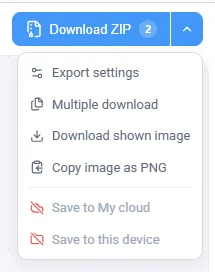
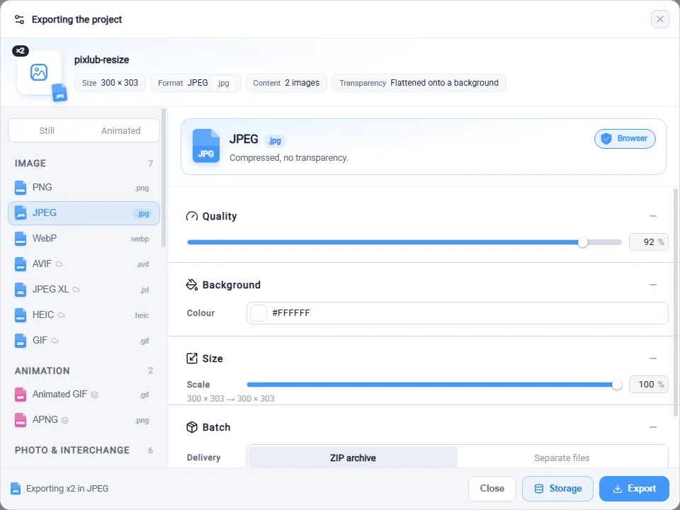
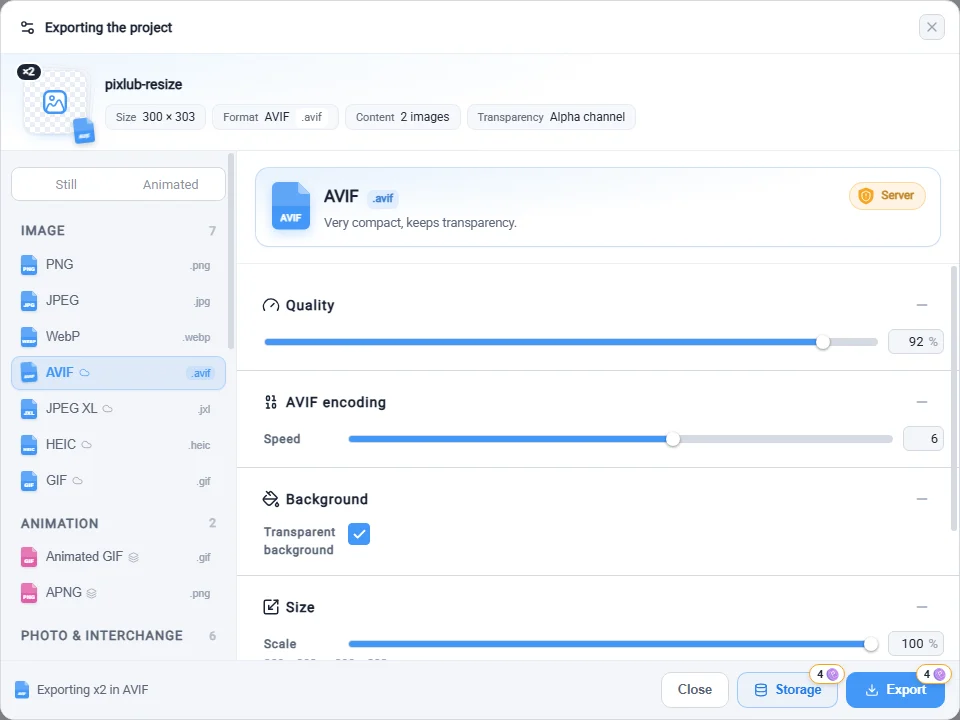
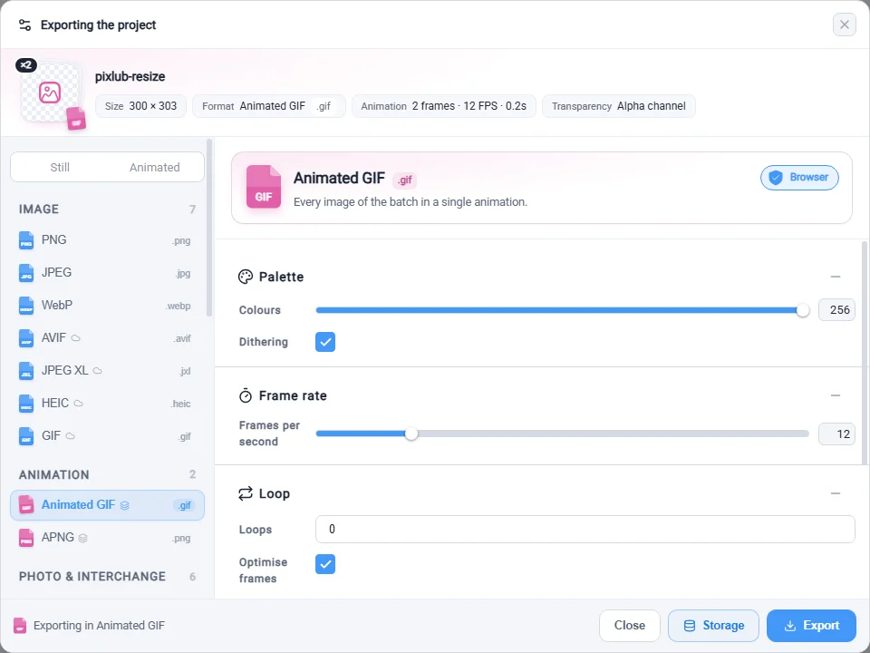

# Export

Saving your images: the Download button, the export dialog, its formats and settings, local or server processing, batches and animations.

Every image tool ends with an export. The **export dialog** picks the format and its settings; on a module page, the **Download** button opens it straight away, so nothing leaves without being set. It is the same everywhere:

| Where | How to open it |
| --- | --- |
| [A module page](../01-module-independant.md) | The **Download** button itself. |
| [Image graph](./01-image-graph.md) | Menu of an output node's **Download** button → **Export settings**. |
| [Adjustments editor](./03-image-adjust.md) | Menu on the right of the **Download** button → **Export settings**. |

The video editor has its own export window, described in the [video editor](../03-video/01-video-editor.md).

## The Download button

*With a batch, the button becomes ZIP download; its menu opens the settings and the other ways to export.*

- **One image**: the button shows the format that will be written (`JPG`, `PNG`…). By default it is **the format of the imported file**: a JPEG photo comes out as JPEG, an animated GIF as an animated GIF. If the result is transparent (a removed background, for instance), it is a **PNG**, to keep the transparency; JPEG remains available. As soon as you pick a format in the dialog, it is kept for the next exports.
- **Several images**: the button becomes **ZIP download** and shows the number of files.

The menu on its right offers:

| Entry | Effect |
| --- | --- |
| **Export settings** | Opens the export dialog (graph, adjustments editor). |
| **Quick download** `PNG` | Module page: a lossless PNG, without going through the dialog. |
| **Multiple download** | A batch as separate files rather than a ZIP archive. |
| **Download shown image** | Only the batch image on display in the preview (graph, adjustments editor). |
| **Copy image** | Copies the image on display to the clipboard, to paste into another app. |

If you picked a [local folder](../05-account-and-credits.md#local-folder), an extra button saves the export straight into that folder.

## The export dialog

*The summary at the top, the formats on the left, the settings of the chosen format on the right.*

1. **The summary**

   At the top, the thumbnail and file name, then facts that update with every setting: the **size** (source → target when the scale changes it), the **format** and its extension, the **content** (still image, number of images in a batch, or frames · frame rate · duration of an animation), the **transparency** (alpha channel kept, or flattened onto a background) and the file **size on disk**, worked out from the full-resolution render. With several files, what would only apply to the first one is not shown and the size becomes the **total size**.

2. **Pick the format**

   The left column sorts the formats by family: image, animation, photo and interchange, document, raw formats, video. A cloud marks a format written by the server; layers, an animation; a film strip, a video; an hourglass, a slower conversion. Animations and videos only show up with several images.

3. **Tune it**

   On the right, the format name, its extension, a **Browser** or **Server** badge depending on who writes it, a short description, then its settings. A format with no settings says so: it is exported as is.

4. **Export**

   The footer sums up the export ("Exporting x2 in JPEG"). **Export** downloads the file, **Export to folder** saves it to your local folder, **Close** keeps your choices without exporting anything.

With several files, the dialog widens and shows on its left, on its own background, **the renders that will be exported**: the size of each one top left, its file size bottom right, a line between two workspaces. On a screen too narrow for it, a click on the summary shows them in its place, as a strip that scrolls by dragging.

On a module page, **the preview follows the export**: it shows the image as the file will render it (background laid, JPEG or WebP loss, pixel format, PNG-8 palette, texture compression). The default settings — PNG-32 in RGBA8888 — change nothing.

During the export, a window follows each stage (rendering, encoding, upload and conversion on the server, archive) and lets you cancel.

## Browser or server

*AVIF is written by the server: the badge says so as soon as the format is chosen.*

- **PNG-32, PNG-8, JPEG, WebP**, **DDS** and **PKM** textures, **animations** and **videos** are encoded **by your browser**: your images never leave your device.
- The other formats (AVIF, JPEG XL, HEIC, TIFF, ICO, PDF…) are written **by our server**. They need an [account](../05-account-and-credits.md) and use credits for each converted file. The [privacy](../06-privacy.md) badge switches to **Sent to the server** as soon as the format is chosen, before anything is sent.

## Batches and animations

*With several images, the animated and video formats gather the whole batch into a single file.*

With several images (a batch, or an animation from the graph), two paths open:

- **One file per image**, with an image format. The **Batch** section picks the delivery (**ZIP archive** or **Separate files**) and the **file name**: `{i}` is replaced by the image number, `{n}` by how many there are. `photo_{i}` gives `photo_1.png`, `photo_2.png`…
- **A single animated file**: animated GIF, APNG, or a video (MP4, WebM…). The **frame rate** sets the frames per second; animated formats add the **loops** (0 = forever) and **optimisation**, which only re-encodes the area that changes from one frame to the next.

> [!NOTE]
> **Plan limits**
>
> How many exports per day, the largest image size and the number of files per batch depend on your plan: see [Account and credits](../05-account-and-credits.md).

## Formats

The full catalogue, in the order of the dialog. The **Written by** column tells whether the file is produced in your browser or on our server.

### Image

| Format | Extension | Written by | Transparency | Description |
| --- | --- | --- | --- | --- |
| **PNG-32** | `.png` | Browser | yes | Lossless, keeps transparency. |
| **PNG-8** | `.png` | Browser | yes | Palette of up to 256 colours, alpha included: much lighter. |
| **JPEG** | `.jpg` | Browser | no | Compressed, no transparency. |
| **WebP** | `.webp` | Browser | yes | Lighter than PNG, keeps transparency. |
| **AVIF** | `.avif` | Server | yes | Very compact, keeps transparency. |
| **JPEG XL** | `.jxl` | Server | yes | Recent codec, lossy or lossless. |
| **HEIC** | `.heic` | Server | yes | Photo format used by Apple devices. |
| **GIF** | `.gif` | Server | yes | Limited palette, single frame. |

### Animation

| Format | Extension | Written by | Transparency | Description |
| --- | --- | --- | --- | --- |
| **Animated GIF** | `.gif` | Browser | yes | Every image of the batch in a single animation. Needs several images: a batch or an animation. |
| **APNG** | `.png` | Browser | yes | True-colour animation, keeps transparency. Needs several images: a batch or an animation. |

### Photo & interchange

| Format | Extension | Written by | Transparency | Description |
| --- | --- | --- | --- | --- |
| **TIFF** | `.tiff` | Server | yes | Archival format, selectable compression. |
| **BMP** | `.bmp` | Server | no |  |
| **TGA** | `.tga` | Server | yes |  |
| **ICO** | `.ico` | Server | yes | Windows icon, several sizes in one file. |
| **JPEG 2000** | `.jp2` | Server | yes |  |
| **QOI** | `.qoi` | Server | yes | Lossless, very fast to encode. |

### GPU texture

| Format | Extension | Written by | Transparency | Description |
| --- | --- | --- | --- | --- |
| **DDS** | `.dds` | Browser | yes | DirectDraw texture, BC1/BC3 compressed or raw. |
| **PKM** | `.pkm` | Browser | yes | ETC1/ETC2 texture for OpenGL ES and mobile. |

### Document

| Format | Extension | Written by | Transparency | Description |
| --- | --- | --- | --- | --- |
| **PDF** | `.pdf` | Server | no |  |
| **PSD** | `.psd` | Server | yes | Photoshop, a single flattened layer. |

### Raw formats

| Format | Extension | Written by | Transparency | Description |
| --- | --- | --- | --- | --- |
| **PPM** | `.ppm` | Server | no |  |
| **PGM** | `.pgm` | Server | no |  |
| **PBM** | `.pbm` | Server | no |  |
| **XBM** | `.xbm` | Server | no |  |

### Video

| Format | Extension | Written by | Transparency | Description |
| --- | --- | --- | --- | --- |
| **MP4** | `.mp4` | Browser | no | Plays everywhere. Needs several images: a batch or an animation. |
| **WebM** | `.webm` | Browser | no | Royalty free, widespread on the web. Needs several images: a batch or an animation. |
| **Matroska** | `.mkv` | Browser | no | Open container, no codec or track limits. Needs several images: a batch or an animation. |
| **QuickTime** | `.mov` | Browser | no | Container used by Apple editing software. Needs several images: a batch or an animation. |
| **AVI** | `.avi` | Browser | no | Legacy Windows container, read by older software. Needs several images: a batch or an animation. Goes through an extra, slower conversion. |
| **Ogg Theora** | `.ogv` | Browser | no | Fully free, Theora and Vorbis. Needs several images: a batch or an animation. Goes through an extra, slower conversion. |

### Audio

| Format | Extension | Written by | Transparency | Description |
| --- | --- | --- | --- | --- |
| **Original track** | `.m4a` | Browser | yes | The sound as it is, not re-encoded: instant and lossless. The container follows the original codec. |
| **MP3** | `.mp3` | Browser | yes | Compressed, plays everywhere. |
| **AAC (.m4a)** | `.m4a` | Browser | yes | Compact, the standard on Apple devices and the web. |
| **Opus (.ogg)** | `.ogg` | Browser | yes | The best quality for its size, voice and music alike (48 kHz). |
| **Ogg Vorbis** | `.ogg` | Browser | yes | Compressed and royalty free. |
| **FLAC** | `.flac` | Browser | yes | Lossless, about half the size of WAV. |
| **WAV** | `.wav` | Browser | yes | Lossless and uncompressed: heavy, but plays everywhere. |
| **AIFF** | `.aiff` | Browser | yes | Lossless, Apple’s counterpart to WAV. |

## Pixel formats

**PNG-32**, **PNG-8** and the **DDS** and **PKM** textures choose how each pixel is written:

- **PNG-32**: RGBA8888 (lossless), RGBA4444, RGBA5551 and RGBA5555 (fewer levels per channel, optional dithering), BGRA8888 (red and blue swapped), RGB888 and RGB565 (no transparency: a background is laid), Alpha (transparency only, as grey) and Alpha Intensity (brightness and transparency).
- **PNG-8**: a palette of up to 256 colours, in RGBA8888, RGB888, Alpha or Alpha Intensity, dithered like pngquant (**Low**, **Medium**, **High**).
- **DDS**: BC1 (DXT1) or BC3 (DXT5) compressed, or raw in the same layouts as PNG-32.
- **PKM**: ETC1, ETC2 RGB or ETC2 RGBA, for OpenGL ES and mobile.

A texture's size only depends on its dimensions: it is announced to the byte.

## Settings

Each setting only shows up for the formats that use it.

| Setting | Formats | Values | Default |
| --- | --- | --- | --- |
| **Pixel format** · Pixels | PNG-32 | RGBA8888, RGBA4444, RGBA5551, RGBA5555, BGRA8888, RGB888, RGB565, Alpha, Alpha Intensity | `RGBA8888` |
| **Pixel format** · Pixels | PNG-8 | RGBA8888, RGB888, Alpha, Alpha Intensity | `RGBA8888` |
| **Pixel format** · Pixels | DDS | BC3 (DXT5), BC1 (DXT1), RGBA8888, BGRA8888, RGBA4444, RGBA5551, RGB888, RGB565, Alpha, Alpha Intensity | `BC3 (DXT5)` |
| **Pixel format** · Pixels | PKM | ETC2 RGBA, ETC2 RGB, ETC1 | `ETC2 RGBA` |
| **Dithering** · Pixels Spreads the error over neighbouring pixels to hide the steps of reduced channels. | PNG-32, DDS | on, off | `on` |
| **Quality** · Quality | JPEG, WebP, AVIF, JPEG XL, HEIC, TIFF, JPEG 2000 | 1 – 100 % | `92 %` |
| **Quality** · Video quality | MP4, WebM, Matroska, QuickTime, AVI, Ogg Theora | Low, Medium, High, Very high | `High` |
| **Encode losslessly** · Lossless Keeps the image pixel for pixel; quality is then ignored and the file much heavier. | JPEG XL | on, off | `off` |
| **Speed** · AVIF encoding 0 encodes slowly for the most compact file, 10 goes as fast as possible. | AVIF | 0 – 10 | `6` |
| **Effort** · JPEG XL encoding The higher the effort, the more compact the file and the longer it takes. | JPEG XL | 1 – 9 | `7` |
| **Method** · TIFF compression | TIFF | None, LZW, Deflate, PackBits, JPEG (lossy) | `LZW` |
| **RLE compression** · TGA compression | TGA | on, off | `on` |
| **Lossy transform** · Wavelet Compresses further at the cost of an approximate reconstruction. | JPEG 2000 | on, off | `off` |
| **Colours** · Palette | PNG-8, GIF, Animated GIF | 2 – 256 | `256` |
| **Dithering** · Palette | PNG-8 | None, PngQuant Low, PngQuant Medium, PngQuant High | `PngQuant Medium` |
| **Dithering** · Palette Blends neighbouring colours to hide the banding of a reduced palette. | GIF, Animated GIF | on, off | `on` |
| **Sizes** · Icon sizes Sides in pixels, comma separated. Each size is written into the file. | ICO |  | `16,32,48,256` |
| **Resolution** · Print | PDF | 36 – 1200 ppp | `144 ppp` |
| **Frames per second** · Frame rate How many frames the produced file plays each second. | Animated GIF, APNG, MP4, WebM, Matroska, QuickTime, AVI, Ogg Theora | 1 – 60 | `12` |
| **Loops** · Loop 0 loops forever. | Animated GIF, APNG | 0 – 1000 | `0` |
| **Optimise frames** · Loop Only re-encodes the area that changes from one frame to the next. | Animated GIF, APNG | on, off | `on` |
| **Transparent background** · Background Keeps the transparent areas as they are; otherwise the colour below is laid underneath. | PNG-32, PNG-8, WebP, AVIF, JPEG XL, HEIC, GIF, TIFF, TGA, ICO, JPEG 2000, QOI, DDS, PKM, PSD, Animated GIF, APNG | on, off | `on` |
| **Colour** · Background Fills the transparent areas of the exported image. | PNG-32, PNG-8, JPEG, WebP, AVIF, JPEG XL, HEIC, GIF, TIFF, BMP, TGA, ICO, JPEG 2000, QOI, DDS, PKM, PDF, PSD, PPM, PGM, PBM, XBM, Animated GIF, APNG, MP4, WebM, Matroska, QuickTime, AVI, Ogg Theora |  | `#ffffff` |
| **Scale** · Size Share of the original size. 100% exports the image as it is. | PNG-32, PNG-8, JPEG, WebP, AVIF, JPEG XL, HEIC, GIF, TIFF, BMP, TGA, ICO, JPEG 2000, QOI, DDS, PKM, PDF, PSD, PPM, PGM, PBM, XBM, Animated GIF, APNG, MP4, WebM, Matroska, QuickTime, AVI, Ogg Theora | 1 – 100 % | `100 %` |
| **Delivery** · Batch | PNG-32, PNG-8, JPEG, WebP, AVIF, JPEG XL, HEIC, GIF, TIFF, BMP, TGA, ICO, JPEG 2000, QOI, DDS, PKM, PDF, PSD, PPM, PGM, PBM, XBM | ZIP archive, Separate files | `ZIP archive` |
| **File name** · Batch \{i\} is replaced by the image number, \{n\} by how many there are. | PNG-32, PNG-8, JPEG, WebP, AVIF, JPEG XL, HEIC, GIF, TIFF, BMP, TGA, ICO, JPEG 2000, QOI, DDS, PKM, PDF, PSD, PPM, PGM, PBM, XBM |  | `export_{i}` |

> [!TIP]
> **Transparency**
>
> A format with no alpha channel (JPEG, BMP, PDF…) or a pixel format without alpha (RGB888, RGB565, ETC1…) always lays the **background colour** under transparent areas. For a format that keeps it, untick **Transparent background** if you still want a solid background.
