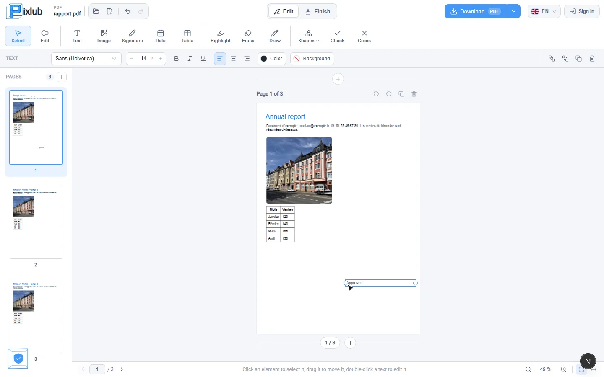

# Documents

Pixlub PDF tools: organize, sign, protect, compress, convert and recognize text.

Document tools work on your PDFs, and convert images, office files and web pages to or from PDF. Each has its own module page, built the same way: files, settings, a **Run** button.

## Using a tool

1. **Add the files**

   Choose a file or drop it. Tools that take several (merge, images to PDF…) show a list you reorder with **Move up** and **Move down**. Each PDF shows its page count and whether it is protected.

2. **Adjust**

   Pages to keep, margins, watermark text, password… The preview shows the pages and, for a signature, where it will be placed.

3. **Run and download**

   **Run** produces the file or files. Several files download one by one or in a ZIP archive.

## The tools

| Family | Tools |
| --- | --- |
| Organize | Merge, split, organize pages, crop, number pages |
| Edit | Watermark, metadata, sign, fill a form, redact |
| Convert | Images to PDF, PDF to images, text, Word or Excel; Office to PDF; HTML to PDF |
| Optimize | Compress, repair |
| Security | Password-protect, unlock |
| Text recognition | OCR to searchable PDF, OCR to text |
| Analyze | Compare two PDFs |

The complete list, with each tool's page, is generated below.

[Module list](../../03-modules/en/README.md)

## PDF editor

▶ [Watch the video](../../assets/modules/docPdfEdit/demo.en.mp4) : Edited text, added elements, blank page.

1. `0:00` Open the PDF editor
2. `0:05` Edit text in the document
3. `0:11` Add text
4. `0:15` Highlight, draw a shape
5. `0:21` Add a page
6. `0:25` Download the result

The [PDF editor](https://pixlub.com/en/document/pdf/editor) creates a PDF or edits one, a page at a time: the page list on the left, the page in the middle, the tools above.

| Area | For |
| --- | --- |
| **Toolbar** | **Edit** rewrites a line of the document; **Text**, **Image**, **Signature**, **Date** and **Table** add an element; **Highlight**, **Erase**, **Draw**, **Shapes**, **Check** and **Cross** annotate. |
| **Format bar** | Font, size, bold, colors, thickness and opacity of the selected element, or of the tool in hand. |
| **Pages** | Drag a thumbnail to move it; rotate, duplicate, delete. The **+** buttons around the page add a blank page, a copy or the pages of another PDF. |
| **Finish** | Crop, watermark, numbers, metadata, compression, protection, applied on export. |

Zoom is set at the bottom right, or with **Ctrl + wheel**. **Undo** and **Redo** take back each step.

## Where processing happens

Most tools run in your browser, OCR included. The **Office to PDF** and **HTML to PDF** conversions go through our servers: their page says so, with its cost, before running.

> [!TIP]
> **Signing a PDF**
>
> Draw your signature with a mouse, a stylus or a finger: the background stays transparent. Then drag it onto the page and pull its corner to enlarge it.

> [!NOTE]
> **Protected PDF**
>
> A password-protected PDF must first go through **Unlock a PDF**. A damaged PDF can often be recovered with **Repair a PDF**.
