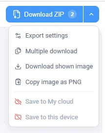
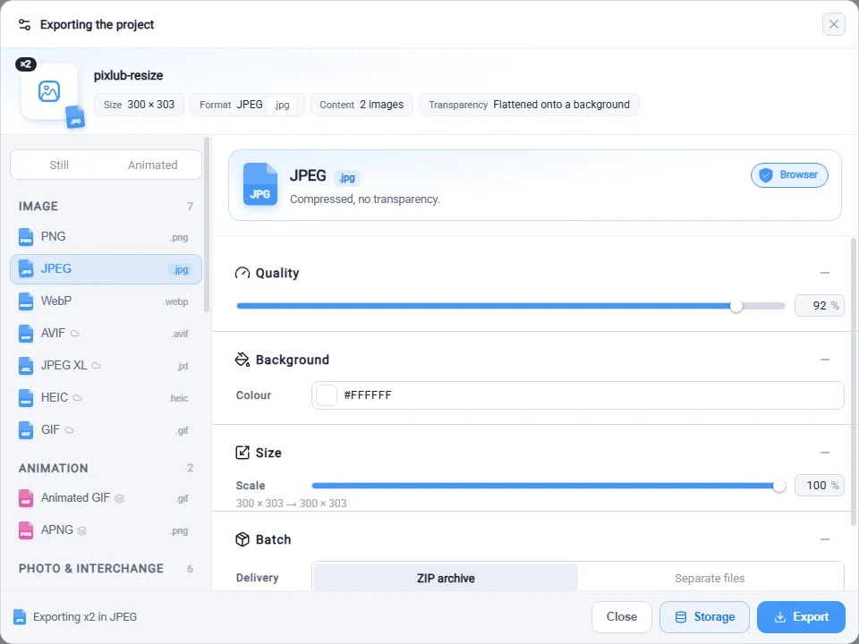
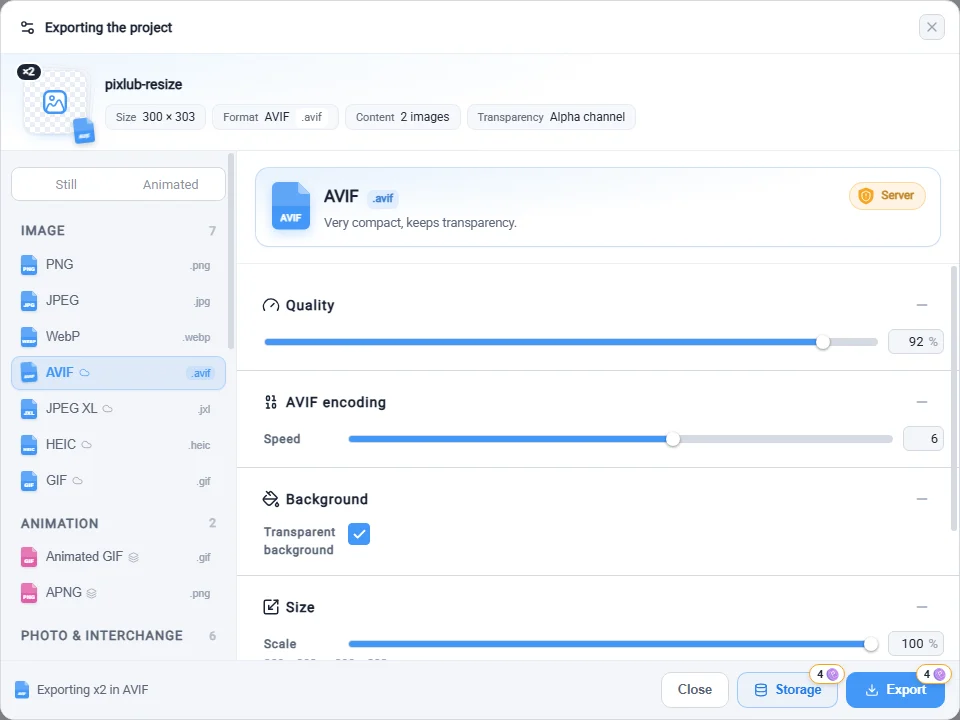
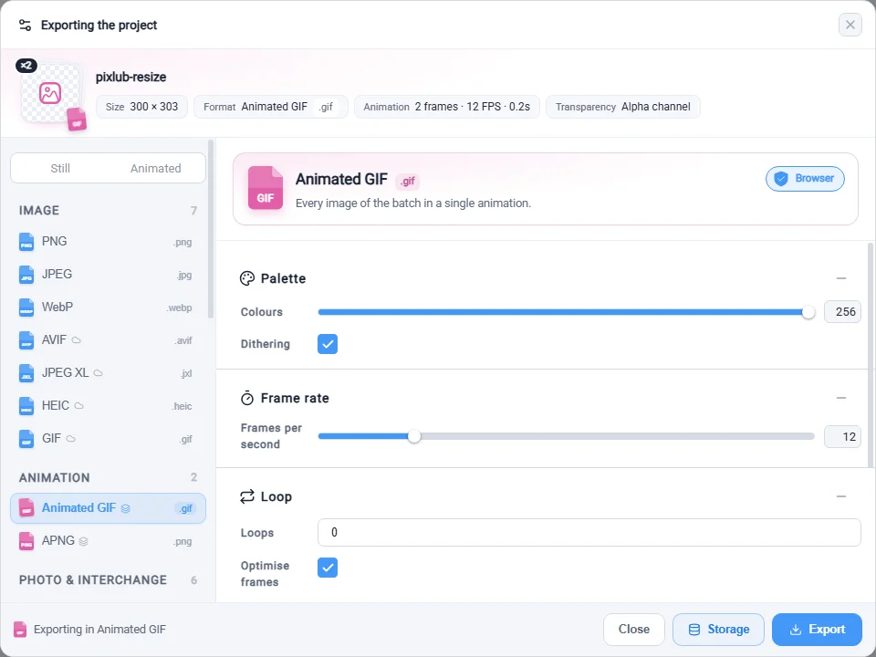

# Exportación

Guardar sus imágenes: el botón Descargar, la ventana de exportación, sus formatos y sus ajustes, el procesamiento local o en servidor, los lotes y las animaciones.

Cada herramienta de imagen termina con una exportación. La **ventana de exportación** elige el formato y sus ajustes; en la página de un módulo, el botón **Descargar** la abre directamente, para que nada salga sin haberse ajustado. Es la misma en todas partes:

| Dónde | Cómo abrirla |
| --- | --- |
| [Página de un módulo](../01-module-independant.md) | El propio botón **Descargar**. |
| [Grafo de imagen](./01-image-graph.md) | Menú del botón **Descargar** de un nodo de salida → **Ajustes de exportación**. |
| [Editor de ajustes](./03-image-adjust.md) | Menú a la derecha del botón **Descargar** → **Ajustes de exportación**. |

El editor de video tiene su propia ventana de exportación, descrita en el [editor de video](../03-video/01-video-editor.md).

## El botón Descargar

*Con un lote, el botón pasa a descargar en ZIP; su menú abre los ajustes y las demás formas de exportar.*

- **Una imagen**: el botón muestra el formato que se escribirá (`JPG`, `PNG`…). Por defecto, es **el formato del archivo importado**: una foto JPEG sale en JPEG y un GIF animado, en GIF animado. Si el resultado es transparente (un fondo eliminado, por ejemplo), es un **PNG**, para conservar la transparencia; el JPEG sigue disponible. En cuanto elige un formato en la ventana, se conserva para las exportaciones siguientes.
- **Varias imágenes**: el botón pasa a **Descargar en ZIP** y muestra el número de archivos.

El menú a su derecha ofrece:

| Entrada | Efecto |
| --- | --- |
| **Ajustes de exportación** | Abre la ventana de exportación (grafo, editor de ajustes). |
| **Descarga rápida** `PNG` | Página de un módulo: un PNG sin pérdida, sin pasar por la ventana. |
| **Descarga múltiple** | Un lote en archivos separados en lugar de en un archivo ZIP. |
| **Descargar la imagen mostrada** | Solo la imagen del lote mostrada en la vista previa (grafo, editor de ajustes). |
| **Copiar la imagen** | Copia la imagen mostrada en el portapapeles, para pegarla en otro programa. |

Si ha elegido una [carpeta local](../05-account-and-credits.md#carpeta-local), un botón adicional guarda la exportación directamente en esa carpeta.

## La ventana de exportación

*El resumen arriba, los formatos a la izquierda y los ajustes del formato elegido a la derecha.*

1. **El resumen**

   Arriba, la miniatura y el nombre del archivo, y luego unos indicadores que se actualizan con cada ajuste: el **tamaño** (origen → destino cuando la escala lo cambia), el **formato** y su extensión, el **contenido** (imagen fija, número de imágenes de un lote, o fotogramas · velocidad · duración de una animación), la **transparencia** (canal alfa conservado, o aplanado sobre un fondo) y el **peso** del archivo, calculado sobre el resultado a resolución completa. Con varios archivos, lo que solo valdría para el primero no se muestra y el peso pasa a ser el **peso total**.

2. **Elegir el formato**

   La columna izquierda agrupa los formatos por familia: imagen, animación, foto e intercambio, documento, formatos sin procesar, video. Una nube señala un formato escrito por el servidor; unas capas, una animación; una película, un video; un reloj de arena, una conversión más lenta. Las animaciones y los videos solo aparecen con varias imágenes.

3. **Ajustar**

   A la derecha, el nombre del formato, su extensión, una insignia **Navegador** o **Servidor** según quién lo escribe, una breve descripción y luego sus ajustes. Un formato sin ajustes lo indica: se exporta tal cual.

4. **Exportar**

   El pie de la ventana resume la exportación («Exportación x2 en JPEG»). **Exportar** descarga el archivo, **Exportar a la carpeta** lo guarda en su carpeta local y **Cerrar** conserva sus elecciones sin exportar nada.

Con varios archivos, la ventana se ensancha y muestra a la izquierda, sobre su propio fondo, **los resultados que se exportarán**: el tamaño de cada uno arriba a la izquierda, su peso abajo a la derecha y una línea entre dos espacios de trabajo. En una pantalla demasiado estrecha, un clic en el resumen los muestra en su lugar, en una franja que se desplaza arrastrando.

En la página de un módulo, **la vista previa sigue a la exportación**: muestra la imagen tal como la generará el archivo (fondo aplicado, pérdida del JPEG o del WebP, formato de píxel, paleta del PNG-8, compresión de una textura). Los ajustes por defecto (PNG-32 en RGBA8888) no cambian nada.

Durante la exportación, una ventana sigue cada etapa (renderizado, codificación, envío y conversión en el servidor, archivo comprimido) y permite cancelar.

## Navegador o servidor

*AVIF lo escribe el servidor: la insignia lo anuncia en cuanto se elige el formato.*

- **PNG-32, PNG-8, JPEG, WebP**, las texturas **DDS** y **PKM**, las **animaciones** y los **videos** se codifican **en su navegador**: sus imágenes no salen de su dispositivo.
- Los demás formatos (AVIF, JPEG XL, HEIC, TIFF, ICO, PDF…) los escribe **nuestro servidor**. Requieren una [cuenta](../05-account-and-credits.md) y consumen créditos por cada archivo convertido. La insignia de [privacidad](../06-privacy.md) cambia a **Enviado al servidor** en cuanto se elige el formato, antes de cualquier envío.

## Lotes y animaciones

*Con varias imágenes, los formatos animados y de video reúnen todo el lote en un solo archivo.*

Con varias imágenes (un lote, o una animación del grafo), hay dos caminos:

- **Un archivo por imagen**, con un formato de imagen. La sección **Lote** elige cómo se entregan (**Archivo ZIP** o **Archivos separados**) y el **nombre de archivo**: `{i}` se sustituye por el número de la imagen y `{n}` por el total. `foto_{i}` da `foto_1.png`, `foto_2.png`…
- **Un solo archivo animado**: GIF animado, APNG o un video (MP4, WebM…). La **velocidad de fotogramas** fija el número de imágenes por segundo; los formatos animados añaden las **repeticiones** (0 = bucle infinito) y la **optimización**, que solo vuelve a codificar la zona que cambia de un fotograma a otro.

> [!NOTE]
> **Límites de su plan**
>
> El número de exportaciones por día, el tamaño máximo de la imagen y el número de archivos por lote dependen de su plan: consulte [Cuenta y créditos](../05-account-and-credits.md).

## Los formatos

El catálogo completo, en el orden de la ventana. La columna **Escrito por** indica si el archivo se genera en su navegador o en nuestro servidor.

### Imagen

| Formato | Extensión | Escrito por | Transparencia | Descripción |
| --- | --- | --- | --- | --- |
| **PNG-32** | `.png` | Navegador | sí | Sin pérdida, conserva la transparencia. |
| **PNG-8** | `.png` | Navegador | sí | Paleta de hasta 256 colores, con transparencia: mucho más ligero. |
| **JPEG** | `.jpg` | Navegador | no | Comprimido, sin transparencia. |
| **WebP** | `.webp` | Navegador | sí | Más ligero que el PNG, conserva la transparencia. |
| **AVIF** | `.avif` | Servidor | sí | Muy compacto, conserva la transparencia. |
| **JPEG XL** | `.jxl` | Servidor | sí | Compresión reciente, con o sin pérdida. |
| **HEIC** | `.heic` | Servidor | sí | Formato de foto de los dispositivos Apple. |
| **GIF** | `.gif` | Servidor | sí | Paleta limitada, una sola imagen. |

### Animación

| Formato | Extensión | Escrito por | Transparencia | Descripción |
| --- | --- | --- | --- | --- |
| **GIF animado** | `.gif` | Navegador | sí | Todas las imágenes del lote en una sola animación. Necesita varias imágenes: un lote o una animación. |
| **APNG** | `.png` | Navegador | sí | Animación en color real, conserva la transparencia. Necesita varias imágenes: un lote o una animación. |

### Foto e intercambio

| Formato | Extensión | Escrito por | Transparencia | Descripción |
| --- | --- | --- | --- | --- |
| **TIFF** | `.tiff` | Servidor | sí | Formato de archivo, compresión a elegir. |
| **BMP** | `.bmp` | Servidor | no |  |
| **TGA** | `.tga` | Servidor | sí |  |
| **ICO** | `.ico` | Servidor | sí | Icono de Windows, varios tamaños en un archivo. |
| **JPEG 2000** | `.jp2` | Servidor | sí |  |
| **QOI** | `.qoi` | Servidor | sí | Sin pérdida, codificación muy rápida. |

### Textura de GPU

| Formato | Extensión | Escrito por | Transparencia | Descripción |
| --- | --- | --- | --- | --- |
| **DDS** | `.dds` | Navegador | sí | Textura DirectDraw, comprimida en BC1/BC3 o sin comprimir. |
| **PKM** | `.pkm` | Navegador | sí | Textura ETC1/ETC2 para OpenGL ES y móviles. |

### Documento

| Formato | Extensión | Escrito por | Transparencia | Descripción |
| --- | --- | --- | --- | --- |
| **PDF** | `.pdf` | Servidor | no |  |
| **PSD** | `.psd` | Servidor | sí | Photoshop, una sola capa acoplada. |

### Formatos sin procesar

| Formato | Extensión | Escrito por | Transparencia | Descripción |
| --- | --- | --- | --- | --- |
| **PPM** | `.ppm` | Servidor | no |  |
| **PGM** | `.pgm` | Servidor | no |  |
| **PBM** | `.pbm` | Servidor | no |  |
| **XBM** | `.xbm` | Servidor | no |  |

### Video

| Formato | Extensión | Escrito por | Transparencia | Descripción |
| --- | --- | --- | --- | --- |
| **MP4** | `.mp4` | Navegador | no | Se reproduce en todas partes. Necesita varias imágenes: un lote o una animación. |
| **WebM** | `.webm` | Navegador | no | Libre de derechos, muy extendido en la web. Necesita varias imágenes: un lote o una animación. |
| **Matroska** | `.mkv` | Navegador | no | Contenedor abierto, sin límite de códecs ni de pistas. Necesita varias imágenes: un lote o una animación. |
| **QuickTime** | `.mov` | Navegador | no | Contenedor de los programas de edición de Apple. Necesita varias imágenes: un lote o una animación. |
| **AVI** | `.avi` | Navegador | no | Antiguo contenedor de Windows, compatible con programas antiguos. Necesita varias imágenes: un lote o una animación. Pasa por una conversión adicional, más lenta. |
| **Ogg Theora** | `.ogv` | Navegador | no | Totalmente libre, Theora y Vorbis. Necesita varias imágenes: un lote o una animación. Pasa por una conversión adicional, más lenta. |

### Audio

| Formato | Extensión | Escrito por | Transparencia | Descripción |
| --- | --- | --- | --- | --- |
| **Pista original** | `.m4a` | Navegador | sí | El sonido tal cual, sin recodificar: instantáneo y sin pérdida. El contenedor sigue el códec original. |
| **MP3** | `.mp3` | Navegador | sí | Comprimido, se reproduce en todas partes. |
| **AAC (.m4a)** | `.m4a` | Navegador | sí | Compacto, estándar de los dispositivos Apple y de la web. |
| **Opus (.ogg)** | `.ogg` | Navegador | sí | La mejor relación calidad/peso, tanto para voz como para música (48 kHz). |
| **Ogg Vorbis** | `.ogg` | Navegador | sí | Comprimido y libre de derechos. |
| **FLAC** | `.flac` | Navegador | sí | Sin pérdida, aproximadamente la mitad de peso que el WAV. |
| **WAV** | `.wav` | Navegador | sí | Sin pérdida ni compresión: pesado, pero se reproduce en todas partes. |
| **AIFF** | `.aiff` | Navegador | sí | Sin pérdida, el equivalente del WAV en Apple. |

## Formatos de píxel

El **PNG-32**, el **PNG-8** y las texturas **DDS** y **PKM** eligen cómo se escribe cada píxel:

- **PNG-32**: RGBA8888 (sin pérdida), RGBA4444, RGBA5551 y RGBA5555 (menos niveles por canal, tramado opcional), BGRA8888 (rojo y azul intercambiados), RGB888 y RGB565 (sin transparencia: se aplica un fondo), Alpha (solo la transparencia, en gris) y Alpha Intensity (luminosidad y transparencia).
- **PNG-8**: una paleta de 256 colores como máximo, en RGBA8888, RGB888, Alpha o Alpha Intensity, tramada como pngquant (**Low**, **Medium**, **High**).
- **DDS**: comprimido BC1 (DXT1) o BC3 (DXT5), o sin comprimir en las mismas disposiciones que el PNG-32.
- **PKM**: ETC1, ETC2 RGB o ETC2 RGBA, para OpenGL ES y dispositivos móviles.

El peso de una textura solo depende de su tamaño: se anuncia al byte exacto.

## Los ajustes

Cada ajuste solo aparece en los formatos que lo usan.

| Ajuste | Formatos | Valores | Por defecto |
| --- | --- | --- | --- |
| **Formato de píxel** · Píxeles | PNG-32 | RGBA8888, RGBA4444, RGBA5551, RGBA5555, BGRA8888, RGB888, RGB565, Alfa, Alfa e intensidad | `RGBA8888` |
| **Formato de píxel** · Píxeles | PNG-8 | RGBA8888, RGB888, Alfa, Alfa e intensidad | `RGBA8888` |
| **Formato de píxel** · Píxeles | DDS | BC3 (DXT5), BC1 (DXT1), RGBA8888, BGRA8888, RGBA4444, RGBA5551, RGB888, RGB565, Alfa, Alfa e intensidad | `BC3 (DXT5)` |
| **Formato de píxel** · Píxeles | PKM | ETC2 RGBA, ETC2 RGB, ETC1 | `ETC2 RGBA` |
| **Tramado** · Píxeles Reparte el error entre los píxeles vecinos para ocultar los escalones de los canales reducidos. | PNG-32, DDS | activado, desactivado | `activado` |
| **Calidad** · Calidad | JPEG, WebP, AVIF, JPEG XL, HEIC, TIFF, JPEG 2000 | 1 – 100 % | `92 %` |
| **Calidad** · Calidad de video | MP4, WebM, Matroska, QuickTime, AVI, Ogg Theora | Baja, Media, Alta, Muy alta | `Alta` |
| **Codificar sin pérdida** · Sin pérdida Conserva la imagen píxel a píxel; la calidad se ignora y el archivo es mucho más pesado. | JPEG XL | activado, desactivado | `desactivado` |
| **Rapidez** · Codificación AVIF 0 codifica lentamente y genera el archivo más compacto; 10 va lo más rápido posible. | AVIF | 0 – 10 | `6` |
| **Esfuerzo** · Codificación JPEG XL Cuanto mayor es el esfuerzo, más compacto es el archivo y más tarda en generarse. | JPEG XL | 1 – 9 | `7` |
| **Método** · Compresión TIFF | TIFF | Ninguno, LZW, Deflate, PackBits, JPEG (con pérdida) | `LZW` |
| **Compresión RLE** · Compresión TGA | TGA | activado, desactivado | `activado` |
| **Transformada con pérdida** · Ondícula Comprime más a costa de una reconstrucción aproximada. | JPEG 2000 | activado, desactivado | `desactivado` |
| **Colores** · Paleta | PNG-8, GIF, GIF animado | 2 – 256 | `256` |
| **Tramado** · Paleta | PNG-8 | Ninguno, PngQuant Low, PngQuant Medium, PngQuant High | `PngQuant Medium` |
| **Tramado** · Paleta Mezcla los colores vecinos para ocultar las bandas de la paleta reducida. | GIF, GIF animado | activado, desactivado | `activado` |
| **Tamaños** · Tamaños del icono Lados en píxeles, separados por comas. Cada tamaño se escribe en el archivo. | ICO |  | `16,32,48,256` |
| **Resolución** · Impresión | PDF | 36 – 1200 ppp | `144 ppp` |
| **Fotogramas por segundo** · Velocidad de fotogramas Número de fotogramas que reproduce cada segundo el archivo generado. | GIF animado, APNG, MP4, WebM, Matroska, QuickTime, AVI, Ogg Theora | 1 – 60 | `12` |
| **Repeticiones** · Bucle 0 para un bucle infinito. | GIF animado, APNG | 0 – 1000 | `0` |
| **Optimizar los fotogramas** · Bucle Solo recodifica la zona que cambia de un fotograma al siguiente. | GIF animado, APNG | activado, desactivado | `activado` |
| **Fondo transparente** · Fondo Deja las zonas transparentes tal cual; si no, se coloca debajo el color indicado a continuación. | PNG-32, PNG-8, WebP, AVIF, JPEG XL, HEIC, GIF, TIFF, TGA, ICO, JPEG 2000, QOI, DDS, PKM, PSD, GIF animado, APNG | activado, desactivado | `activado` |
| **Color** · Fondo Rellena las zonas transparentes de la imagen exportada. | PNG-32, PNG-8, JPEG, WebP, AVIF, JPEG XL, HEIC, GIF, TIFF, BMP, TGA, ICO, JPEG 2000, QOI, DDS, PKM, PDF, PSD, PPM, PGM, PBM, XBM, GIF animado, APNG, MP4, WebM, Matroska, QuickTime, AVI, Ogg Theora |  | `#ffffff` |
| **Escala** · Tamaño Proporción del tamaño original. 100 % exporta la imagen tal cual. | PNG-32, PNG-8, JPEG, WebP, AVIF, JPEG XL, HEIC, GIF, TIFF, BMP, TGA, ICO, JPEG 2000, QOI, DDS, PKM, PDF, PSD, PPM, PGM, PBM, XBM, GIF animado, APNG, MP4, WebM, Matroska, QuickTime, AVI, Ogg Theora | 1 – 100 % | `100 %` |
| **Entrega** · Lote | PNG-32, PNG-8, JPEG, WebP, AVIF, JPEG XL, HEIC, GIF, TIFF, BMP, TGA, ICO, JPEG 2000, QOI, DDS, PKM, PDF, PSD, PPM, PGM, PBM, XBM | Archivo ZIP, Archivos separados | `Archivo ZIP` |
| **Nombre de archivo** · Lote \{i\} se reemplaza por el número de la imagen y \{n\}, por el total. | PNG-32, PNG-8, JPEG, WebP, AVIF, JPEG XL, HEIC, GIF, TIFF, BMP, TGA, ICO, JPEG 2000, QOI, DDS, PKM, PDF, PSD, PPM, PGM, PBM, XBM |  | `export_{i}` |

> [!TIP]
> **Transparencia**
>
> Un formato sin canal alfa (JPEG, BMP, PDF…) o un formato de píxel sin alfa (RGB888, RGB565, ETC1…) siempre coloca el **color de fondo** bajo las zonas transparentes. En un formato que la conserva, desmarque **Fondo transparente** si aun así quiere un fondo sólido.
