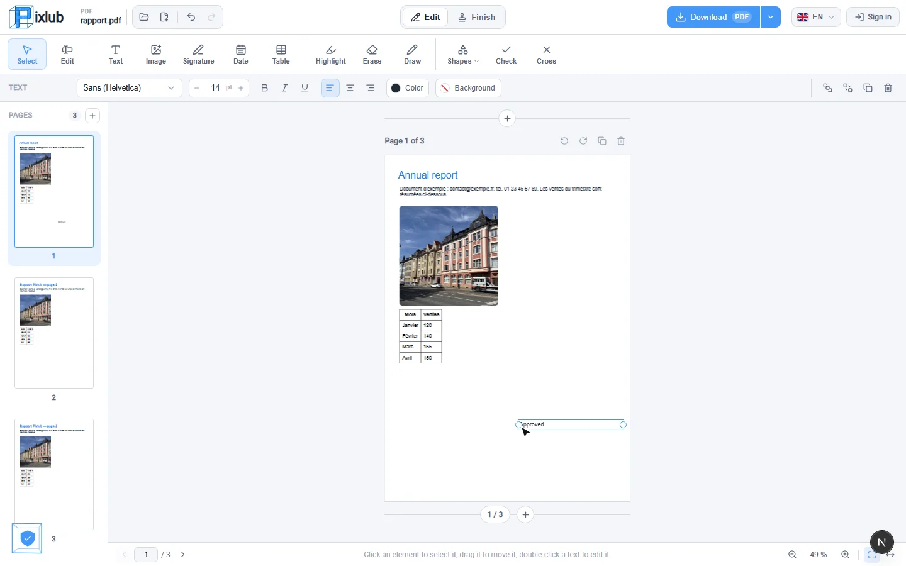

# Documentos

Las herramientas PDF de Pixlub: organizar, firmar, proteger, comprimir, convertir y reconocer el texto.

Las herramientas de documentos trabajan sobre sus PDF y convierten imágenes, archivos de ofimática y páginas web a PDF o desde PDF. Cada una tiene su página de módulo, con el mismo esquema: archivos, ajustes y un botón **Iniciar**.

## Usar una herramienta

1. **Añadir los archivos**

   Elija un archivo o suéltelo. Las herramientas que aceptan varios (combinar, imágenes a PDF…) muestran una lista que se reordena con los botones para subir y bajar. Para cada PDF se muestran el número de páginas y la posible protección.

2. **Ajustar**

   Páginas que conservar, márgenes, texto de la marca de agua, contraseña… La vista previa muestra las páginas y, para la firma, el lugar donde se colocará.

3. **Iniciar y descargar**

   **Iniciar** genera el archivo o los archivos. Si hay varios, se descargan uno a uno o en un archivo ZIP.

## Las herramientas

| Familia | Herramientas |
| --- | --- |
| Organizar | Unir, dividir, organizar las páginas, recortar, numerar las páginas |
| Modificar | Marca de agua, metadatos, firmar, rellenar un formulario, censurar |
| Convertir | Imágenes a PDF; PDF a imágenes, texto, Word o Excel; Office a PDF; HTML a PDF |
| Optimizar | Comprimir, reparar |
| Seguridad | Proteger con contraseña, desbloquear |
| Reconocimiento de texto | OCR a PDF con texto buscable, OCR a texto |
| Analizar | Comparar dos PDF |

La lista completa, con la ficha de cada herramienta, se genera a continuación.

[Lista de módulos](../../03-modules/es/README.md)

## Editor de PDF

▶ [Ver el video](../../assets/modules/docPdfEdit/demo.en.mp4) : Texto modificado, elementos añadidos, página en blanco.

1. `0:00` Open the PDF editor
2. `0:05` Edit text in the document
3. `0:11` Add text
4. `0:15` Highlight, draw a shape
5. `0:21` Add a page
6. `0:25` Download the result

El [Editor de PDF](https://pixlub.com/es/document/pdf/editor) crea un PDF o modifica uno existente, página por página: la lista de páginas a la izquierda, la página en el centro y las herramientas encima.

| Zona | Para |
| --- | --- |
| **Barra de herramientas** | **Modificar** reescribe una línea del documento; **Texto**, **Imagen**, **Firma**, **Fecha** y **Tabla** añaden un elemento; **Resaltar**, **Borrar**, **Dibujar**, **Formas**, **Marca de verificación** y **Cruz** anotan. |
| **Barra de formato** | Fuente, tamaño, negrita, colores, grosor y opacidad del elemento seleccionado, o de la herramienta activa. |
| **Páginas** | Arrastrar una miniatura para moverla; girar, duplicar, eliminar. Los botones **+** alrededor de la página añaden una página en blanco, una copia o las páginas de otro PDF. |
| **Finalizar** | Recortar, marca de agua, números, metadatos, compresión y protección, aplicados al exportar. |

El zoom se ajusta abajo a la derecha, o con **Ctrl + rueda**. **Deshacer** y **Rehacer** recuperan cada gesto.

## Dónde se hace el procesamiento

La mayoría de las herramientas se ejecutan en su navegador, incluido el OCR. Las conversiones **Office a PDF** y **HTML a PDF** pasan por nuestros servidores: su página lo indica, con su costo, antes de iniciar.

> [!TIP]
> **Firmar un PDF**
>
> Dibuje su firma con el mouse, el lápiz o el dedo: el fondo queda transparente. Después, arrástrela a la página y tire de su esquina para agrandarla.

> [!NOTE]
> **PDF protegido**
>
> Un PDF protegido con contraseña debe pasar primero por **Desbloquear un PDF**. Un PDF dañado a menudo puede recuperarse con **Reparar un PDF**.
