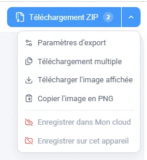
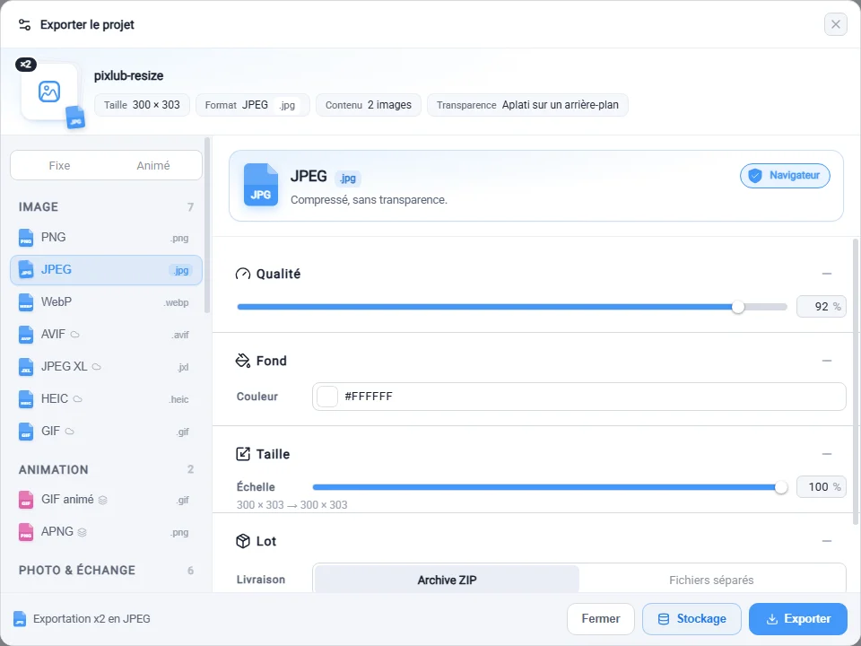
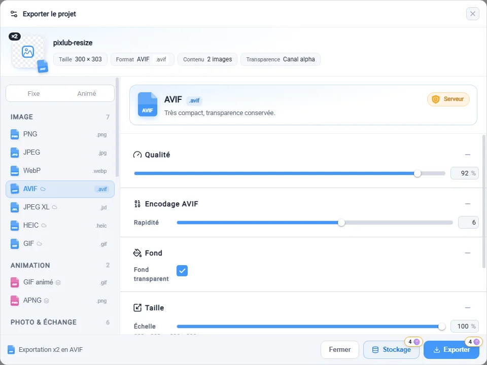
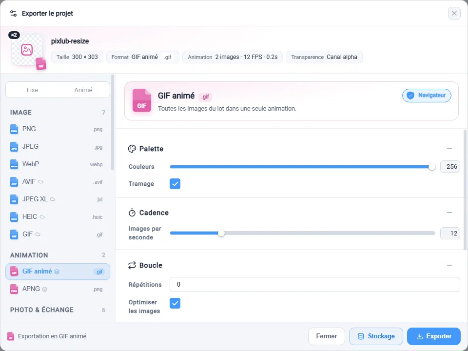

# Exportation

Enregistrer vos images : le bouton Télécharger, la modale d'exportation, ses formats et ses réglages, le traitement local ou serveur, les lots et les animations.

Chaque outil d'image se termine par un export. La **modale d'exportation** choisit le format et ses réglages ; sur la page d'un module, le bouton **Télécharger** l'ouvre d'office, pour que rien ne parte sans avoir été réglé. Elle est la même partout :

| Où | Comment l'ouvrir |
| --- | --- |
| [Page d'un module](../01-module-independant.md) | Le bouton **Télécharger** lui-même. |
| [Graphe d'image](./01-image-graph.md) | Menu du bouton **Télécharger** d'un nœud de sortie → **Paramètres d'export**. |
| [Éditeur de réglages](./03-image-adjust.md) | Menu à droite du bouton **Télécharger** → **Paramètres d'export**. |

Le montage vidéo a sa propre fenêtre d'export, décrite dans l'[éditeur vidéo](../03-video/01-video-editor.md).

## Le bouton Télécharger

*Avec un lot, le bouton devient Téléchargement ZIP ; son menu ouvre les réglages et les autres façons d'exporter.*

- **Une image** : le bouton affiche le format qui sera écrit (`JPG`, `PNG`…). Par défaut, c'est **le format du fichier importé** : une photo JPEG ressort en JPEG, un GIF animé en GIF animé. Si le rendu est transparent (un fond retiré, par exemple), c'est un **PNG**, pour garder la transparence ; le JPEG reste au choix. Dès que vous choisissez un format dans la modale, il est gardé pour les exports suivants.
- **Plusieurs images** : le bouton devient **Téléchargement ZIP** et affiche le nombre de fichiers.

Le menu à sa droite propose :

| Entrée | Effet |
| --- | --- |
| **Paramètres d'export** | Ouvre la modale d'exportation (graphe, éditeur de réglages). |
| **Téléchargement rapide** `PNG` | Page d'un module : un PNG sans perte, sans passer par la modale. |
| **Téléchargement multiple** | Un lot en fichiers séparés plutôt qu'en archive ZIP. |
| **Télécharger l'image affichée** | Seulement l'image du lot montrée dans l'aperçu (graphe, éditeur de réglages). |
| **Copier l'image** | Copie l'image affichée dans le presse-papiers, à coller dans un autre logiciel. |

Si vous avez choisi un [dossier local](../05-account-and-credits.md#dossier-local), un bouton supplémentaire enregistre l'export directement dans ce dossier.

## La modale d'exportation

*Le résumé en haut, les formats à gauche, les réglages du format choisi à droite.*

1. **Le résumé**

   En haut, la vignette et le nom du fichier, puis des repères qui se mettent à jour à chaque réglage : la **taille** (source → cible quand l'échelle la change), le **format** et son extension, le **contenu** (image fixe, nombre d'images d'un lot, ou images · cadence · durée d'une animation), la **transparence** (canal alpha gardé, ou aplati sur un fond) et le **poids** du fichier, calculé sur le rendu en pleine résolution. Avec plusieurs fichiers, ce qui ne vaudrait que pour le premier n'est pas montré et le poids devient le **poids total**.

2. **Choisir le format**

   La colonne de gauche range les formats par famille : image, animation, photo et échange, document, formats bruts, vidéo. Un nuage signale un format écrit par le serveur ; des calques, une animation ; une pellicule, une vidéo ; un sablier, une conversion plus lente. Les animations et les vidéos n'apparaissent qu'avec plusieurs images.

3. **Régler**

   À droite, le nom du format, son extension, une pastille **Navigateur** ou **Serveur** selon qui l'écrit, une courte description, puis ses réglages. Un format sans réglage l'indique : il s'exporte tel quel.

4. **Exporter**

   Le pied de la modale résume l'export (« Exportation x2 en JPEG »). **Exporter** télécharge le fichier, **Exporter dans le dossier** l'enregistre dans votre dossier local, **Fermer** garde vos choix sans rien exporter.

Avec plusieurs fichiers, la modale s'élargit et montre à gauche, sur son propre fond, **les rendus qui partiront** : la taille de chacun en haut à gauche, son poids en bas à droite, un trait entre deux espaces de travail. Sur un écran trop étroit, un clic sur le résumé les affiche à sa place, en une bande qui défile au glisser.

Sur la page d'un module, **l'aperçu suit l'export** : il montre l'image telle que le fichier la rendra (fond posé, perte du JPEG ou du WebP, format de pixel, palette du PNG-8, compression d'une texture). Les réglages par défaut — PNG-32 en RGBA8888 — ne changent rien.

Pendant l'export, une fenêtre suit chaque étape (rendu, encodage, envoi et conversion sur le serveur, archive) et permet d'annuler.

## Navigateur ou serveur

*AVIF est écrit par le serveur : la pastille l'annonce dès que le format est choisi.*

- **PNG-32, PNG-8, JPEG, WebP**, les textures **DDS** et **PKM**, les **animations** et les **vidéos** sont encodés **par votre navigateur** : vos images ne quittent pas votre appareil.
- Les autres formats (AVIF, JPEG XL, HEIC, TIFF, ICO, PDF…) sont écrits **par notre serveur**. Ils demandent un [compte](../05-account-and-credits.md) et consomment des crédits pour chaque fichier converti. La pastille de [confidentialité](../06-privacy.md) passe sur **Envoyé au serveur** dès que le format est choisi, avant tout envoi.

## Lots et animations

*Avec plusieurs images, les formats animés et vidéo assemblent tout le lot en un seul fichier.*

Avec plusieurs images (un lot, ou une animation du graphe), deux voies s'ouvrent :

- **Un fichier par image**, avec un format d'image. La section **Lot** choisit la livraison (**Archive ZIP** ou **Fichiers séparés**) et le **nom de fichier** : `{i}` est remplacé par le numéro de l'image, `{n}` par leur nombre. `photo_{i}` donne `photo_1.png`, `photo_2.png`…
- **Un seul fichier animé** : GIF animé, APNG, ou une vidéo (MP4, WebM…). La **cadence** fixe le nombre d'images par seconde ; les formats animés ajoutent les **répétitions** (0 = boucle infinie) et l'**optimisation**, qui ne réencode que la zone qui change d'une image à l'autre.

> [!NOTE]
> **Limites de votre offre**
>
> Le nombre d'exports par jour, la taille maximale de l'image et le nombre de fichiers par lot dépendent de votre offre : voir [Compte et crédits](../05-account-and-credits.md).

## Les formats

Le catalogue complet, dans l'ordre de la modale. La colonne **Écrit par** dit si le fichier est produit dans votre navigateur ou sur notre serveur.

### Image

| Format | Extension | Écrit par | Transparence | Description |
| --- | --- | --- | --- | --- |
| **PNG-32** | `.png` | Navigateur | oui | Sans perte, transparence conservée. |
| **PNG-8** | `.png` | Navigateur | oui | Palette de 256 couleurs au plus, transparence comprise : bien plus léger. |
| **JPEG** | `.jpg` | Navigateur | non | Compressé, sans transparence. |
| **WebP** | `.webp` | Navigateur | oui | Plus léger que le PNG, transparence conservée. |
| **AVIF** | `.avif` | Serveur | oui | Très compact, transparence conservée. |
| **JPEG XL** | `.jxl` | Serveur | oui | Compression récente, avec ou sans perte. |
| **HEIC** | `.heic` | Serveur | oui | Format photo des appareils Apple. |
| **GIF** | `.gif` | Serveur | oui | Palette limitée, une seule image. |

### Animation

| Format | Extension | Écrit par | Transparence | Description |
| --- | --- | --- | --- | --- |
| **GIF animé** | `.gif` | Navigateur | oui | Toutes les images du lot dans une seule animation. Demande plusieurs images : un lot ou une animation. |
| **APNG** | `.png` | Navigateur | oui | Animation en couleurs réelles, transparence conservée. Demande plusieurs images : un lot ou une animation. |

### Photo & échange

| Format | Extension | Écrit par | Transparence | Description |
| --- | --- | --- | --- | --- |
| **TIFF** | `.tiff` | Serveur | oui | Format d'archivage, compression au choix. |
| **BMP** | `.bmp` | Serveur | non |  |
| **TGA** | `.tga` | Serveur | oui |  |
| **ICO** | `.ico` | Serveur | oui | Icône Windows, plusieurs tailles dans un fichier. |
| **JPEG 2000** | `.jp2` | Serveur | oui |  |
| **QOI** | `.qoi` | Serveur | oui | Sans perte, encodage très rapide. |

### Texture GPU

| Format | Extension | Écrit par | Transparence | Description |
| --- | --- | --- | --- | --- |
| **DDS** | `.dds` | Navigateur | oui | Texture DirectDraw, compressée BC1/BC3 ou brute. |
| **PKM** | `.pkm` | Navigateur | oui | Texture ETC1/ETC2 pour OpenGL ES et le mobile. |

### Document

| Format | Extension | Écrit par | Transparence | Description |
| --- | --- | --- | --- | --- |
| **PDF** | `.pdf` | Serveur | non |  |
| **PSD** | `.psd` | Serveur | oui | Photoshop, un seul calque aplati. |

### Formats bruts

| Format | Extension | Écrit par | Transparence | Description |
| --- | --- | --- | --- | --- |
| **PPM** | `.ppm` | Serveur | non |  |
| **PGM** | `.pgm` | Serveur | non |  |
| **PBM** | `.pbm` | Serveur | non |  |
| **XBM** | `.xbm` | Serveur | non |  |

### Vidéo

| Format | Extension | Écrit par | Transparence | Description |
| --- | --- | --- | --- | --- |
| **MP4** | `.mp4` | Navigateur | non | Lisible partout. Demande plusieurs images : un lot ou une animation. |
| **WebM** | `.webm` | Navigateur | non | Libre de droits, très répandu sur le web. Demande plusieurs images : un lot ou une animation. |
| **Matroska** | `.mkv` | Navigateur | non | Conteneur ouvert, sans limite de codecs ni de pistes. Demande plusieurs images : un lot ou une animation. |
| **QuickTime** | `.mov` | Navigateur | non | Conteneur des logiciels de montage Apple. Demande plusieurs images : un lot ou une animation. |
| **AVI** | `.avi` | Navigateur | non | Ancien conteneur Windows, lu par les vieux logiciels. Demande plusieurs images : un lot ou une animation. Passe par une conversion supplémentaire, plus lente. |
| **Ogg Theora** | `.ogv` | Navigateur | non | Entièrement libre, Theora et Vorbis. Demande plusieurs images : un lot ou une animation. Passe par une conversion supplémentaire, plus lente. |

### Audio

| Format | Extension | Écrit par | Transparence | Description |
| --- | --- | --- | --- | --- |
| **Piste d’origine** | `.m4a` | Navigateur | oui | Le son tel qu’il est, sans réencodage : instantané et sans perte. Le conteneur suit le codec d’origine. |
| **MP3** | `.mp3` | Navigateur | oui | Compressé, lisible partout. |
| **AAC (.m4a)** | `.m4a` | Navigateur | oui | Compact, standard des appareils Apple et du web. |
| **Opus (.ogg)** | `.ogg` | Navigateur | oui | Le meilleur rapport qualité/poids, voix comme musique (48 kHz). |
| **Ogg Vorbis** | `.ogg` | Navigateur | oui | Compressé et libre de droits. |
| **FLAC** | `.flac` | Navigateur | oui | Sans perte, environ deux fois plus léger que le WAV. |
| **WAV** | `.wav` | Navigateur | oui | Sans perte ni compression : lourd, mais lu partout. |
| **AIFF** | `.aiff` | Navigateur | oui | Sans perte, l’équivalent du WAV chez Apple. |

## Formats de pixel

Le **PNG-32**, le **PNG-8** et les textures **DDS** et **PKM** choisissent comment chaque pixel est écrit :

- **PNG-32** : RGBA8888 (sans perte), RGBA4444, RGBA5551 et RGBA5555 (moins de niveaux par canal, tramage au choix), BGRA8888 (rouge et bleu permutés), RGB888 et RGB565 (sans transparence : un fond est posé), Alpha (la transparence seule, en gris) et Alpha Intensity (luminosité et transparence).
- **PNG-8** : une palette de 256 couleurs au plus, en RGBA8888, RGB888, Alpha ou Alpha Intensity, tramée comme pngquant (**Low**, **Medium**, **High**).
- **DDS** : compressé BC1 (DXT1) ou BC3 (DXT5), ou brut dans les mêmes dispositions que le PNG-32.
- **PKM** : ETC1, ETC2 RGB ou ETC2 RGBA, pour OpenGL ES et le mobile.

Le poids d'une texture ne dépend que de sa taille : il est annoncé à l'octet près.

## Les réglages

Chaque réglage n'apparaît que pour les formats qui l'utilisent.

| Réglage | Formats | Valeurs | Par défaut |
| --- | --- | --- | --- |
| **Format de pixel** · Pixels | PNG-32 | RGBA8888, RGBA4444, RGBA5551, RGBA5555, BGRA8888, RGB888, RGB565, Alpha, Alpha Intensity | `RGBA8888` |
| **Format de pixel** · Pixels | PNG-8 | RGBA8888, RGB888, Alpha, Alpha Intensity | `RGBA8888` |
| **Format de pixel** · Pixels | DDS | BC3 (DXT5), BC1 (DXT1), RGBA8888, BGRA8888, RGBA4444, RGBA5551, RGB888, RGB565, Alpha, Alpha Intensity | `BC3 (DXT5)` |
| **Format de pixel** · Pixels | PKM | ETC2 RGBA, ETC2 RGB, ETC1 | `ETC2 RGBA` |
| **Tramage** · Pixels Répartit l'erreur sur les pixels voisins pour masquer les paliers des canaux réduits. | PNG-32, DDS | activé, désactivé | `activé` |
| **Qualité** · Qualité | JPEG, WebP, AVIF, JPEG XL, HEIC, TIFF, JPEG 2000 | 1 – 100 % | `92 %` |
| **Qualité** · Qualité vidéo | MP4, WebM, Matroska, QuickTime, AVI, Ogg Theora | Basse, Moyenne, Haute, Très haute | `Haute` |
| **Encoder sans perte** · Sans perte Conserve l'image au pixel près ; la qualité est alors ignorée et le fichier bien plus lourd. | JPEG XL | activé, désactivé | `désactivé` |
| **Rapidité** · Encodage AVIF 0 encode lentement et produit le fichier le plus compact, 10 va au plus vite. | AVIF | 0 – 10 | `6` |
| **Effort** · Encodage JPEG XL Plus l'effort est élevé, plus le fichier est compact et long à produire. | JPEG XL | 1 – 9 | `7` |
| **Méthode** · Compression TIFF | TIFF | Aucune, LZW, Deflate, PackBits, JPEG (avec perte) | `LZW` |
| **Compression RLE** · Compression TGA | TGA | activé, désactivé | `activé` |
| **Transformée avec perte** · Ondelette Compresse davantage au prix d'une reconstruction approchée. | JPEG 2000 | activé, désactivé | `désactivé` |
| **Couleurs** · Palette | PNG-8, GIF, GIF animé | 2 – 256 | `256` |
| **Tramage** · Palette | PNG-8 | Aucun, PngQuant Low, PngQuant Medium, PngQuant High | `PngQuant Medium` |
| **Tramage** · Palette Mélange les couleurs voisines pour masquer les aplats de la palette réduite. | GIF, GIF animé | activé, désactivé | `activé` |
| **Tailles** · Tailles de l'icône Côtés en pixels, séparés par des virgules. Chaque taille est écrite dans le fichier. | ICO |  | `16,32,48,256` |
| **Résolution** · Impression | PDF | 36 – 1200 ppp | `144 ppp` |
| **Images par seconde** · Cadence Nombre d'images jouées par seconde dans le fichier produit. | GIF animé, APNG, MP4, WebM, Matroska, QuickTime, AVI, Ogg Theora | 1 – 60 | `12` |
| **Répétitions** · Boucle 0 pour une boucle infinie. | GIF animé, APNG | 0 – 1000 | `0` |
| **Optimiser les images** · Boucle Ne réencode que la zone qui change d'une image à l'autre. | GIF animé, APNG | activé, désactivé | `activé` |
| **Fond transparent** · Fond Laisse les zones transparentes telles quelles ; sinon la couleur ci-dessous est posée dessous. | PNG-32, PNG-8, WebP, AVIF, JPEG XL, HEIC, GIF, TIFF, TGA, ICO, JPEG 2000, QOI, DDS, PKM, PSD, GIF animé, APNG | activé, désactivé | `activé` |
| **Couleur** · Fond Remplit les zones transparentes de l'image exportée. | PNG-32, PNG-8, JPEG, WebP, AVIF, JPEG XL, HEIC, GIF, TIFF, BMP, TGA, ICO, JPEG 2000, QOI, DDS, PKM, PDF, PSD, PPM, PGM, PBM, XBM, GIF animé, APNG, MP4, WebM, Matroska, QuickTime, AVI, Ogg Theora |  | `#ffffff` |
| **Échelle** · Taille Proportion de la taille d'origine. 100 % exporte l'image telle quelle. | PNG-32, PNG-8, JPEG, WebP, AVIF, JPEG XL, HEIC, GIF, TIFF, BMP, TGA, ICO, JPEG 2000, QOI, DDS, PKM, PDF, PSD, PPM, PGM, PBM, XBM, GIF animé, APNG, MP4, WebM, Matroska, QuickTime, AVI, Ogg Theora | 1 – 100 % | `100 %` |
| **Livraison** · Lot | PNG-32, PNG-8, JPEG, WebP, AVIF, JPEG XL, HEIC, GIF, TIFF, BMP, TGA, ICO, JPEG 2000, QOI, DDS, PKM, PDF, PSD, PPM, PGM, PBM, XBM | Archive ZIP, Fichiers séparés | `Archive ZIP` |
| **Nom de fichier** · Lot \{i\} est remplacé par le numéro de l'image, \{n\} par leur nombre. | PNG-32, PNG-8, JPEG, WebP, AVIF, JPEG XL, HEIC, GIF, TIFF, BMP, TGA, ICO, JPEG 2000, QOI, DDS, PKM, PDF, PSD, PPM, PGM, PBM, XBM |  | `export_{i}` |

> [!TIP]
> **Transparence**
>
> Un format sans canal alpha (JPEG, BMP, PDF…) ou un format de pixel sans alpha (RGB888, RGB565, ETC1…) pose toujours la **couleur de fond** sous les zones transparentes. Pour un format qui la garde, décochez **Fond transparent** si vous voulez quand même un fond plein.
