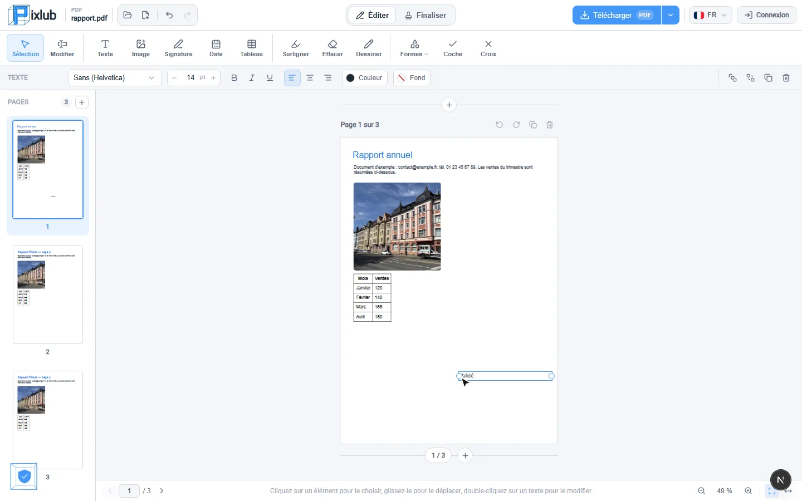

# Documents

Les outils PDF de Pixlub : organiser, signer, protéger, compresser, convertir et reconnaître le texte.

Les outils de documents travaillent sur vos PDF, et convertissent images, fichiers bureautiques et pages web vers PDF ou depuis PDF. Chacun a sa page module, sur le même modèle : des fichiers, des réglages, un bouton **Lancer**.

## Utiliser un outil

1. **Ajouter les fichiers**

   Choisissez un fichier ou déposez-le. Les outils qui en prennent plusieurs (fusion, images vers PDF…) affichent une liste que l'on réordonne avec **Avancer** et **Reculer**. Le nombre de pages et la protection éventuelle s'affichent pour chaque PDF.

2. **Régler**

   Pages à garder, marges, texte du filigrane, mot de passe… L'aperçu montre les pages et, pour la signature, l'endroit où elle sera posée.

3. **Lancer et télécharger**

   **Lancer** produit le ou les fichiers. Plusieurs fichiers se téléchargent un par un ou dans une archive ZIP.

## Les outils

| Famille | Outils |
| --- | --- |
| Organiser | Fusionner, découper, organiser les pages, rogner, numéroter les pages |
| Modifier | Filigrane, métadonnées, signer, remplir un formulaire, caviarder |
| Convertir | Images vers PDF, PDF vers images, texte, Word ou Excel ; Office vers PDF ; HTML vers PDF |
| Optimiser | Compresser, réparer |
| Sécurité | Protéger par mot de passe, déverrouiller |
| Reconnaissance de texte | OCR vers PDF consultable, OCR vers texte |
| Analyser | Comparer deux PDF |

La liste complète, avec la fiche de chaque outil, est générée ci-dessous.

[Liste des modules](../../03-modules/fr/README.md)

## Éditeur PDF

▶ [Voir la vidéo](../../assets/modules/docPdfEdit/demo.fr.mp4) : Texte modifié, éléments ajoutés, page vierge.

1. `0:00` Ouvrir l’Éditeur PDF
2. `0:06` Modifier un texte du document
3. `0:12` Ajouter du texte
4. `0:16` Surligner, dessiner une forme
5. `0:22` Ajouter une page
6. `0:26` Télécharger le résultat

L'[Éditeur PDF](https://pixlub.com/fr/document/pdf/editor) crée un PDF ou en modifie un, une page à la fois : la liste des pages à gauche, la page au centre, les outils au-dessus.

| Zone | Pour |
| --- | --- |
| **Barre d'outils** | **Modifier** réécrit une ligne du document ; **Texte**, **Image**, **Signature**, **Date** et **Tableau** ajoutent un élément ; **Surligner**, **Effacer**, **Dessiner**, **Formes**, **Coche** et **Croix** annotent. |
| **Barre de mise en forme** | Police, taille, gras, couleurs, épaisseur et opacité de l'élément choisi, ou de l'outil en main. |
| **Pages** | Glisser une vignette pour la déplacer ; tourner, dupliquer, supprimer. Les boutons **+** autour de la page ajoutent une page vierge, une copie ou les pages d'un autre PDF. |
| **Finaliser** | Rogner, filigrane, numéros, métadonnées, compression, protection, appliqués à l'export. |

Le zoom se règle en bas à droite, ou avec **Ctrl + molette**. **Annuler** et **Rétablir** reprennent chaque geste.

## Où se fait le traitement

La plupart des outils tournent dans votre navigateur, y compris l'OCR. Les conversions **Office vers PDF** et **HTML vers PDF** passent par nos serveurs : leur page l'indique avec son coût avant le lancement.

> [!TIP]
> **Signer un PDF**
>
> Dessinez votre signature à la souris, au stylet ou au doigt : le fond reste transparent. Glissez-la ensuite sur la page et tirez son coin pour l'agrandir.

> [!NOTE]
> **PDF protégé**
>
> Un PDF protégé par un mot de passe doit d'abord passer par **Déverrouiller un PDF**. Un PDF endommagé peut souvent être récupéré avec **Réparer un PDF**.
