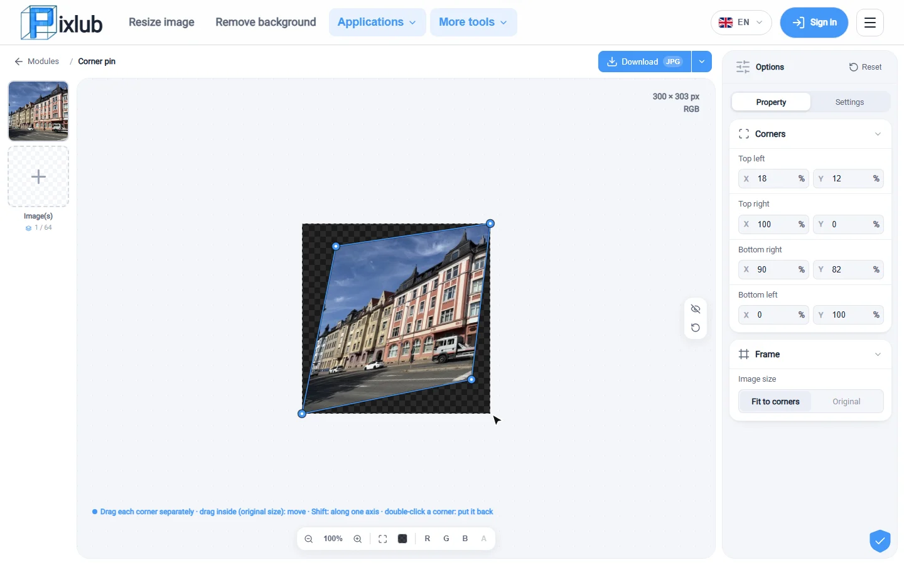

# Corner pin

Move the four corners of an image freely to put it in perspective.

**Category** : Transformation · **Identifier** : `cornerPin` · [API reference](./api.md)

## Where to use it

- **[Module page](https://pixlub.com/en/module/cornerPin)** : Drop your files, adjust, download: the module on its own, nothing else.
- **[Image graph](https://pixlub.com/en/image/graph)** : Connect it to other modules to build a richer effect.

## Inputs

The files the module page accepts: drop them on the import area, or click it to browse. A file in another format is set aside, with a message listing the allowed formats.

| Input | Accepted formats | Files |
| --- | --- | --- |
| **Image(s)** (required) Image put in perspective by its four corners. | `PNG`, `JPEG`, `WebP`, `GIF`, `AVIF`, `BMP` | One or more: each image is processed on its own, with the same settings |

How many images are processed at once depends on your plan.

Through the API, the files and their formats are detailed in the [API view](./api.md).

## Video walkthrough

▶ [Watch the video](../../../../assets/modules/cornerPin/demo.en.mp4) : Pull the corners, pick the image size, reset a corner.

1. `0:00` Import an image
2. `0:02` Pull the corners
3. `0:09` Image size
4. `0:14` Double-click: reset a corner
5. `0:16` Export the result

## How to use

1. **Import**

   Drop one or more images.

2. **Pull the corners**

   Drag each image corner in the preview. Dragging inside moves the whole image.

3. **Pick the size**

   **Fit to corners** grows the image to show everything, **Original** keeps its size and cuts what overflows.

## Settings

| Setting | Effect |
| --- | --- |
| **Top left**, **Top right**, **Bottom right**, **Bottom left** | X and Y position of each corner, in % of the image (−100 to 200). |
| **Image size** | **Fit to corners** or **Original**. |

## Tips

- **Shift** while pulling a corner keeps it on one axis; a **double-click** on a corner puts it back.
- To place an image on a screen or a poster, pick **Original** and match the corners to the target in the [image graph](../../../../01-app/en/02-image/01-image-graph.md).

## Export

The **Download** button saves the result in the format of the imported file: a JPEG photo comes out as JPEG. The menu on its right opens the **Export settings** to pick another format, set the quality, size or background, and offers **Copy image**.

With several images, the button becomes **ZIP download**; the menu also offers separate files, or only the image on display.

- **[The export dialog](../../../../01-app/en/02-image/04-exportation.md)** : Every format, its settings, local or server processing, batches and the local folder.
