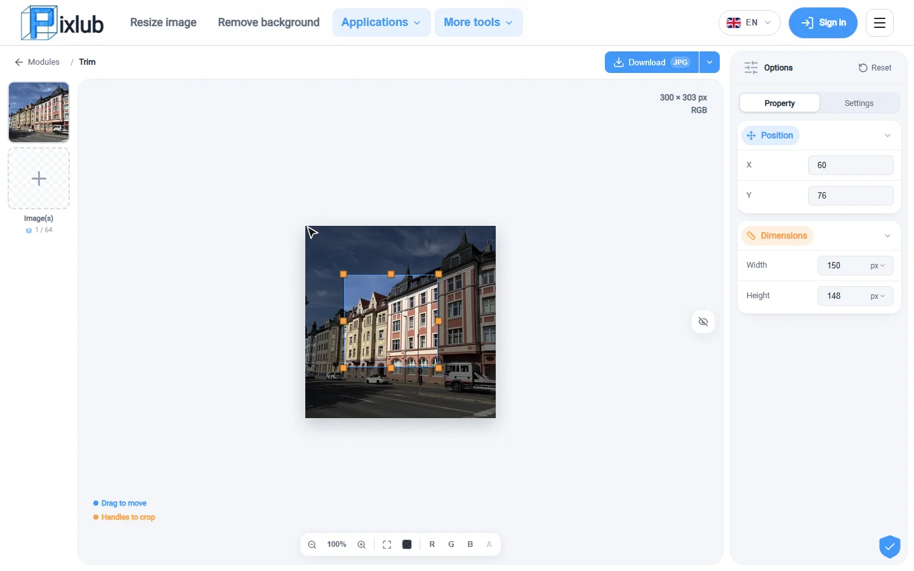

# Trim

Keep a rectangular area of the image, with the mouse or to the pixel.

**Category** : Transformation · **Identifier** : `crop` · [API reference](./api.md)

## Where to use it

- **[Module page](https://pixlub.com/en/module/crop)** : Drop your files, adjust, download: the module on its own, nothing else.
- **[Image graph](https://pixlub.com/en/image/graph)** : Connect it to other modules to build a richer effect.

## Inputs

The files the module page accepts: drop them on the import area, or click it to browse. A file in another format is set aside, with a message listing the allowed formats.

| Input | Accepted formats | Files |
| --- | --- | --- |
| **Image(s)** (required) Image the area is cut out of. | `PNG`, `JPEG`, `WebP`, `GIF`, `AVIF`, `BMP` | One or more: each image is processed on its own, with the same settings |

How many images are processed at once depends on your plan.

Through the API, the files and their formats are detailed in the [API view](./api.md).

## Video walkthrough

▶ [Watch the video](../../../../assets/modules/crop/demo.en.mp4) : Pull the handles, move the area, type an exact size.

1. `0:00` Import an image
2. `0:02` Pull the handles
3. `0:09` Move the area
4. `0:12` Type an exact size
5. `0:18` Export the result

## How to use

1. **Import**

   Drop one or more images.

2. **Frame it**

   Pull the frame handles to resize it, drag inside it to move it.

3. **Fine-tune to the pixel**

   Type **X**, **Y**, **Width** and **Height** in the panel.

## Settings

| Setting | Effect |
| --- | --- |
| **X** / **Y** | Top-left corner of the area, in pixels. |
| **Width** / **Height** | Size of the area, in pixels or %. |

## Tips

- In a batch, the same area applies to every image: use **%** sizes when the images differ in size.
- To remove transparent edges only, [Auto crop](../trim/README.md) does it on its own.

## Export

The **Download** button saves the result in the format of the imported file: a JPEG photo comes out as JPEG. The menu on its right opens the **Export settings** to pick another format, set the quality, size or background, and offers **Copy image**.

With several images, the button becomes **ZIP download**; the menu also offers separate files, or only the image on display.

- **[The export dialog](../../../../01-app/en/02-image/04-exportation.md)** : Every format, its settings, local or server processing, batches and the local folder.
