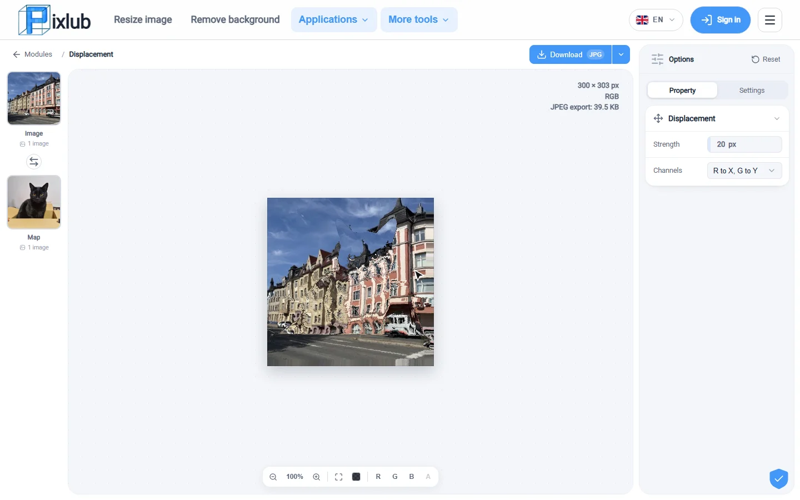

# Displacement

Warp an image based on a second image, the displacement map.

**Category** : Transformation · **Identifier** : `displace` · [API reference](./api.md)

## Where to use it

- **[Module page](https://pixlub.com/en/module/displace)** : Drop your files, adjust, download: the module on its own, nothing else.
- **[Image graph](https://pixlub.com/en/image/graph)** : Connect it to other modules to build a richer effect.

## Inputs

The files the module page accepts: drop them on the import area, or click it to browse. A file in another format is set aside, with a message listing the allowed formats.

| Input | Accepted formats | Files |
| --- | --- | --- |
| **Image** (required) Image to distort. | `PNG`, `JPEG`, `WebP`, `GIF`, `AVIF`, `BMP` | One file |
| **Map** (required) Reference image for pixel displacement. | `PNG`, `JPEG`, `WebP`, `GIF`, `AVIF`, `BMP` | One file |

Through the API, the files and their formats are detailed in the [API view](./api.md).

## Video walkthrough

▶ [Watch the video](../../../../assets/modules/displace/demo.en.mp4) : Image, map, strength and channels.

1. `0:00` Import an image
2. `0:02` Add the map
3. `0:04` Displacement strength
4. `0:08` Channels read from the map
5. `0:12` Export the result

## How to use

1. **Import the image**

   Drop the image to warp in the **Image** box.

2. **Add the map**

   Drop a second image in the **Map** box: its colors decide how far each pixel moves.

3. **Dose it**

   Set the **strength**, then the **channels** read from the map.

## Settings

| Setting | Effect |
| --- | --- |
| **Strength** | Maximum displacement, 0 to 500 px. |
| **Channels** | **R to X, G to Y**: red pushes in width, green in height. **Luminance**: brightness pushes on both axes. |

## Tips

- A noise or clouds map gives a frosted glass or heat haze look.
- A blurry map warps smoothly; a sharp map creates breaks.

## Export

The **Download** button saves the result in the format of the imported file: a JPEG photo comes out as JPEG. The menu on its right opens the **Export settings** to pick another format, set the quality, size or background, and offers **Copy image**.

- **[The export dialog](../../../../01-app/en/02-image/04-exportation.md)** : Every format, its settings, local or server processing, batches and the local folder.
