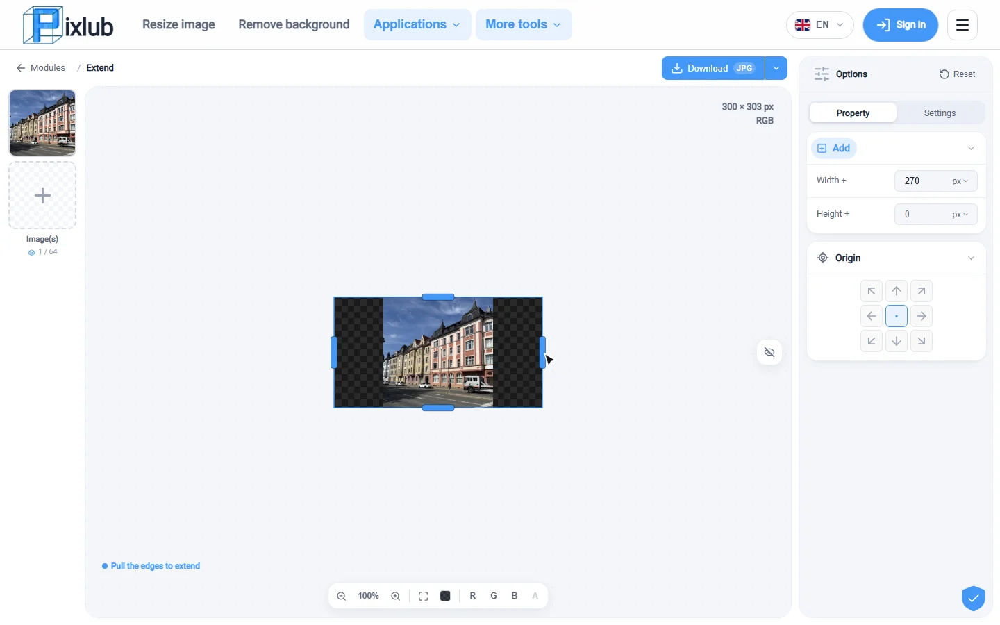

# Extend

Enlarge the image area without distorting its content: add room around it.

**Category** : Transformation · **Identifier** : `extend` · [API reference](./api.md)

## Where to use it

- **[Module page](https://pixlub.com/en/module/extend)** : Drop your files, adjust, download: the module on its own, nothing else.
- **[Image graph](https://pixlub.com/en/image/graph)** : Connect it to other modules to build a richer effect.

## Inputs

The files the module page accepts: drop them on the import area, or click it to browse. A file in another format is set aside, with a message listing the allowed formats.

| Input | Accepted formats | Files |
| --- | --- | --- |
| **Image(s)** (required) Image whose canvas is enlarged, without distorting its content. | `PNG`, `JPEG`, `WebP`, `GIF`, `AVIF`, `BMP` | One or more: each image is processed on its own, with the same settings |

How many images are processed at once depends on your plan.

Through the API, the files and their formats are detailed in the [API view](./api.md).

## Video walkthrough

▶ [Watch the video](../../../../assets/modules/extend/demo.en.mp4) : Pull an edge, type the extra size, pick the origin.

1. `0:00` Import an image
2. `0:02` Pull an edge in the preview
3. `0:05` Type the extra size
4. `0:09` Pick the origin
5. `0:15` Export the result

## How to use

1. **Import**

   Drop one or more images.

2. **Add room**

   Pull an image edge in the preview, or type **Width +** and **Height +**.

3. **Pick the origin**

   The **Origin** grid sets where the image stays: centered, the room spreads all around.

## Settings

| Setting | Effect |
| --- | --- |
| **Width +** / **Height +** | Added room, in pixels or %. |
| **Origin** | Position of the image in the new area. |

The added area is **transparent**: export to PNG or WebP to keep it.

## Tips

- For a colored background, use Extend in the [image graph](../../../../01-app/en/02-image/01-image-graph.md) and merge it over a solid fill.
- To reach an exact format (square, 16:9), use the [output size](../../../../01-app/en/01-module-independant.md#output-size) in **Custom** with **Contain** instead.

## Export

The **Download** button saves the result in the format of the imported file: a JPEG photo comes out as JPEG. The menu on its right opens the **Export settings** to pick another format, set the quality, size or background, and offers **Copy image**.

With several images, the button becomes **ZIP download**; the menu also offers separate files, or only the image on display.

- **[The export dialog](../../../../01-app/en/02-image/04-exportation.md)** : Every format, its settings, local or server processing, batches and the local folder.
