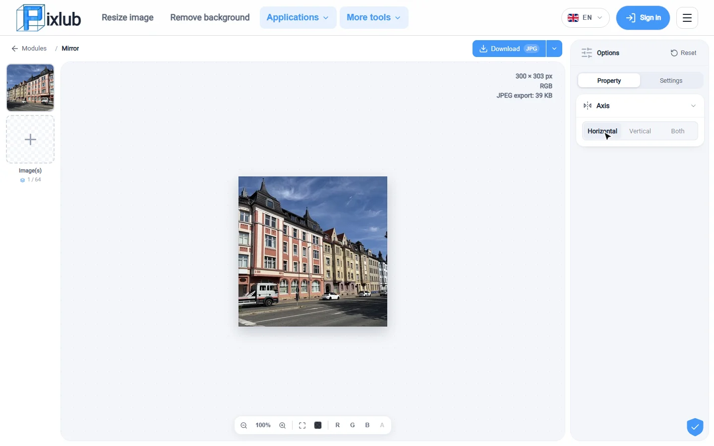

# Mirror

Flip an image horizontally, vertically, or both.

**Category** : Transformation · **Identifier** : `flip` · [API reference](./api.md)

## Where to use it

- **[Module page](https://pixlub.com/en/module/flip)** : Drop your files, adjust, download: the module on its own, nothing else.
- **[Image graph](https://pixlub.com/en/image/graph)** : Connect it to other modules to build a richer effect.

## Inputs

The files the module page accepts: drop them on the import area, or click it to browse. A file in another format is set aside, with a message listing the allowed formats.

| Input | Accepted formats | Files |
| --- | --- | --- |
| **Image(s)** (required) Image to flip. | `PNG`, `JPEG`, `WebP`, `GIF`, `AVIF`, `BMP` | One or more: each image is processed on its own, with the same settings |

How many images are processed at once depends on your plan.

Through the API, the files and their formats are detailed in the [API view](./api.md).

## Video walkthrough

▶ [Watch the video](../../../../assets/modules/flip/demo.en.mp4) : Horizontal mirror, vertical, then both.

1. `0:00` Import an image
2. `0:03` Horizontal mirror
3. `0:07` Vertical, or both
4. `0:12` Export the result

## How to use

1. **Import**

   Drop one or more images.

2. **Pick the axis**

   **Horizontal** swaps left and right, **Vertical** top and bottom.

## Settings

| Axis | Effect |
| --- | --- |
| **Horizontal** | Left-to-right reflection (default). |
| **Vertical** | Top-to-bottom reflection. |
| **Both** | Same as a half turn (180°). |

## Tips

- A selfie flipped by the camera is fixed with a horizontal mirror.
- Any text in the image will read backwards: check before exporting.

## Export

The **Download** button saves the result in the format of the imported file: a JPEG photo comes out as JPEG. The menu on its right opens the **Export settings** to pick another format, set the quality, size or background, and offers **Copy image**.

With several images, the button becomes **ZIP download**; the menu also offers separate files, or only the image on display.

- **[The export dialog](../../../../01-app/en/02-image/04-exportation.md)** : Every format, its settings, local or server processing, batches and the local folder.
