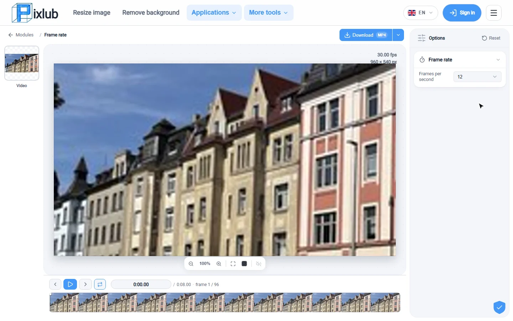

# Frame rate

Change the number of frames per second of a video.

**Category** : Transformation · **Identifier** : `frameRateVideo`

## Where to use it

- **[Module page](https://pixlub.com/en/module/frameRateVideo)** : Drop your files, adjust, download: the module on its own, nothing else.
- **[Video editor](https://pixlub.com/en/video/editor)** : Add it as an effect on a clip of your edit.

## Inputs

The files the module page accepts: drop them on the import area, or click it to browse. A file in another format is set aside, with a message listing the allowed formats.

| Input | Accepted formats | Files |
| --- | --- | --- |
| **Video** (required) Video whose frame rate is rewritten. | `MP4`, `WebM`, `MOV`, `MKV` | One file |

## Video walkthrough

▶ [Watch the video](../../../../assets/modules/frameRateVideo/demo.en.mp4) : Lower the frame rate to 12 fps, then back to 25 fps.

1. `0:00` Import a video
2. `0:03` Lower the frame rate: 12 fps
3. `0:13` Standard frame rate: 25 fps
4. `0:21` Export the result

## How to use

1. **Import**

   Drop a video. Its frame rate shows at the top right of the preview.

2. **Pick the frame rate**

   Play the preview to judge the smoothness.

## Settings

| Setting | Effect |
| --- | --- |
| **Frames per second** | **Source** (unchanged), or 12, 15, 24, 25, 30, 50, 60 fps. |

Lowering the frame rate shrinks the file; raising it above the source duplicates frames without adding smoothness.

## Tips

- 12 or 15 fps is enough for a GIF or a light preview.
- 24 fps gives a "cinema" look, 25 or 30 fps that of regular video.

## Export

The result is exported from the module page or the video editor, as MP4, WebM or another video container, without leaving your browser.

- **[The video editor](../../../../01-app/en/03-video/01-video-editor.md)** : Edit, tune the effects and export a video.
