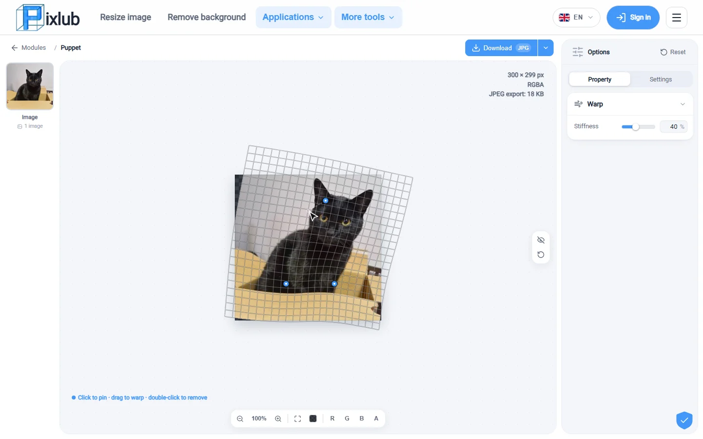

# Puppet

Warp an image by placing pins and moving them.

**Category** : Transformation · **Identifier** : `puppet` · [API reference](./api.md)

## Where to use it

- **[Module page](https://pixlub.com/en/module/puppet)** : Drop your files, adjust, download: the module on its own, nothing else.
- **[Image graph](https://pixlub.com/en/image/graph)** : Connect it to other modules to build a richer effect.

## Inputs

The files the module page accepts: drop them on the import area, or click it to browse. A file in another format is set aside, with a message listing the allowed formats.

| Input | Accepted formats | Files |
| --- | --- | --- |
| **Image** (required) Image warped by the pins. | `PNG`, `JPEG`, `WebP`, `GIF`, `AVIF`, `BMP` | One file |

Through the API, the files and their formats are detailed in the [API view](./api.md).

## Video walkthrough

▶ [Watch the video](../../../../assets/modules/puppet/demo.en.mp4) : Place pins, warp, set the stiffness.

1. `0:00` Import a character
2. `0:02` Place pins
3. `0:07` Drag to warp
4. `0:11` Rigidity
5. `0:20` Double-click: remove a pin
6. `0:22` Export the result

## How to use

1. **Import**

   Drop an image, a character for instance.

2. **Pin**

   Click in the preview to place pins on the parts to hold or to move.

3. **Warp**

   Drag a pin: the image follows, the other pins stay put.

## Settings

| Setting | Effect |
| --- | --- |
| **Stiffness** | 0 to 100%. High: the image bends less and keeps its shapes. Low: it follows freely. |
| **Pins** | Target of each pin (X, Y in % of the image), animatable one by one in the graph. |

A **double-click** on a pin removes it.

## Tips

- Place fixed pins first (feet, body) before moving a head or an arm.
- The module handles one image at a time: pins belong to each image.

## Export

The **Download** button saves the result in the format of the imported file: a JPEG photo comes out as JPEG. The menu on its right opens the **Export settings** to pick another format, set the quality, size or background, and offers **Copy image**.

- **[The export dialog](../../../../01-app/en/02-image/04-exportation.md)** : Every format, its settings, local or server processing, batches and the local folder.
