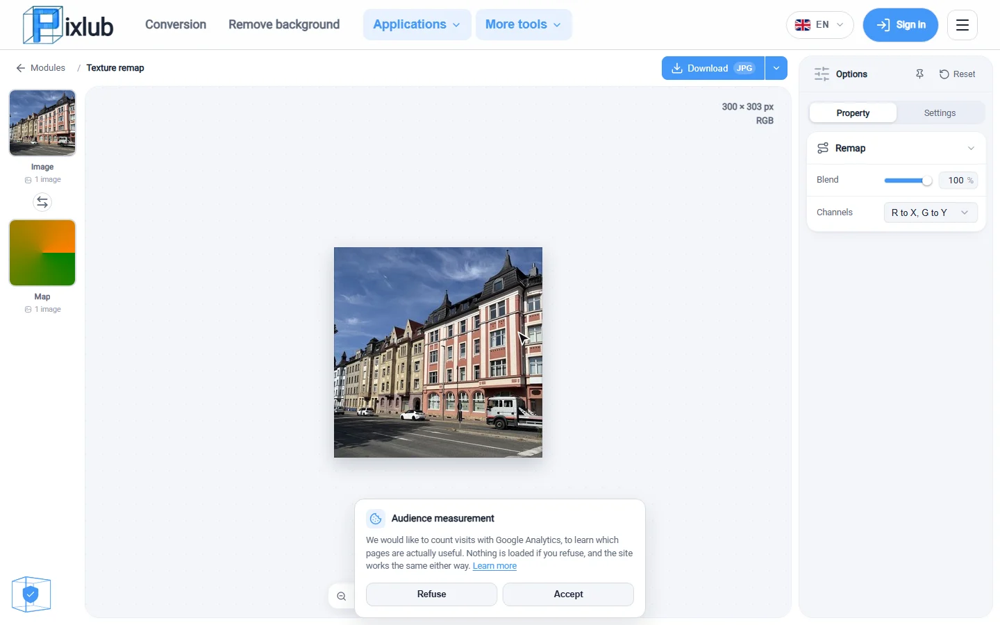

# Texture remap

Redraw an image by reading, for each pixel, the position given by a map.

**Category** : Transformation · **Identifier** : `remap` · [API reference](./api.md)

## Where to use it

- **[Module page](https://pixlub.com/en/module/remap)** : Drop your files, adjust, download: the module on its own, nothing else.
- **[Image graph](https://pixlub.com/en/image/graph)** : Connect it to other modules to build a richer effect.

## Inputs

The files the module page accepts: drop them on the import area, or click it to browse. A file in another format is set aside, with a message listing the allowed formats.

| Input | Accepted formats | Files |
| --- | --- | --- |
| **Image** (required) Texture to read, repeated beyond its edges. | `PNG`, `JPEG`, `WebP`, `GIF`, `AVIF`, `BMP` | One file |
| **Map** (required) Image whose red gives the X position to read and green the Y position. | `PNG`, `JPEG`, `WebP`, `GIF`, `AVIF`, `BMP` | One file |

Through the API, the files and their formats are detailed in the [API view](./api.md).

## Video walkthrough

▶ [Watch the video](../../../../assets/modules/remap/demo.en.mp4) : Texture, map, blend and channels.

1. `0:00` Import an image
2. `0:02` Add a radial map
3. `0:05` Dose the blend
4. `0:15` Channels read from the map
5. `0:20` Export the result

## How to use

1. **Import the texture**

   Drop the image to read in the **Image** box; it repeats beyond its edges.

2. **Add the map**

   Drop the map in the **Map** box: its red gives the column to read, its green the row.

3. **Dose it**

   Set the **blend**, then the **channels** read from the map.

## Settings

| Setting | Effect |
| --- | --- |
| **Blend** | 0% leaves the image untouched, 100% fully reads the map. |
| **Channels** | **R to X, G to Y**: 0 = left (or top) edge, 100% = right (or bottom) edge. **Luminance**: brightness gives the position on both axes. |

## Tips

- A black → red radial [Gradient](../../07-generate/gradient/README.md) (green at 50%) stretches noise into rays: animating its angle spins them.
- Unlike [Displacement](../displace/README.md), which pushes each pixel around its place, the map here gives an absolute position.

## Export

The **Download** button saves the result in the format of the imported file: a JPEG photo comes out as JPEG. The menu on its right opens the **Export settings** to pick another format, set the quality, size or background, and offers **Copy image**.

- **[The export dialog](../../../../01-app/en/02-image/04-exportation.md)** : Every format, its settings, local or server processing, batches and the local folder.
