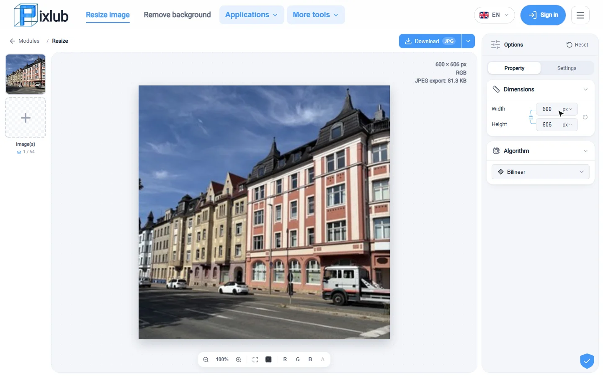
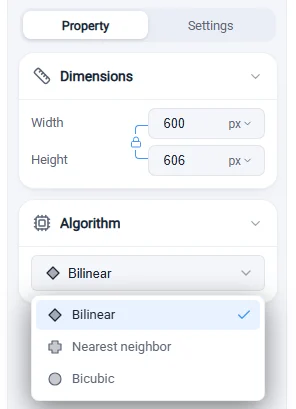
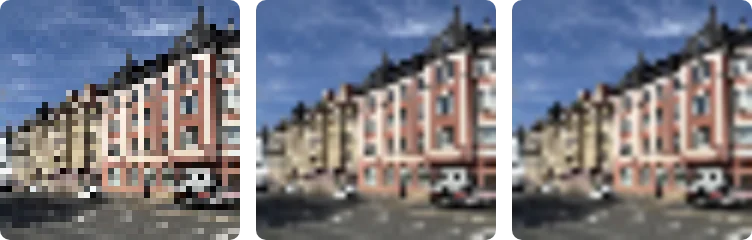

# Resize

Change an image's width and height, in pixels, percentage, centimeters or inches.

**Category** : Transformation · **Identifier** : `resize` · [API reference](./api.md)

## Where to use it

- **[Module page](https://pixlub.com/en/module/resize)** : Drop your files, adjust, download: the module on its own, nothing else.
- **[Image graph](https://pixlub.com/en/image/graph)** : Connect it to other modules to build a richer effect.

## Inputs

The files the module page accepts: drop them on the import area, or click it to browse. A file in another format is set aside, with a message listing the allowed formats.

| Input | Accepted formats | Files |
| --- | --- | --- |
| **Image(s)** (required) Image to resize. | `PNG`, `JPEG`, `WebP`, `GIF`, `AVIF`, `BMP` | One or more: each image is processed on its own, with the same settings |

How many images are processed at once depends on your plan.

Through the API, the files and their formats are detailed in the [API view](./api.md).

## Video walkthrough

▶ [Watch the video](../../../../assets/modules/resize/demo.en.mp4) : Width, padlock, units, algorithms and a batch of images.

1. `0:00` Import an image
2. `0:02` Width: the height follows
3. `0:06` Padlock open: free width and height
4. `0:14` Units: percentage, centimeters, resolution
5. `0:29` Algorithms compared up close
6. `0:44` A batch of several images
7. `0:52` Export the result

## How to use

1. **Import**

   Drop one or more images. The preview corner shows their size.

2. **Set a dimension**

   Type the width **or** the height: with the padlock closed, the other follows the proportions.

3. **Pick the algorithm**

   **Bilinear** suits most images.

4. **Export**

   **Download**, or **Download ZIP** for a batch.

## Settings

### Dimensions

| Unit | Values |
| --- | --- |
| **px** | 0 to 8000 |
| **%** | 0 to 800% of the original size |
| **cm** / **in** | 0 to 500 cm, 0 to 200 in, based on the **resolution** (300 dpi by default) |

Both sides share the same unit. An empty field ("Auto") follows the proportions, or keeps the original size when the padlock is open.

| Padlock | Effect |
| --- | --- |
| **Closed** | Only one side counts, the other follows. In a batch, each image keeps its proportions. |
| **Open** | Both sides are free: the image can get distorted. |

### Algorithm

*Nearest neighbor, bilinear, bicubic.*

| Algorithm | For |
| --- | --- |
| **Bilinear** | Most images. |
| **Nearest neighbor** | Pixel art, icons: crisp edges. |
| **Bicubic** | Shrinking a photo while keeping detail. |

## Tips

- An exact format without distortion: **Settings** tab, **Custom** size and **Cover**. See [Output size](../../../../01-app/en/01-module-independant.md#output-size).
- For ×2 or ×0.5, [Resize (Factor)](../resizeFactor/README.md) is more direct.
- Enlarging adds no detail: start from the largest image you have.

## Export

The **Download** button saves the result in the format of the imported file: a JPEG photo comes out as JPEG. The menu on its right opens the **Export settings** to pick another format, set the quality, size or background, and offers **Copy image**.

With several images, the button becomes **ZIP download**; the menu also offers separate files, or only the image on display.

- **[The export dialog](../../../../01-app/en/02-image/04-exportation.md)** : Every format, its settings, local or server processing, batches and the local folder.
