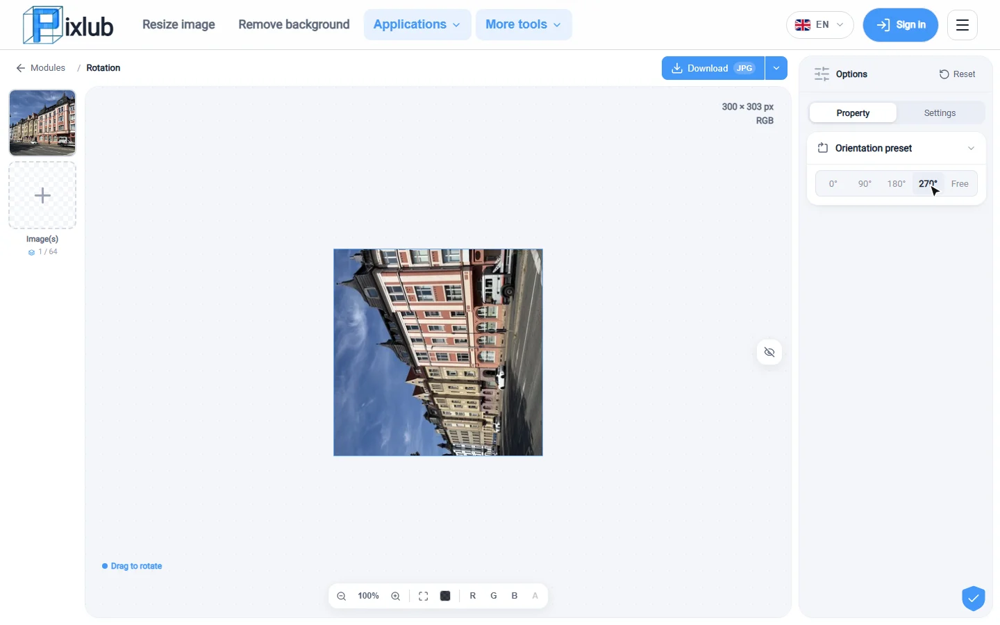

# Rotation

Rotate an image by a quarter turn or a free angle.

**Category** : Transformation · **Identifier** : `rotate` · [API reference](./api.md)

## Where to use it

- **[Module page](https://pixlub.com/en/module/rotate)** : Drop your files, adjust, download: the module on its own, nothing else.
- **[Image graph](https://pixlub.com/en/image/graph)** : Connect it to other modules to build a richer effect.

## Inputs

The files the module page accepts: drop them on the import area, or click it to browse. A file in another format is set aside, with a message listing the allowed formats.

| Input | Accepted formats | Files |
| --- | --- | --- |
| **Image(s)** (required) Image to rotate. | `PNG`, `JPEG`, `WebP`, `GIF`, `AVIF`, `BMP` | One or more: each image is processed on its own, with the same settings |

How many images are processed at once depends on your plan.

Through the API, the files and their formats are detailed in the [API view](./api.md).

## Video walkthrough

▶ [Watch the video](../../../../assets/modules/rotate/demo.en.mp4) : Ready-made orientations, free angle, rotation with the mouse.

1. `0:00` Import an image
2. `0:02` Ready-made orientations
3. `0:06` Free angle
4. `0:11` Rotate with the mouse
5. `0:15` Export the result

## How to use

1. **Import**

   Drop one or more images.

2. **Pick the orientation**

   **90°**, **180°** or **270°** in one click.

3. **Or a free angle**

   Pick **Free**, then type the angle or rotate the image by dragging it in the preview.

## Settings

| Setting | Effect |
| --- | --- |
| **Orientation** | 0°, 90°, 180°, 270° or **Free**. |
| **Angle** | In Free mode: −180° to 180°. |

With a free angle, the image grows to keep its corners; the added corners are **transparent**.

## Tips

- To straighten a tilted photo, 1° to 5° is often enough; then crop with [Trim](../crop/README.md).
- To mirror the image instead of rotating it, use [Mirror](../flip/README.md).

## Export

The **Download** button saves the result in the format of the imported file: a JPEG photo comes out as JPEG. The menu on its right opens the **Export settings** to pick another format, set the quality, size or background, and offers **Copy image**.

With several images, the button becomes **ZIP download**; the menu also offers separate files, or only the image on display.

- **[The export dialog](../../../../01-app/en/02-image/04-exportation.md)** : Every format, its settings, local or server processing, batches and the local folder.
