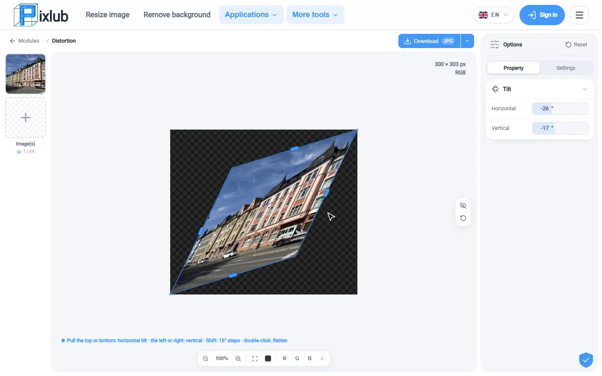

# Distortion

Slant an image horizontally or vertically (shear).

**Category** : Transformation · **Identifier** : `skew` · [API reference](./api.md)

## Where to use it

- **[Module page](https://pixlub.com/en/module/skew)** : Drop your files, adjust, download: the module on its own, nothing else.
- **[Image graph](https://pixlub.com/en/image/graph)** : Connect it to other modules to build a richer effect.

## Inputs

The files the module page accepts: drop them on the import area, or click it to browse. A file in another format is set aside, with a message listing the allowed formats.

| Input | Accepted formats | Files |
| --- | --- | --- |
| **Image(s)** (required) Image to skew. | `PNG`, `JPEG`, `WebP`, `GIF`, `AVIF`, `BMP` | One or more: each image is processed on its own, with the same settings |

How many images are processed at once depends on your plan.

Through the API, the files and their formats are detailed in the [API view](./api.md).

## Video walkthrough

▶ [Watch the video](../../../../assets/modules/skew/demo.en.mp4) : Pull an edge, set the angles, flatten.

1. `0:00` Import an image
2. `0:02` Pull an edge to slant
3. `0:09` Set the angles
4. `0:15` Export the result

## How to use

1. **Import**

   Drop one or more images.

2. **Slant with the mouse**

   Pull the top or bottom of the image to slant it horizontally, the left or right side to slant it vertically.

3. **Adjust**

   Type the angles in the panel. A double-click in the preview flattens the image.

## Settings

| Setting | Effect |
| --- | --- |
| **Horizontal** | −80° to 80°. Shifts the top against the bottom. |
| **Vertical** | −80° to 80°. Shifts the left side against the right. |

The image widens to stay whole; the added corners are **transparent**.

## Tips

- Hold **Shift** while pulling an edge to move in 15° steps.
- To place each corner freely, use [Corner pin](../cornerPin/README.md).

## Export

The **Download** button saves the result in the format of the imported file: a JPEG photo comes out as JPEG. The menu on its right opens the **Export settings** to pick another format, set the quality, size or background, and offers **Copy image**.

With several images, the button becomes **ZIP download**; the menu also offers separate files, or only the image on display.

- **[The export dialog](../../../../01-app/en/02-image/04-exportation.md)** : Every format, its settings, local or server processing, batches and the local folder.
