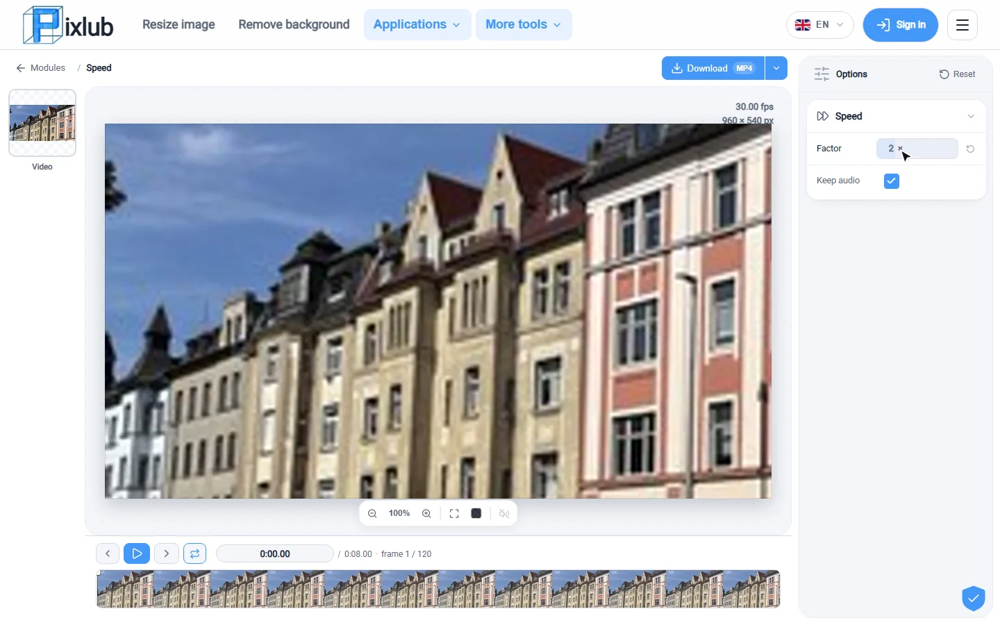

# Speed

Speed a video up or slow it down.

**Category** : Transformation · **Identifier** : `speedVideo`

## Where to use it

- **[Module page](https://pixlub.com/en/module/speedVideo)** : Drop your files, adjust, download: the module on its own, nothing else.
- **[Video editor](https://pixlub.com/en/video/editor)** : Add it as an effect on a clip of your edit.

## Inputs

The files the module page accepts: drop them on the import area, or click it to browse. A file in another format is set aside, with a message listing the allowed formats.

| Input | Accepted formats | Files |
| --- | --- | --- |
| **Video** (required) Video to speed up or slow down. | `MP4`, `WebM`, `MOV`, `MKV` | One file |

## Video walkthrough

▶ [Watch the video](../../../../assets/modules/speedVideo/demo.en.mp4) : Speed up ×2, then slow down ×0.5.

1. `0:00` Import a video
2. `0:03` Speed up: factor 2
3. `0:11` Slow down: factor 0.5
4. `0:19` Export the result

## How to use

1. **Import**

   Drop a video.

2. **Pick the factor**

   Above 1 the video speeds up; below 1 it slows down. Play the preview to judge.

## Settings

| Setting | Effect |
| --- | --- |
| **Factor** | ×0.25 to ×8. **2** halves the duration. |
| **Keep audio** | Checked: the sound follows the speed. Unchecked: the video comes out silent, faster. |

The frame rate does not change: what changes is which frames are taken from the source.

## Tips

- For a smooth slow motion, start from a video shot at a high frame rate (50 or 60 fps).
- To reduce the file size without changing the duration, lower the [Frame rate](../frameRateVideo/README.md) instead.

## Export

The result is exported from the module page or the video editor, as MP4, WebM or another video container, without leaving your browser.

- **[The video editor](../../../../01-app/en/03-video/01-video-editor.md)** : Edit, tune the effects and export a video.
