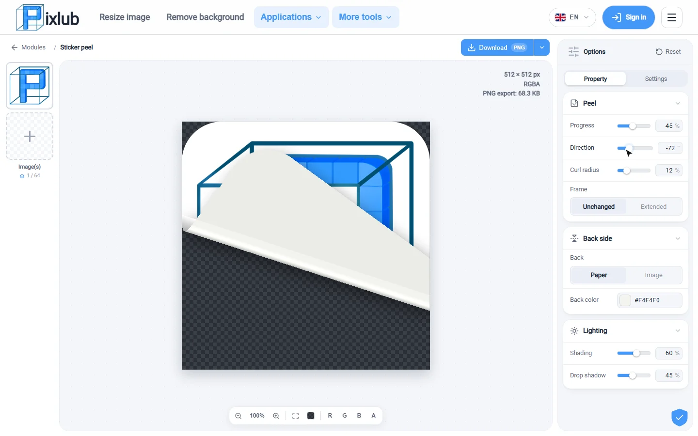

# Sticker peel

Peel an image off like a sticker, curling it in a chosen direction.

**Category** : Transformation · **Identifier** : `sticker` · [API reference](./api.md)

## Where to use it

- **[Module page](https://pixlub.com/en/module/sticker)** : Drop your files, adjust, download: the module on its own, nothing else.
- **[Image graph](https://pixlub.com/en/image/graph)** : Connect it to other modules to build a richer effect.

## Inputs

The files the module page accepts: drop them on the import area, or click it to browse. A file in another format is set aside, with a message listing the allowed formats.

| Input | Accepted formats | Files |
| --- | --- | --- |
| **Image(s)** (required) Image peeled like a sticker; its transparency gives the sticker its shape. | `PNG`, `JPEG`, `WebP`, `GIF`, `AVIF`, `BMP` | One or more: each image is processed on its own, with the same settings |

How many images are processed at once depends on your plan.

Through the API, the files and their formats are detailed in the [API view](./api.md).

## Video walkthrough

▶ [Watch the video](../../../../assets/modules/sticker/demo.en.mp4) : Progress, direction, curl, back and lighting.

1. `0:00` Import a transparent image
2. `0:02` Progress and direction
3. `0:09` Roll radius
4. `0:13` Back of the sticker
5. `0:18` Shading and shadow
6. `0:25` Export the result

## How to use

1. **Import**

   Drop an image. Its transparency gives the sticker its shape: a cut-out logo works great.

2. **Peel**

   Set the fold **progress** and its **direction**.

3. **Finish**

   Pick the **back** (paper or image) and dose the **lighting**.

## Settings

| Setting | Effect |
| --- | --- |
| **Progress** | 0%: flat, 100%: fully turned over. |
| **Direction** | Direction the fold travels in (−180° to 180°). |
| **Curl radius** | How round the curling part is. |
| **Frame** | **Extended** grows the image so the fully turned sticker stays visible. |
| **Back** | **Paper** (solid color) or **Image** (seen through, mirrored). |
| **Shading** / **Drop shadow** | Curl relief and shadow on the background. |

## Tips

- Export to PNG or WebP to keep the transparency around the sticker.
- For a lifting-corner look, keep a low **progress** (10 to 25%).

## Export

The **Download** button saves the result in the format of the imported file: a JPEG photo comes out as JPEG. The menu on its right opens the **Export settings** to pick another format, set the quality, size or background, and offers **Copy image**.

With several images, the button becomes **ZIP download**; the menu also offers separate files, or only the image on display.

- **[The export dialog](../../../../01-app/en/02-image/04-exportation.md)** : Every format, its settings, local or server processing, batches and the local folder.
