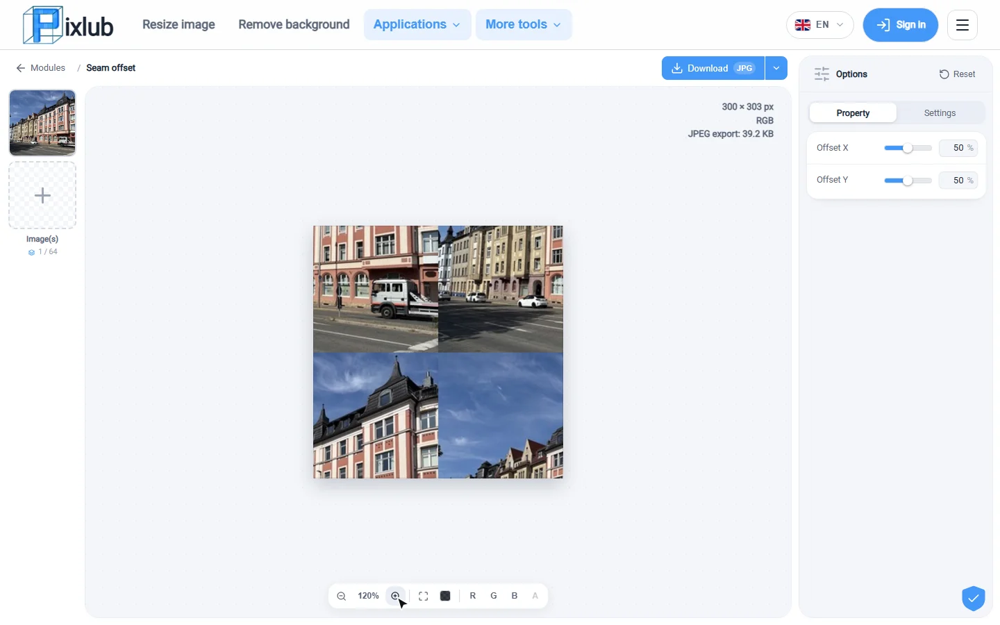

# Seam offset

Offset an image with wrapping to check and build tileable textures.

**Category** : Transformation · **Identifier** : `tile` · [API reference](./api.md)

## Where to use it

- **[Module page](https://pixlub.com/en/module/tile)** : Drop your files, adjust, download: the module on its own, nothing else.
- **[Image graph](https://pixlub.com/en/image/graph)** : Connect it to other modules to build a richer effect.

## Inputs

The files the module page accepts: drop them on the import area, or click it to browse. A file in another format is set aside, with a message listing the allowed formats.

| Input | Accepted formats | Files |
| --- | --- | --- |
| **Image(s)** (required) Image that will be offset. | `PNG`, `JPEG`, `WebP`, `GIF`, `AVIF`, `BMP` | One or more: each image is processed on its own, with the same settings |

How many images are processed at once depends on your plan.

Through the API, the files and their formats are detailed in the [API view](./api.md).

## Video walkthrough

▶ [Watch the video](../../../../assets/modules/tile/demo.en.mp4) : Seams brought to the middle, then a custom offset.

1. `0:00` Import an image
2. `0:02` Seams in the middle
3. `0:07` Set the offset
4. `0:14` Export the result

## How to use

1. **Import**

   Drop the texture to check.

2. **Look at the middle**

   At 50%, the image edges meet in the middle: a visible seam means the texture does not tile.

3. **Fix it**

   Retouch the seam elsewhere, then set the offset back to the original image.

## Settings

| Setting | Effect |
| --- | --- |
| **Offset X** | 0 to 100% of the width. What leaves on the right comes back on the left. |
| **Offset Y** | 0 to 100% of the height. What leaves at the bottom comes back at the top. |

## Tips

- 0% or 100% give back the original image.
- For an offset that does not wrap, use [Translate](../translate/README.md).

## Export

The **Download** button saves the result in the format of the imported file: a JPEG photo comes out as JPEG. The menu on its right opens the **Export settings** to pick another format, set the quality, size or background, and offers **Copy image**.

With several images, the button becomes **ZIP download**; the menu also offers separate files, or only the image on display.

- **[The export dialog](../../../../01-app/en/02-image/04-exportation.md)** : Every format, its settings, local or server processing, batches and the local folder.
