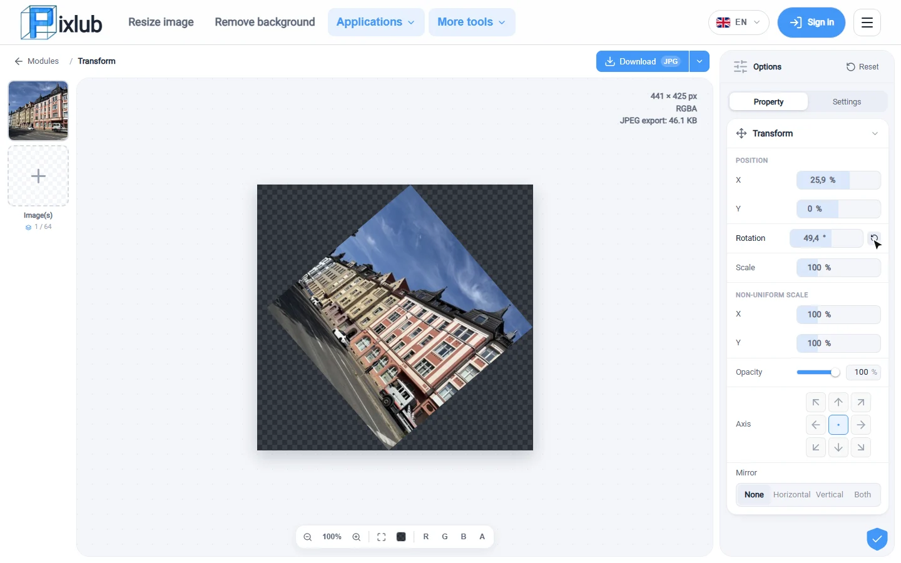

# Transform

Move, rotate, scale, mirror and fade an image in one go.

**Category** : Transformation · **Identifier** : `transform` · [API reference](./api.md)

## Where to use it

- **[Module page](https://pixlub.com/en/module/transform)** : Drop your files, adjust, download: the module on its own, nothing else.
- **[Image graph](https://pixlub.com/en/image/graph)** : Connect it to other modules to build a richer effect.

## Inputs

The files the module page accepts: drop them on the import area, or click it to browse. A file in another format is set aside, with a message listing the allowed formats.

| Input | Accepted formats | Files |
| --- | --- | --- |
| **Image(s)** (required) Image to transform. | `PNG`, `JPEG`, `WebP`, `GIF`, `AVIF`, `BMP` | One or more: each image is processed on its own, with the same settings |

How many images are processed at once depends on your plan.

Through the API, the files and their formats are detailed in the [API view](./api.md).

## Video walkthrough

▶ [Watch the video](../../../../assets/modules/transform/demo.en.mp4) : Position, rotation, scale, opacity, mirror and axis.

1. `0:00` Import an image
2. `0:02` Position and rotation
3. `0:09` Scale
4. `0:14` Opacity and mirror
5. `0:20` Transform axis
6. `0:26` Export the result

## How to use

1. **Import**

   Drop one or more images.

2. **Adjust**

   On the preview, drag the image to move it, pull a corner to scale and the top point to rotate; or use each panel (Position, Scale, Rotation…).

3. **Pick the axis**

   The **axis** is the point the image rotates, scales and mirrors around.

## Settings

| Setting | Effect |
| --- | --- |
| **X** / **Y** | Offset, in % of the width and height. |
| **Rotation** | −360° to 360°, around the axis. |
| **Scale** | 0 to 400%, on both axes. |
| **Non-uniform scale X** / **Y** | Stretches in width or height, on top of the scale. |
| **Opacity** | 0 to 100%. |
| **Axis** | Center, corner or edge of reference. |
| **Mirror** | None, horizontal, vertical or both. |

The image keeps its size: what goes out is cut, the freed room is **transparent**.

## Tips

- In the [image graph](../../../../01-app/en/02-image/01-image-graph.md), put Transform before a merge to place a layer wherever you want.
- To just rotate the whole image without cutting it, use [Rotation](../rotate/README.md).

## Export

The **Download** button saves the result in the format of the imported file: a JPEG photo comes out as JPEG. The menu on its right opens the **Export settings** to pick another format, set the quality, size or background, and offers **Copy image**.

With several images, the button becomes **ZIP download**; the menu also offers separate files, or only the image on display.

- **[The export dialog](../../../../01-app/en/02-image/04-exportation.md)** : Every format, its settings, local or server processing, batches and the local folder.
