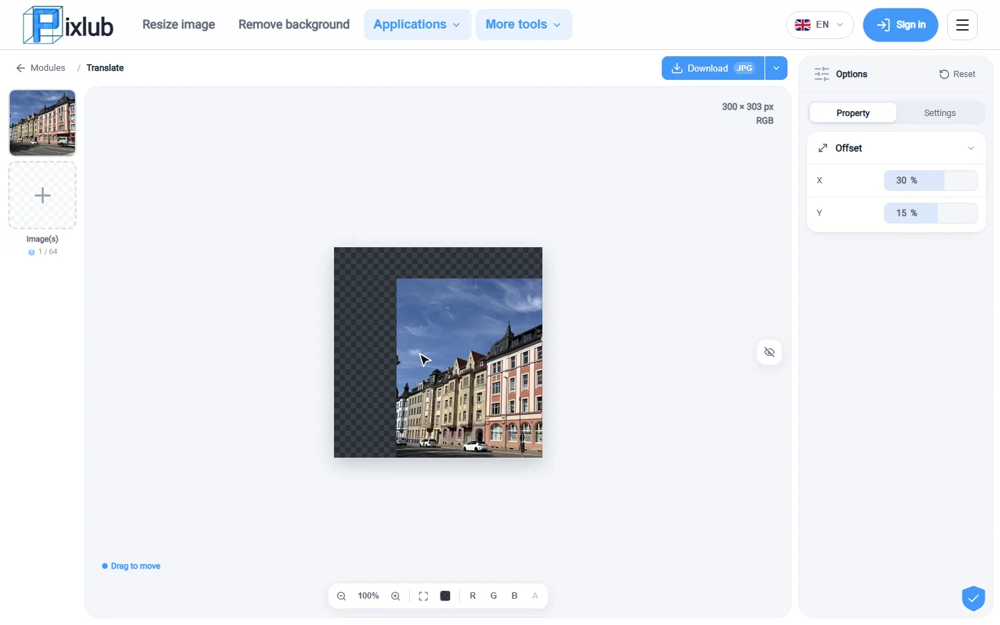

# Translate

Shift the content of an image in X and Y, without changing its size.

**Category** : Transformation · **Identifier** : `translate` · [API reference](./api.md)

## Where to use it

- **[Module page](https://pixlub.com/en/module/translate)** : Drop your files, adjust, download: the module on its own, nothing else.
- **[Image graph](https://pixlub.com/en/image/graph)** : Connect it to other modules to build a richer effect.

## Inputs

The files the module page accepts: drop them on the import area, or click it to browse. A file in another format is set aside, with a message listing the allowed formats.

| Input | Accepted formats | Files |
| --- | --- | --- |
| **Image(s)** (required) Image whose texture is moved. | `PNG`, `JPEG`, `WebP`, `GIF`, `AVIF`, `BMP` | One or more: each image is processed on its own, with the same settings |

How many images are processed at once depends on your plan.

Through the API, the files and their formats are detailed in the [API view](./api.md).

## Video walkthrough

▶ [Watch the video](../../../../assets/modules/translate/demo.en.mp4) : Drag the image, then an exact offset.

1. `0:00` Import an image
2. `0:02` Drag the image
3. `0:06` Exact offset
4. `0:11` Export the result

## How to use

1. **Import**

   Drop one or more images.

2. **Move**

   Drag the image in the preview, or type **X** and **Y**.

## Settings

| Setting | Effect |
| --- | --- |
| **X** | −100 to 100% of the width. Positive: to the right. |
| **Y** | −100 to 100% of the height. Positive: downward. |

The image keeps its size: what goes out is cut, the freed room is **transparent**.

## Tips

- To make the outgoing edge come back on the other side (tileable texture), use [Seam offset](../tile/README.md).
- To move, rotate and scale in one go: [Transform](../transform/README.md).

## Export

The **Download** button saves the result in the format of the imported file: a JPEG photo comes out as JPEG. The menu on its right opens the **Export settings** to pick another format, set the quality, size or background, and offers **Copy image**.

With several images, the button becomes **ZIP download**; the menu also offers separate files, or only the image on display.

- **[The export dialog](../../../../01-app/en/02-image/04-exportation.md)** : Every format, its settings, local or server processing, batches and the local folder.
