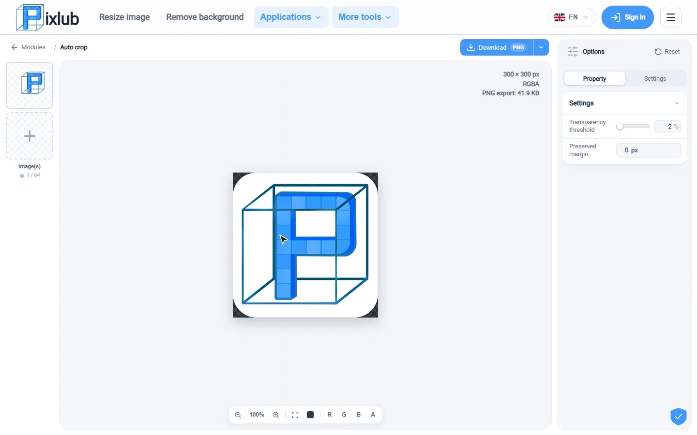

# Auto crop

Automatically trim the transparent edges of an image.

**Category** : Transformation · **Identifier** : `trim` · [API reference](./api.md)

## Where to use it

- **[Module page](https://pixlub.com/en/module/trim)** : Drop your files, adjust, download: the module on its own, nothing else.
- **[Image graph](https://pixlub.com/en/image/graph)** : Connect it to other modules to build a richer effect.

## Inputs

The files the module page accepts: drop them on the import area, or click it to browse. A file in another format is set aside, with a message listing the allowed formats.

| Input | Accepted formats | Files |
| --- | --- | --- |
| **Image(s)** (required) Image whose transparent edges are trimmed. | `PNG`, `JPEG`, `WebP`, `GIF`, `AVIF`, `BMP` | One or more: each image is processed on its own, with the same settings |

How many images are processed at once depends on your plan.

Through the API, the files and their formats are detailed in the [API view](./api.md).

## Video walkthrough

▶ [Watch the video](../../../../assets/modules/trim/demo.en.mp4) : Empty edges removed, margin kept, transparency threshold.

1. `0:00` Import a transparent image
2. `0:03` Empty edges are trimmed
3. `0:07` Keep a margin
4. `0:11` Transparency threshold
5. `0:16` Export the result

## How to use

1. **Import**

   Drop an image with transparency (PNG, WebP…).

2. **That's it**

   Empty edges disappear: the image tightens around its content.

3. **Adjust if needed**

   Keep a **margin** around the content, or raise the **threshold** to ignore nearly transparent pixels.

## Settings

| Setting | Effect |
| --- | --- |
| **Transparency threshold** | 0 to 100%. A pixel less opaque than this counts as empty. |
| **Preserved margin** | 0 to 500 px kept around the content. |

## Tips

- Great after a background removal: the object ends up tightly framed.
- An image without transparency stays the same: use [Trim](../crop/README.md).

## Export

The **Download** button saves the result in the format of the imported file: a JPEG photo comes out as JPEG. The menu on its right opens the **Export settings** to pick another format, set the quality, size or background, and offers **Copy image**.

With several images, the button becomes **ZIP download**; the menu also offers separate files, or only the image on display.

- **[The export dialog](../../../../01-app/en/02-image/04-exportation.md)** : Every format, its settings, local or server processing, batches and the local folder.
