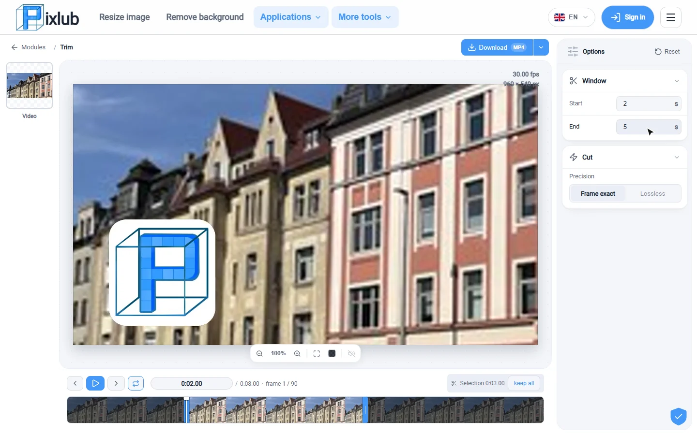

# Trim

Keep a portion of a video, between a start and an end.

**Category** : Transformation · **Identifier** : `trimVideo`

## Where to use it

- **[Module page](https://pixlub.com/en/module/trimVideo)** : Drop your files, adjust, download: the module on its own, nothing else.
- **[Video editor](https://pixlub.com/en/video/editor)** : Add it as an effect on a clip of your edit.

## Inputs

The files the module page accepts: drop them on the import area, or click it to browse. A file in another format is set aside, with a message listing the allowed formats.

| Input | Accepted formats | Files |
| --- | --- | --- |
| **Video** (required) Video a portion of which is kept. | `MP4`, `WebM`, `MOV`, `MKV` | One file |

## Video walkthrough

▶ [Watch the video](../../../../assets/modules/trimVideo/demo.en.mp4) : Start and end, playing the clip, cut precision.

1. `0:00` Import a video
2. `0:05` Start and end of the clip
3. `0:10` Play the kept part
4. `0:16` Cut precision
5. `0:19` Export the result

## How to use

1. **Import**

   Drop a video.

2. **Set the start and end**

   In seconds. Play the preview to check the kept part.

3. **Pick the precision**

   **Frame exact** cuts exactly, **Lossless** is faster.

## Settings

| Setting | Effect |
| --- | --- |
| **Start** | Start time, in seconds. |
| **End** | End time, in seconds. **0** keeps everything to the end. |
| **Precision** | **Frame exact**: re-encodes the video. **Lossless**: copies it as is, with the start snapped to the nearest keyframe. |

Everything happens in the browser: the video is not uploaded.

## Tips

- **Lossless** keeps the original quality and exports in seconds, but the start may move by a fraction of a second.
- To change the pace of the kept part: [Speed](../speedVideo/README.md).

## Export

The result is exported from the module page or the video editor, as MP4, WebM or another video container, without leaving your browser.

- **[The video editor](../../../../01-app/en/03-video/01-video-editor.md)** : Edit, tune the effects and export a video.
