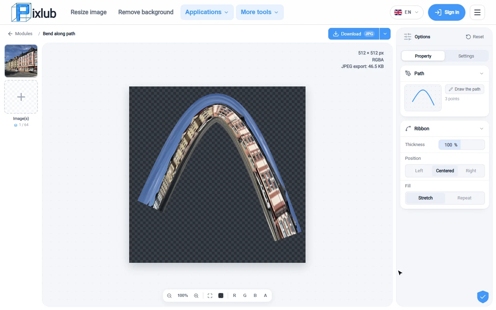

# Bend along path

Bend an image along a path, like a ribbon.

**Category** : Transformation · **Identifier** : `warpPath` · [API reference](./api.md)

## Where to use it

- **[Module page](https://pixlub.com/en/module/warpPath)** : Drop your files, adjust, download: the module on its own, nothing else.
- **[Image graph](https://pixlub.com/en/image/graph)** : Connect it to other modules to build a richer effect.

## Inputs

The files the module page accepts: drop them on the import area, or click it to browse. A file in another format is set aside, with a message listing the allowed formats.

| Input | Accepted formats | Files |
| --- | --- | --- |
| **Image** (required) Image bent along the path: its width follows the path, its height becomes the ribbon thickness. | `PNG`, `JPEG`, `WebP`, `GIF`, `AVIF`, `BMP` | One file |

Through the API, the files and their formats are detailed in the [API view](./api.md).

## Video walkthrough

▶ [Watch the video](../../../../assets/modules/warpPath/demo.en.mp4) : Redraw the path, set the thickness, position and fill.

1. `0:00` Import an image
2. `0:03` Redraw the path
3. `0:19` Ribbon thickness
4. `0:23` Position and fill
5. `0:28` Export the result

## How to use

1. **Import**

   Drop an image: its width follows the path, its height becomes the ribbon thickness.

2. **Draw the path**

   **Draw the path** opens the editor: click to add a point, drag it to move it, double-click to remove it, then **Apply**.

3. **Set the ribbon**

   Thickness, position and fill in the panel.

## Settings

| Setting | Effect |
| --- | --- |
| **Path** | The path points, with smoothing and corner rounding. |
| **Thickness** | 10 to 200%. At 100%, the image keeps its proportions. |
| **Position** | Ribbon **left**, **centered** or **right** of the path. |
| **Fill** | **Stretch** once over the whole path, or **Repeat** the image. |

The result has the size of the path frame; the rest is **transparent**.

## Tips

- Too thick a ribbon pinches in tight turns: soften the curve or lower the thickness.
- **Repeat** suits patterns (borders, decorative ribbons), **Stretch** a text or a photo.

## Export

The **Download** button saves the result in the format of the imported file: a JPEG photo comes out as JPEG. The menu on its right opens the **Export settings** to pick another format, set the quality, size or background, and offers **Copy image**.

- **[The export dialog](../../../../01-app/en/02-image/04-exportation.md)** : Every format, its settings, local or server processing, batches and the local folder.
