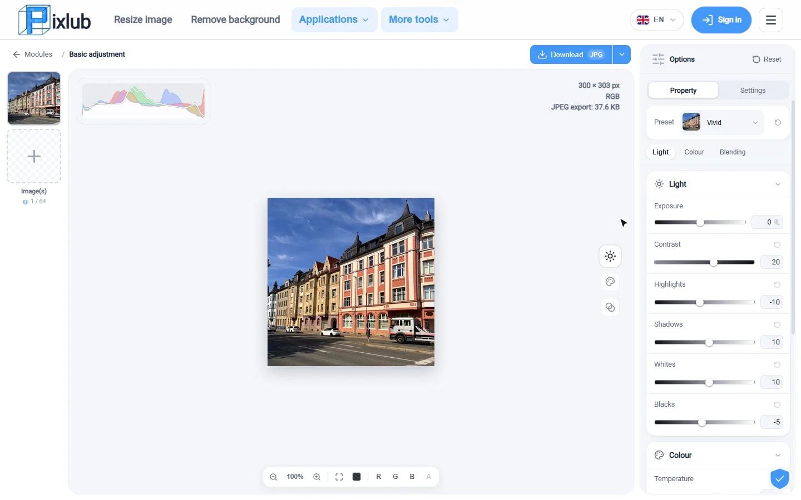

# Basic adjustment

The essential photo settings in one place: light, tones, white balance and colours.

**Category** : Adjustment · **Identifier** : `baseAdjust` · [API reference](./api.md)

## Where to use it

- **[Module page](https://pixlub.com/en/module/baseAdjust)** : Drop your files, adjust, download: the module on its own, nothing else.
- **[Image graph](https://pixlub.com/en/image/graph)** : Connect it to other modules to build a richer effect.

## Inputs

The files the module page accepts: drop them on the import area, or click it to browse. A file in another format is set aside, with a message listing the allowed formats.

| Input | Accepted formats | Files |
| --- | --- | --- |
| **Image(s)** (required) Image to develop. | `PNG`, `JPEG`, `WebP`, `GIF`, `AVIF`, `BMP` | One or more: each image is processed on its own, with the same settings |

How many images are processed at once depends on your plan.

Through the API, the files and their formats are detailed in the [API view](./api.md).

## Video walkthrough

▶ [Watch the video](../../../../assets/modules/baseAdjust/demo.en.mp4) : Preset, light, colour.

1. `0:00` Import an image
2. `0:02` Start from a preset
3. `0:10` Light
4. `0:20` Colour
5. `0:28` Export the result

## How to use

1. **Import**

   Drop one or more images.

2. **Start from a preset**

   Pick a **preset** at the top of the panel, or stay on **Custom**.

3. **Fine-tune**

   The **Light**, **Colour** and **Blending** tabs lead to each group of sliders.

## Settings

| Setting | Effect |
| --- | --- |
| **Exposure** | −5 to 5 EV. +1 doubles the light, −1 halves it. |
| **Contrast** | Spreads or tightens light and dark tones. |
| **Highlights** / **Shadows** | Darkens the light tones (a sky), opens up the dark tones. |
| **Whites** / **Blacks** | Moves the white and black points. |
| **Temperature** / **Tint** | Blue ↔ orange yellow, green ↔ magenta. |
| **Vibrance** / **Saturation** | Boosts mostly dull colours / every colour (−100: grey). |
| **Hue shift** | −180° to 180° around the colour wheel. |
| **Blending** | Blend mode and opacity: how the adjustment sits on the original picture. |

## Tips

- For a dull photo, prefer **vibrance** over saturation: already vivid colours do not clip.
- To stack several adjustments, use the [adjustment editor](../../../../01-app/en/02-image/03-image-adjust.md).

## Export

The **Download** button saves the result in the format of the imported file: a JPEG photo comes out as JPEG. The menu on its right opens the **Export settings** to pick another format, set the quality, size or background, and offers **Copy image**.

With several images, the button becomes **ZIP download**; the menu also offers separate files, or only the image on display.

- **[The export dialog](../../../../01-app/en/02-image/04-exportation.md)** : Every format, its settings, local or server processing, batches and the local folder.
