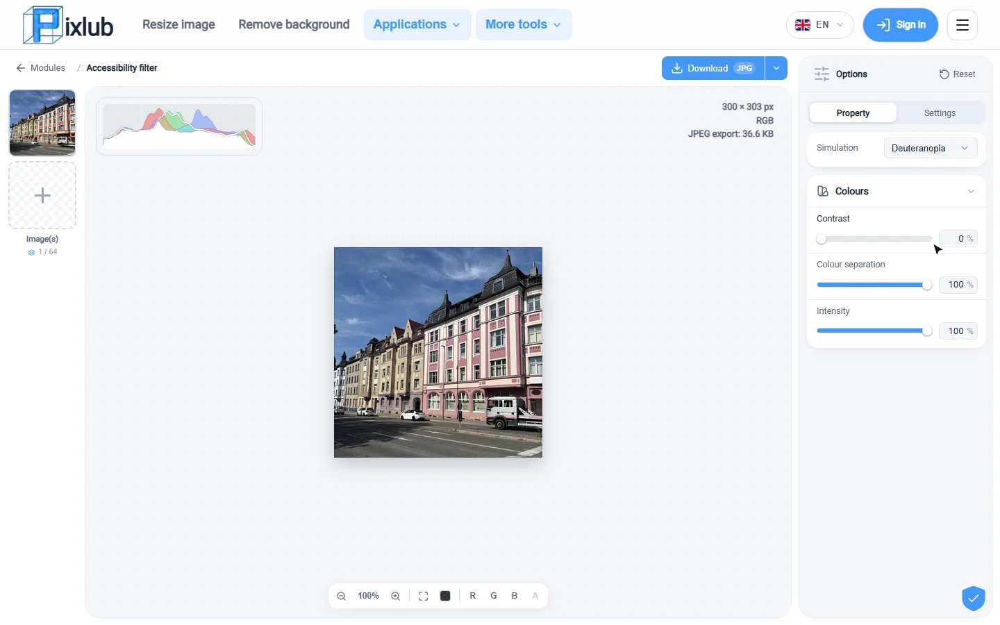

# Accessibility filter

Correct an image's colours so they stay readable for colour-blind vision.

**Category** : Adjustment · **Identifier** : `colorAccessibility` · [API reference](./api.md)

## Where to use it

- **[Module page](https://pixlub.com/en/module/colorAccessibility)** : Drop your files, adjust, download: the module on its own, nothing else.
- **[Image graph](https://pixlub.com/en/image/graph)** : Connect it to other modules to build a richer effect.

## Inputs

The files the module page accepts: drop them on the import area, or click it to browse. A file in another format is set aside, with a message listing the allowed formats.

| Input | Accepted formats | Files |
| --- | --- | --- |
| **Image(s)** (required) Image whose colors are corrected for color-blind vision. | `PNG`, `JPEG`, `WebP`, `GIF`, `AVIF`, `BMP` | One or more: each image is processed on its own, with the same settings |

How many images are processed at once depends on your plan.

Through the API, the files and their formats are detailed in the [API view](./api.md).

## Video walkthrough

▶ [Watch the video](../../../../assets/modules/colorAccessibility/demo.en.mp4) : Pick the vision, dose the correction.

1. `0:00` Import an image
2. `0:02` Pick the vision
3. `0:06` Dose the correction
4. `0:14` Export the result

## How to use

1. **Import**

   Drop one or more images.

2. **Pick the vision**

   Protanopia, deuteranopia, tritanopia or their milder forms.

3. **Dose**

   Contrast, colour separation and correction intensity.

## Settings

| Setting | Effect |
| --- | --- |
| **Simulation** | Vision the picture is corrected for. **Normal** changes nothing. |
| **Contrast** | Spreads colours around mid grey. |
| **Colour separation** | Moves the lost shades onto colours still seen. |
| **Intensity** | How much correction is applied. |

## Tips

- Useful for a chart or a map whose colours carry information.
- Deuteranomaly (green poorly seen) is the most common form.

## Export

The **Download** button saves the result in the format of the imported file: a JPEG photo comes out as JPEG. The menu on its right opens the **Export settings** to pick another format, set the quality, size or background, and offers **Copy image**.

With several images, the button becomes **ZIP download**; the menu also offers separate files, or only the image on display.

- **[The export dialog](../../../../01-app/en/02-image/04-exportation.md)** : Every format, its settings, local or server processing, batches and the local folder.
