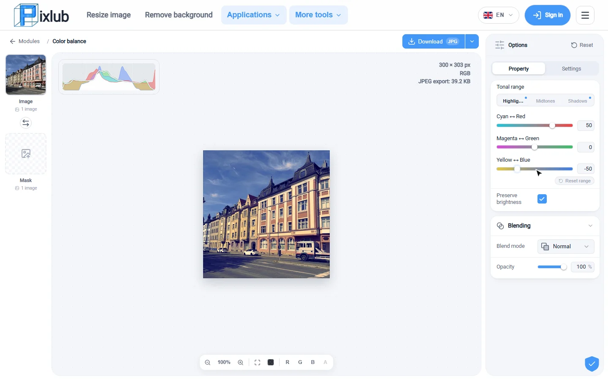

# Color balance

Tint the highlights, midtones and shadows of an image separately.

**Category** : Adjustment · **Identifier** : `colorBalance` · [API reference](./api.md)

## Where to use it

- **[Module page](https://pixlub.com/en/module/colorBalance)** : Drop your files, adjust, download: the module on its own, nothing else.
- **[Image graph](https://pixlub.com/en/image/graph)** : Connect it to other modules to build a richer effect.

## Inputs

The files the module page accepts: drop them on the import area, or click it to browse. A file in another format is set aside, with a message listing the allowed formats.

| Input | Accepted formats | Files |
| --- | --- | --- |
| **Image** (required) Image whose tints are adjusted. | `PNG`, `JPEG`, `WebP`, `GIF`, `AVIF`, `BMP` | One file |
| **Mask** (optional) Optional mask: the adjustment follows its lightness, white = full effect, black = none. When missing, the whole image is adjusted. | `PNG`, `JPEG`, `WebP`, `GIF`, `AVIF`, `BMP` | One file |

Through the API, the files and their formats are detailed in the [API view](./api.md).

## Video walkthrough

▶ [Watch the video](../../../../assets/modules/colorBalance/demo.en.mp4) : Shadows, highlights, preserved brightness.

1. `0:00` Import an image
2. `0:02` Shadows
3. `0:08` Highlights
4. `0:16` Preserve brightness
5. `0:20` Export the result

## How to use

1. **Import**

   Drop one or more images.

2. **Pick the range**

   The **Highlights**, **Midtones** and **Shadows** tabs pick the tones being set.

3. **Tint**

   Three sliders: cyan ↔ red, magenta ↔ green, yellow ↔ blue.

## Settings

| Setting | Effect |
| --- | --- |
| **Tonal range** | Highlights, midtones or shadows, each with its three sliders. |
| **Preserve brightness** | Only the hue moves, never the picture's lightness. |
| **Blending** | Blend mode and opacity: how the adjustment sits on the original picture. |

## Tips

- Shadows toward blue, highlights toward orange: the "teal & orange" grade of movies.
- In the [image graph](../../../../01-app/en/02-image/01-image-graph.md), a mask limits the adjustment to an area.

## Export

The **Download** button saves the result in the format of the imported file: a JPEG photo comes out as JPEG. The menu on its right opens the **Export settings** to pick another format, set the quality, size or background, and offers **Copy image**.

- **[The export dialog](../../../../01-app/en/02-image/04-exportation.md)** : Every format, its settings, local or server processing, batches and the local folder.
