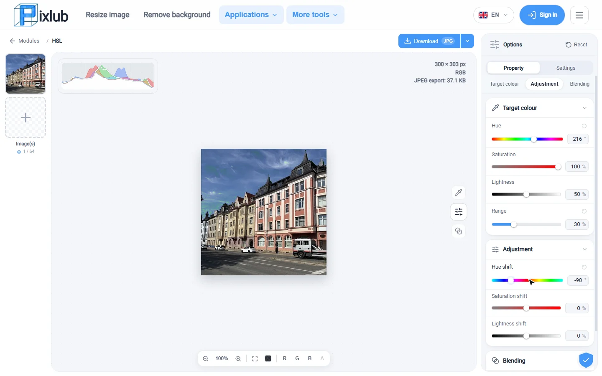

# HSL

Change the hue, saturation and lightness of one colour range only.

**Category** : Adjustment · **Identifier** : `hsl` · [API reference](./api.md)

## Where to use it

- **[Module page](https://pixlub.com/en/module/hsl)** : Drop your files, adjust, download: the module on its own, nothing else.
- **[Image graph](https://pixlub.com/en/image/graph)** : Connect it to other modules to build a richer effect.

## Inputs

The files the module page accepts: drop them on the import area, or click it to browse. A file in another format is set aside, with a message listing the allowed formats.

| Input | Accepted formats | Files |
| --- | --- | --- |
| **Image(s)** (required) Image whose color range is shifted in hue, saturation and lightness. | `PNG`, `JPEG`, `WebP`, `GIF`, `AVIF`, `BMP` | One or more: each image is processed on its own, with the same settings |

How many images are processed at once depends on your plan.

Through the API, the files and their formats are detailed in the [API view](./api.md).

## Video walkthrough

▶ [Watch the video](../../../../assets/modules/hsl/demo.en.mp4) : Target the sky blue, shift its hue, saturation and lightness.

1. `0:00` Import an image
2. `0:02` Target a colour: the sky blue
3. `0:10` Shift its hue
4. `0:13` Saturation and lightness
5. `0:20` Export the result

## How to use

1. **Import**

   Drop one or more images.

2. **Target a colour**

   Set the **target colour**, then reduce the **range** to touch only that colour.

3. **Change it**

   Shift its **hue**, **saturation** or **lightness**.

## Settings

| Setting | Effect |
| --- | --- |
| **Target colour** | Hue, saturation and lightness of the colours to change. |
| **Range** | 0 to 100%. At 100%, the whole picture changes. |
| **Hue shift** | −180° to 180°. |
| **Saturation** / **Lightness shift** | −100 to 100%: toward grey or more vivid, toward black or white. |
| **Blending** | Blend mode and opacity: how the adjustment sits on the original picture. |

## Tips

- For a deeper sky: target blue and lower its lightness.
- A small range keeps skin tones safe when changing an orange.

## Export

The **Download** button saves the result in the format of the imported file: a JPEG photo comes out as JPEG. The menu on its right opens the **Export settings** to pick another format, set the quality, size or background, and offers **Copy image**.

With several images, the button becomes **ZIP download**; the menu also offers separate files, or only the image on display.

- **[The export dialog](../../../../01-app/en/02-image/04-exportation.md)** : Every format, its settings, local or server processing, batches and the local folder.
