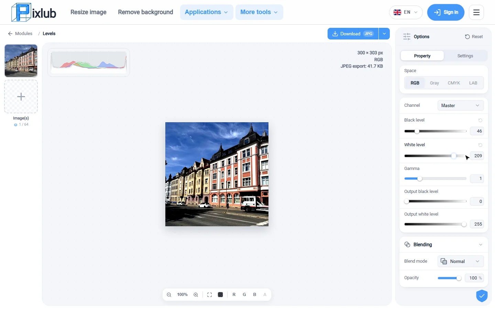

# Levels

Set the black and white points, gamma and output range, channel by channel.

**Category** : Adjustment · **Identifier** : `levels` · [API reference](./api.md)

## Where to use it

- **[Module page](https://pixlub.com/en/module/levels)** : Drop your files, adjust, download: the module on its own, nothing else.
- **[Image graph](https://pixlub.com/en/image/graph)** : Connect it to other modules to build a richer effect.

## Inputs

The files the module page accepts: drop them on the import area, or click it to browse. A file in another format is set aside, with a message listing the allowed formats.

| Input | Accepted formats | Files |
| --- | --- | --- |
| **Image(s)** (required) Image whose levels are adjusted. | `PNG`, `JPEG`, `WebP`, `GIF`, `AVIF`, `BMP` | One or more: each image is processed on its own, with the same settings |

How many images are processed at once depends on your plan.

Through the API, the files and their formats are detailed in the [API view](./api.md).

## Video walkthrough

▶ [Watch the video](../../../../assets/modules/levels/demo.en.mp4) : Black and white points, gamma, then a single channel.

1. `0:00` Import an image
2. `0:02` Black and white points
3. `0:09` Midtone gamma
4. `0:13` One channel at a time
5. `0:20` Export the result

## How to use

1. **Import**

   Drop one or more images.

2. **Set black and white**

   Raise the **black level**, lower the **white level**: contrast opens up.

3. **Fine-tune**

   **Gamma** lightens or darkens the midtones. The **Channel** menu sets one colour on its own.

## Settings

| Setting | Effect |
| --- | --- |
| **Space** | RGB, Gray, CMYK or LAB. |
| **Channel** | Master (all) or one channel of the space. Every channel applies together. |
| **Black** / **White level** | 0 to 255. Anything darker turns black, lighter turns white. |
| **Gamma** | 0.1 to 4. Below 1 the picture darkens, above it lightens. |
| **Output levels** | Values black and white take: washed-out or dulled look. |
| **Blending** | Blend mode and opacity: how the adjustment sits on the original picture. |

## Tips

- Adjusting the **Blue** or **Red** channel alone fixes a colour cast.
- Raising the output black gives a matte, film-like look.

## Export

The **Download** button saves the result in the format of the imported file: a JPEG photo comes out as JPEG. The menu on its right opens the **Export settings** to pick another format, set the quality, size or background, and offers **Copy image**.

With several images, the button becomes **ZIP download**; the menu also offers separate files, or only the image on display.

- **[The export dialog](../../../../01-app/en/02-image/04-exportation.md)** : Every format, its settings, local or server processing, batches and the local folder.
