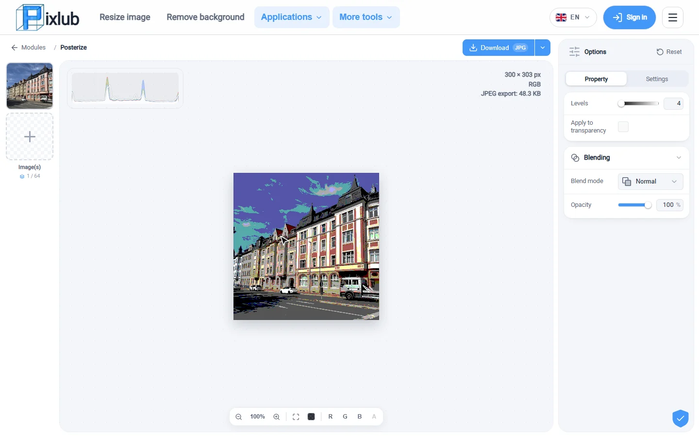

# Posterize

Reduce the number of shades per channel for stylized flat colours.

**Category** : Adjustment · **Identifier** : `posterize` · [API reference](./api.md)

## Where to use it

- **[Module page](https://pixlub.com/en/module/posterize)** : Drop your files, adjust, download: the module on its own, nothing else.
- **[Image graph](https://pixlub.com/en/image/graph)** : Connect it to other modules to build a richer effect.

## Inputs

The files the module page accepts: drop them on the import area, or click it to browse. A file in another format is set aside, with a message listing the allowed formats.

| Input | Accepted formats | Files |
| --- | --- | --- |
| **Image(s)** (required) Image whose levels per channel are reduced. | `PNG`, `JPEG`, `WebP`, `GIF`, `AVIF`, `BMP` | One or more: each image is processed on its own, with the same settings |

How many images are processed at once depends on your plan.

Through the API, the files and their formats are detailed in the [API view](./api.md).

## Video walkthrough

▶ [Watch the video](../../../../assets/modules/posterize/demo.en.mp4) : 3 levels, then 8, and the opacity.

1. `0:00` Import an image
2. `0:03` Number of levels
3. `0:09` Dose it with the opacity
4. `0:17` Export the result

## How to use

1. **Import**

   Drop one or more images.

2. **Pick the number of levels**

   Few levels: bold flat colours. Many: close to the original.

## Settings

| Setting | Effect |
| --- | --- |
| **Levels** | 2 to 256 steps per channel. |
| **Apply to transparency** | Posterizes the alpha channel as well. |
| **Blending** | Blend mode and opacity: how the adjustment sits on the original picture. |

## Tips

- 4 to 6 levels give a poster or cartoon look.
- Combine with [Outline](../outline/README.md) for a comic-book style.

## Export

The **Download** button saves the result in the format of the imported file: a JPEG photo comes out as JPEG. The menu on its right opens the **Export settings** to pick another format, set the quality, size or background, and offers **Copy image**.

With several images, the button becomes **ZIP download**; the menu also offers separate files, or only the image on display.

- **[The export dialog](../../../../01-app/en/02-image/04-exportation.md)** : Every format, its settings, local or server processing, batches and the local folder.
