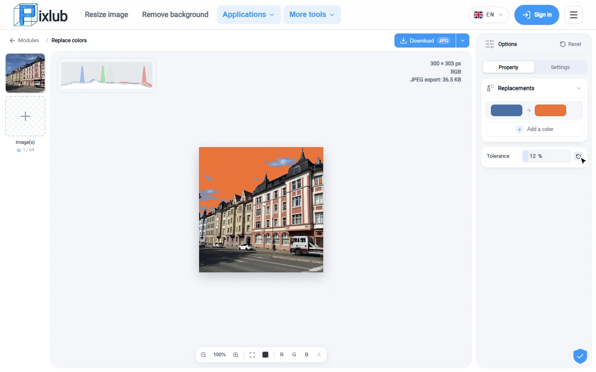

# Replace colors

Replace one or more colours of an image with others.

**Category** : Adjustment · **Identifier** : `replaceColors` · [API reference](./api.md)

## Where to use it

- **[Module page](https://pixlub.com/en/module/replaceColors)** : Drop your files, adjust, download: the module on its own, nothing else.
- **[Image graph](https://pixlub.com/en/image/graph)** : Connect it to other modules to build a richer effect.

## Inputs

The files the module page accepts: drop them on the import area, or click it to browse. A file in another format is set aside, with a message listing the allowed formats.

| Input | Accepted formats | Files |
| --- | --- | --- |
| **Image(s)** (required) Image whose source colors are replaced. | `PNG`, `JPEG`, `WebP`, `GIF`, `AVIF`, `BMP` | One or more: each image is processed on its own, with the same settings |

How many images are processed at once depends on your plan.

Through the API, the files and their formats are detailed in the [API view](./api.md).

## Video walkthrough

▶ [Watch the video](../../../../assets/modules/replaceColors/demo.en.mp4) : A colour pair, then the tolerance.

1. `0:00` Import an image
2. `0:02` Add a colour pair
3. `0:15` Widen with the tolerance
4. `0:19` Export the result

## How to use

1. **Import**

   Drop one or more images.

2. **Add a pair**

   **Add a color**, then pick the colour to replace and the new one (HEX entry or eyedropper).

3. **Set the tolerance**

   Raise it to take in nearby shades.

## Settings

| Setting | Effect |
| --- | --- |
| **Colors** | List of pairs: colour to replace → new colour. |
| **Tolerance** | 0%: exact colour only. 100%: every colour. |

## Tips

- A 20 to 40% tolerance is enough for a flat colour with slight variations.
- To change a colour while keeping its shades, [HSL](../hsl/README.md) is gentler.

## Export

The **Download** button saves the result in the format of the imported file: a JPEG photo comes out as JPEG. The menu on its right opens the **Export settings** to pick another format, set the quality, size or background, and offers **Copy image**.

With several images, the button becomes **ZIP download**; the menu also offers separate files, or only the image on display.

- **[The export dialog](../../../../01-app/en/02-image/04-exportation.md)** : Every format, its settings, local or server processing, batches and the local folder.
