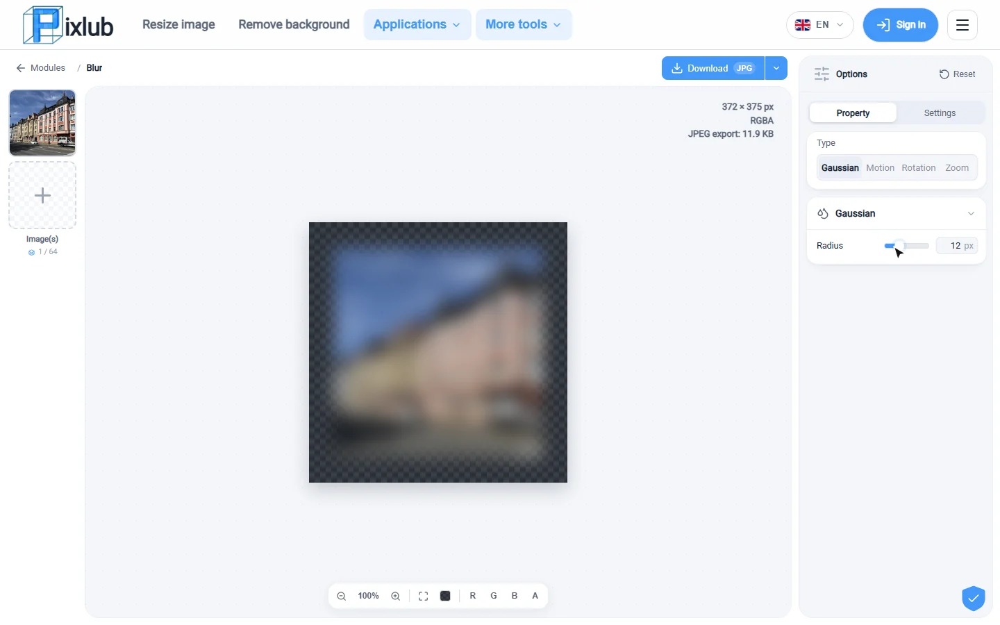

# Blur

Blur an image: gaussian, motion, spin or zoom.

**Category** : Filters · **Identifier** : `blur` · [API reference](./api.md)

## Where to use it

- **[Module page](https://pixlub.com/en/module/blur)** : Drop your files, adjust, download: the module on its own, nothing else.
- **[Image graph](https://pixlub.com/en/image/graph)** : Connect it to other modules to build a richer effect.

## Inputs

The files the module page accepts: drop them on the import area, or click it to browse. A file in another format is set aside, with a message listing the allowed formats.

| Input | Accepted formats | Files |
| --- | --- | --- |
| **Image(s)** (required) Image to blur. | `PNG`, `JPEG`, `WebP`, `GIF`, `AVIF`, `BMP` | One or more: each image is processed on its own, with the same settings |

How many images are processed at once depends on your plan.

Through the API, the files and their formats are detailed in the [API view](./api.md).

## Video walkthrough

▶ [Watch the video](../../../../assets/modules/blur/demo.en.mp4) : Gaussian, motion, then zoom with its center.

1. `0:00` Import an image
2. `0:02` Gaussian blur
3. `0:05` Motion blur
4. `0:11` Zoom, center placed
5. `0:15` Export the result

## How to use

1. **Import**

   Drop one or more images.

2. **Pick the type**

   **Gaussian**, **Motion**, **Spin** or **Zoom**.

3. **Adjust**

   Each type has its setting. For Spin and Zoom, click in the preview to place the center.

## Settings

| Setting | Effect |
| --- | --- |
| **Gaussian** | Radius, 0 to 40 px: an even blur. |
| **Motion** | Angle and distance (0 to 500 px): a streak in one direction. |
| **Spin** | Spin angle, 0° to 90°, around the center. |
| **Zoom** | Intensity, 0 to 100%, from the center. |
| **Center X** / **Y** | Position of the center, in %. |

## Tips

- A small gaussian radius (1 to 3 px) softens skin without erasing detail.
- To hide faces, use [Face blur](../../08-api/faceBlurApi/README.md) instead.

## Export

The **Download** button saves the result in the format of the imported file: a JPEG photo comes out as JPEG. The menu on its right opens the **Export settings** to pick another format, set the quality, size or background, and offers **Copy image**.

With several images, the button becomes **ZIP download**; the menu also offers separate files, or only the image on display.

- **[The export dialog](../../../../01-app/en/02-image/04-exportation.md)** : Every format, its settings, local or server processing, batches and the local folder.
