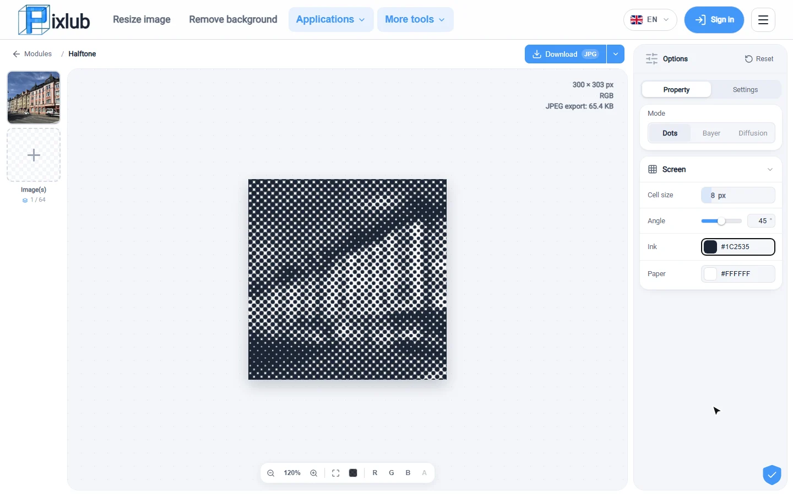

# Halftone

Convert an image to a dot screen or dithering, for a retro or print look.

**Category** : Filters · **Identifier** : `halftone` · [API reference](./api.md)

## Where to use it

- **[Module page](https://pixlub.com/en/module/halftone)** : Drop your files, adjust, download: the module on its own, nothing else.
- **[Image graph](https://pixlub.com/en/image/graph)** : Connect it to other modules to build a richer effect.

## Inputs

The files the module page accepts: drop them on the import area, or click it to browse. A file in another format is set aside, with a message listing the allowed formats.

| Input | Accepted formats | Files |
| --- | --- | --- |
| **Image(s)** (required) Image converted to a halftone pattern. | `PNG`, `JPEG`, `WebP`, `GIF`, `AVIF`, `BMP` | One or more: each image is processed on its own, with the same settings |

How many images are processed at once depends on your plan.

Through the API, the files and their formats are detailed in the [API view](./api.md).

## Video walkthrough

▶ [Watch the video](../../../../assets/modules/halftone/demo.en.mp4) : Dot screen, ink, then Bayer and diffusion dithering.

1. `0:00` Import an image
2. `0:04` Dot screen
3. `0:11` Bayer and diffusion dithering
4. `0:17` Export the result

## How to use

1. **Import**

   Drop one or more images.

2. **Pick the mode**

   **Dots** (print screen), **Bayer** (regular pattern) or **Diffusion** (fine grain).

3. **Adjust**

   Screen size and angle, ink and paper colours, or levels per channel.

## Settings

| Setting | Effect |
| --- | --- |
| **Mode** | Dots, Bayer or Diffusion. |
| **Cell size** / **Angle** | Dots mode: 3 to 40 px, 0° to 90°. |
| **Ink** / **Paper** | Dots mode: screen colours. |
| **Levels per channel** | Bayer and Diffusion: 2 to 8. |

## Tips

- Diffusion with 2 levels gives the look of old black and white screens.

## Export

The **Download** button saves the result in the format of the imported file: a JPEG photo comes out as JPEG. The menu on its right opens the **Export settings** to pick another format, set the quality, size or background, and offers **Copy image**.

With several images, the button becomes **ZIP download**; the menu also offers separate files, or only the image on display.

- **[The export dialog](../../../../01-app/en/02-image/04-exportation.md)** : Every format, its settings, local or server processing, batches and the local folder.
