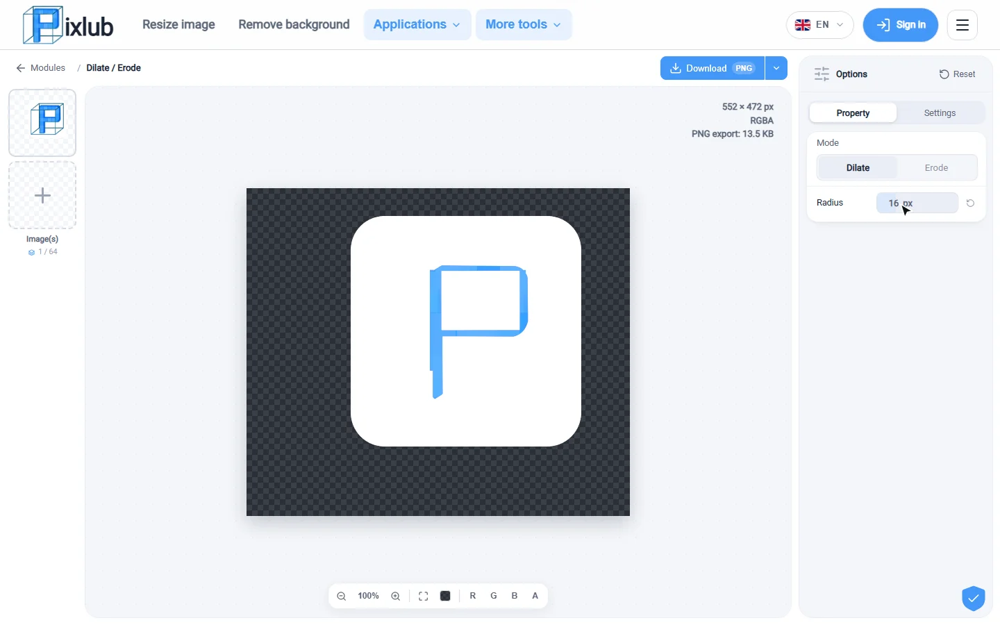

# Dilate / Erode

Thicken or thin an image's opaque areas: masks, silhouettes, outlines.

**Category** : Filters · **Identifier** : `morphology` · [API reference](./api.md)

## Where to use it

- **[Module page](https://pixlub.com/en/module/morphology)** : Drop your files, adjust, download: the module on its own, nothing else.
- **[Image graph](https://pixlub.com/en/image/graph)** : Connect it to other modules to build a richer effect.

## Inputs

The files the module page accepts: drop them on the import area, or click it to browse. A file in another format is set aside, with a message listing the allowed formats.

| Input | Accepted formats | Files |
| --- | --- | --- |
| **Image(s)** (required) Image whose opaque areas are dilated or eroded. | `PNG`, `JPEG`, `WebP`, `GIF`, `AVIF`, `BMP` | One or more: each image is processed on its own, with the same settings |

How many images are processed at once depends on your plan.

Through the API, the files and their formats are detailed in the [API view](./api.md).

## Video walkthrough

▶ [Watch the video](../../../../assets/modules/morphology/demo.en.mp4) : Dilate, then erode.

1. `0:00` Import a cut-out image
2. `0:02` Dilate
3. `0:05` Erode
4. `0:07` Export the result

## How to use

1. **Import**

   Drop an image with transparency, or a black and white mask.

2. **Pick the mode**

   **Dilate** thickens opaque areas, **Erode** thins them.

3. **Set the radius**

   In pixels.

## Settings

| Setting | Effect |
| --- | --- |
| **Mode** | Dilate or erode. |
| **Radius** | 1 to 64 px. |

## Tips

- Eroding a cut-out by a few pixels removes the fringe of the old background.
- Dilating then eroding by the same radius fills small holes in a mask.

## Export

The **Download** button saves the result in the format of the imported file: a JPEG photo comes out as JPEG. The menu on its right opens the **Export settings** to pick another format, set the quality, size or background, and offers **Copy image**.

With several images, the button becomes **ZIP download**; the menu also offers separate files, or only the image on display.

- **[The export dialog](../../../../01-app/en/02-image/04-exportation.md)** : Every format, its settings, local or server processing, batches and the local folder.
