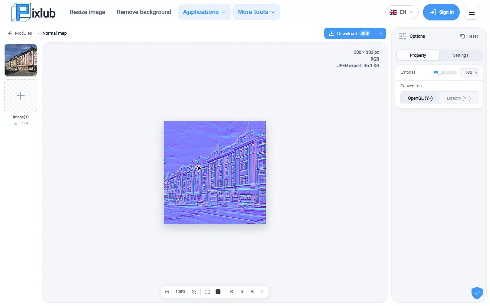

# Normal map

Build a normal map from a height map, for 3D.

**Category** : Filters · **Identifier** : `normalMap` · [API reference](./api.md)

## Where to use it

- **[Module page](https://pixlub.com/en/module/normalMap)** : Drop your files, adjust, download: the module on its own, nothing else.
- **[Image graph](https://pixlub.com/en/image/graph)** : Connect it to other modules to build a richer effect.

## Inputs

The files the module page accepts: drop them on the import area, or click it to browse. A file in another format is set aside, with a message listing the allowed formats.

| Input | Accepted formats | Files |
| --- | --- | --- |
| **Image(s)** (required) Grayscale height map: light is high, dark is low. | `PNG`, `JPEG`, `WebP`, `GIF`, `AVIF`, `BMP` | One or more: each image is processed on its own, with the same settings |

How many images are processed at once depends on your plan.

Through the API, the files and their formats are detailed in the [API view](./api.md).

## Video walkthrough

▶ [Watch the video](../../../../assets/modules/normalMap/demo.en.mp4) : Emboss, then OpenGL or DirectX convention.

1. `0:00` Import a height map
2. `0:03` Emboss
3. `0:07` OpenGL or DirectX convention
4. `0:08` Export the result

## How to use

1. **Import**

   Drop a height map: light is high, dark is low.

2. **Dose the relief**

   Stronger, the slopes get steeper.

3. **Pick the convention**

   The one your 3D engine uses.

## Settings

| Setting | Effect |
| --- | --- |
| **Emboss** | 1 to 400%. |
| **Convention** | **OpenGL (Y+)**: Blender, Unity, Godot. **DirectX (Y−)**: Unreal, 3ds Max. |

## Tips

- Export to PNG: JPEG compression damages the normals.
- A photo turned [Black and white](../../04-adjust/blackWhite/README.md) makes a quick height map.

## Export

The **Download** button saves the result in the format of the imported file: a JPEG photo comes out as JPEG. The menu on its right opens the **Export settings** to pick another format, set the quality, size or background, and offers **Copy image**.

With several images, the button becomes **ZIP download**; the menu also offers separate files, or only the image on display.

- **[The export dialog](../../../../01-app/en/02-image/04-exportation.md)** : Every format, its settings, local or server processing, batches and the local folder.
