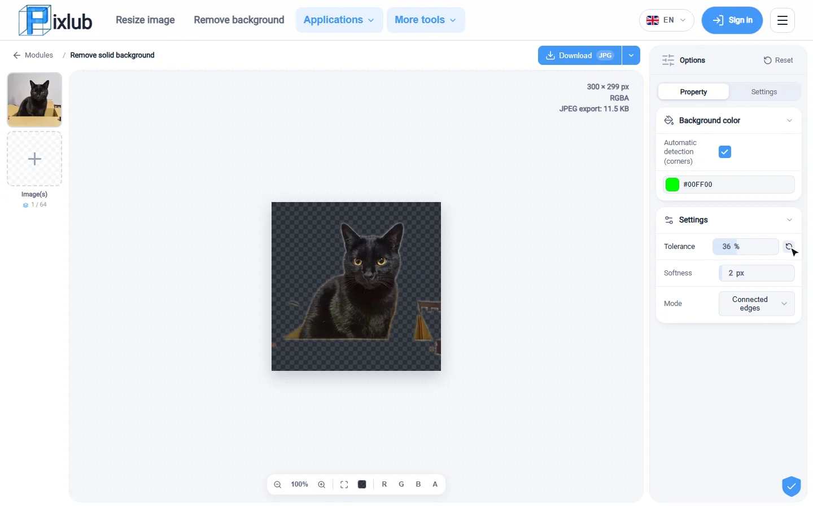

# Remove solid background

Make a single-colour background transparent: green screen, studio, wall.

**Category** : Filters · **Identifier** : `removeBg` · [API reference](./api.md)

## Where to use it

- **[Module page](https://pixlub.com/en/module/removeBg)** : Drop your files, adjust, download: the module on its own, nothing else.
- **[Image graph](https://pixlub.com/en/image/graph)** : Connect it to other modules to build a richer effect.

## Inputs

The files the module page accepts: drop them on the import area, or click it to browse. A file in another format is set aside, with a message listing the allowed formats.

| Input | Accepted formats | Files |
| --- | --- | --- |
| **Image(s)** (required) Image whose solid background is made transparent. | `PNG`, `JPEG`, `WebP`, `GIF`, `AVIF`, `BMP` | One or more: each image is processed on its own, with the same settings |

How many images are processed at once depends on your plan.

Through the API, the files and their formats are detailed in the [API view](./api.md).

## Video walkthrough

▶ [Watch the video](../../../../assets/modules/removeBg/demo.en.mp4) : Background detected, tolerance, softened edge, mode.

1. `0:00` Import an image on a plain background
2. `0:03` Background detected from the corners
3. `0:06` Soften the edge
4. `0:08` Detection mode
5. `0:16` Export the result

## How to use

1. **Import**

   Drop an image on a plain background: its colour is read from the corners.

2. **Set the tolerance**

   Raise it until the whole background disappears.

3. **Fine-tune**

   Soften the edge; uncheck detection to pick the colour yourself.

## Settings

| Setting | Effect |
| --- | --- |
| **Automatic detection** | Background colour read from the corners; otherwise, the chosen **color**. |
| **Tolerance** | 0 to 100%: shades removed with the background. |
| **Softness** | 0 to 50 px of soft edge. |
| **Mode** | **Connected edges**: only background linked to the edges. **Whole image**: everywhere. |

## Touch up with the eraser

- The **Eraser** button of the preview turns it on: its options float over the image.
- Paint to remove what is left; **Restore** (or **Alt**) brings back what the cutout took away.
- **Erased areas in red** shows everything that was removed.

## Tips

- Everything runs in the browser, with no credits. For a complex background, use [Background removal](../../08-api/removeBgApi/README.md).
- Export to PNG or WebP to keep the transparency.

## Export

The **Download** button saves the result in the format of the imported file: a JPEG photo comes out as JPEG. The menu on its right opens the **Export settings** to pick another format, set the quality, size or background, and offers **Copy image**.

With several images, the button becomes **ZIP download**; the menu also offers separate files, or only the image on display.

- **[The export dialog](../../../../01-app/en/02-image/04-exportation.md)** : Every format, its settings, local or server processing, batches and the local folder.
