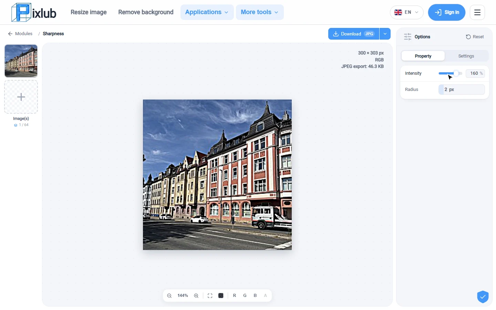

# Sharpness

Enhance an image's details and edges.

**Category** : Filters · **Identifier** : `sharpen` · [API reference](./api.md)

## Where to use it

- **[Module page](https://pixlub.com/en/module/sharpen)** : Drop your files, adjust, download: the module on its own, nothing else.
- **[Image graph](https://pixlub.com/en/image/graph)** : Connect it to other modules to build a richer effect.

## Inputs

The files the module page accepts: drop them on the import area, or click it to browse. A file in another format is set aside, with a message listing the allowed formats.

| Input | Accepted formats | Files |
| --- | --- | --- |
| **Image(s)** (required) Image whose details and edges are sharpened. | `PNG`, `JPEG`, `WebP`, `GIF`, `AVIF`, `BMP` | One or more: each image is processed on its own, with the same settings |

How many images are processed at once depends on your plan.

Through the API, the files and their formats are detailed in the [API view](./api.md).

## Video walkthrough

▶ [Watch the video](../../../../assets/modules/sharpen/demo.en.mp4) : Intensity, then radius, seen up close.

1. `0:00` Import an image
2. `0:04` Intensity
3. `0:08` Radius
4. `0:14` Export the result

## How to use

1. **Import**

   Drop one or more images. Zoom into the preview to judge.

2. **Dose**

   Raise the **intensity**, fit the **radius** to the size of the details.

## Settings

| Setting | Effect |
| --- | --- |
| **Intensity** | 0 to 200%. |
| **Radius** | 1 to 10 px: small for details, large for edges. |

## Tips

- Too much sharpening creates light halos along edges: stay below 100% for a photo.
- Sharpen last, after a resize.

## Export

The **Download** button saves the result in the format of the imported file: a JPEG photo comes out as JPEG. The menu on its right opens the **Export settings** to pick another format, set the quality, size or background, and offers **Copy image**.

With several images, the button becomes **ZIP download**; the menu also offers separate files, or only the image on display.

- **[The export dialog](../../../../01-app/en/02-image/04-exportation.md)** : Every format, its settings, local or server processing, batches and the local folder.
