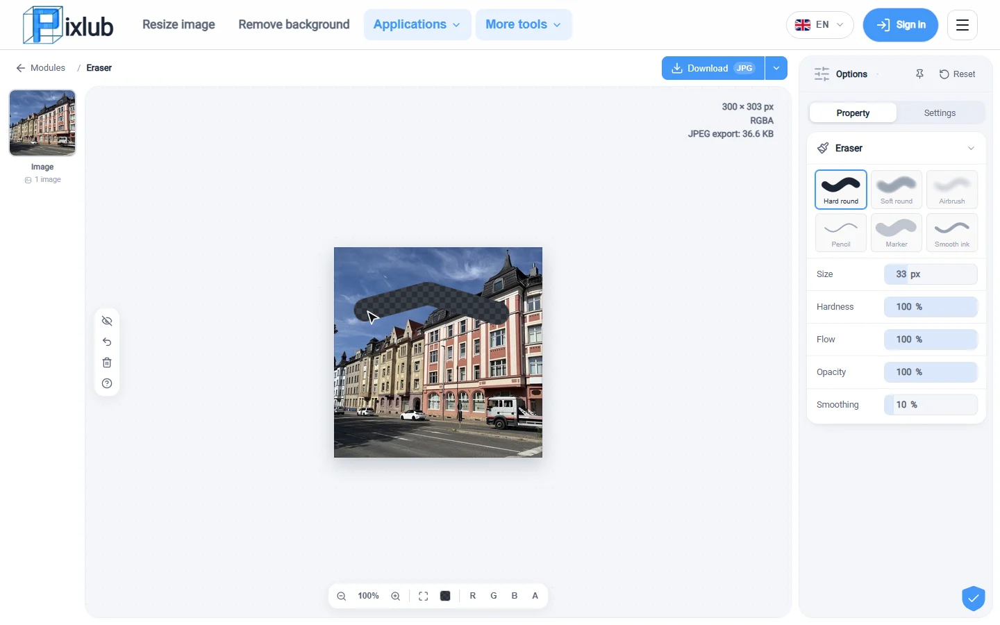

# Eraser

Erase parts of an image by hand, with a palette of tips.

**Category** : Composition · **Identifier** : `eraser` · [API reference](./api.md)

## Where to use it

- **[Module page](https://pixlub.com/en/module/eraser)** : Drop your files, adjust, download: the module on its own, nothing else.
- **[Image graph](https://pixlub.com/en/image/graph)** : Connect it to other modules to build a richer effect.

## Inputs

The files the module page accepts: drop them on the import area, or click it to browse. A file in another format is set aside, with a message listing the allowed formats.

| Input | Accepted formats | Files |
| --- | --- | --- |
| **Image** (required) Image to erase. | `PNG`, `JPEG`, `WebP`, `GIF`, `AVIF`, `BMP` | One file |

Through the API, the files and their formats are detailed in the [API view](./api.md).

## Video walkthrough

▶ [Watch the video](../../../../assets/modules/eraser/demo.en.mp4) : Hard tip, soft tip, hardness and opacity.

1. `0:00` Import an image
2. `0:03` Erase with the hard tip
3. `0:11` Soften the edge with the soft tip
4. `0:15` Hardness and opacity
5. `0:24` Export the result

## How to use

1. **Import**

   Drop the image to erase.

2. **Pick a tip**

   Take a brush from the palette, then adjust its size and hardness.

3. **Erase**

   Paint in the preview: whatever the eraser touches turns transparent. **Erased areas in red** shows what is removed.

## Settings

| Setting | Effect |
| --- | --- |
| **Erase / Restore** | Remove, or bring back a part already erased (**Alt** flips it for one stroke). |
| **Brushes** | Hard round, soft round, airbrush, pencil, marker, smooth ink: sets everything at once. |
| **Size** | Tip diameter, in image pixels. |
| **Hardness** | 100%: crisp edge. 0%: soft edge. |
| **Flow** | Low, the stroke builds up where you go over it again. |
| **Opacity** | Ceiling of a stroke: at 50%, it only removes half. |
| **Smoothing** | The stroke follows the hand with a slight delay, steadier. |

Each stroke keeps the tip it was drawn with: changing the size only affects the next strokes.

## Tips

- **Ctrl + Z** or "Remove last stroke" undoes a stroke; the bin clears them all.
- Export as **PNG** or **WebP**: JPEG does not keep transparency.

## Export

The **Download** button saves the result in the format of the imported file: a JPEG photo comes out as JPEG. The menu on its right opens the **Export settings** to pick another format, set the quality, size or background, and offers **Copy image**.

- **[The export dialog](../../../../01-app/en/02-image/04-exportation.md)** : Every format, its settings, local or server processing, batches and the local folder.
