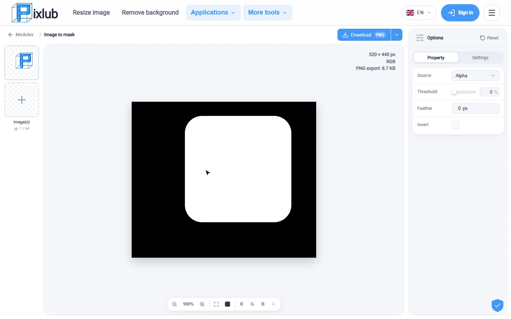

# Image to mask

Turn an image into a black and white mask, from its transparency, a channel or its lightness.

**Category** : Composition · **Identifier** : `imageToMask` · [API reference](./api.md)

## Where to use it

- **[Module page](https://pixlub.com/en/module/imageToMask)** : Drop your files, adjust, download: the module on its own, nothing else.
- **[Image graph](https://pixlub.com/en/image/graph)** : Connect it to other modules to build a richer effect.

## Inputs

The files the module page accepts: drop them on the import area, or click it to browse. A file in another format is set aside, with a message listing the allowed formats.

| Input | Accepted formats | Files |
| --- | --- | --- |
| **Image(s)** (required) Image converted to a mask (by its alpha, a channel or its luminance). | `PNG`, `JPEG`, `WebP`, `GIF`, `AVIF`, `BMP` | One or more: each image is processed on its own, with the same settings |

How many images are processed at once depends on your plan.

Through the API, the files and their formats are detailed in the [API view](./api.md).

## Video walkthrough

▶ [Watch the video](../../../../assets/modules/imageToMask/demo.en.mp4) : Mask source, threshold, feather, invert.

1. `0:00` Import a cut-out image
2. `0:03` Pick the mask source
3. `0:06` Threshold and feather
4. `0:12` Invert
5. `0:14` Export the result

## How to use

1. **Import**

   Drop one or more images.

2. **Pick the source**

   **Alpha**, **luminance** or a **red**, **green**, **blue** channel.

3. **Fine-tune**

   A **threshold** for a sharp mask, a **feather** for a soft edge.

## Settings

| Setting | Effect |
| --- | --- |
| **Source** | Alpha, luminance, red, green or blue. |
| **Threshold** | 0 to 100%. At 0, the mask stays graded. |
| **Feather** | 0 to 100 px. |
| **Invert** | White ↔ black. |

## Tips

- The resulting mask is then applied with [Mask](../mask/README.md), on another image.

## Export

The **Download** button saves the result in the format of the imported file: a JPEG photo comes out as JPEG. The menu on its right opens the **Export settings** to pick another format, set the quality, size or background, and offers **Copy image**.

With several images, the button becomes **ZIP download**; the menu also offers separate files, or only the image on display.

- **[The export dialog](../../../../01-app/en/02-image/04-exportation.md)** : Every format, its settings, local or server processing, batches and the local folder.
