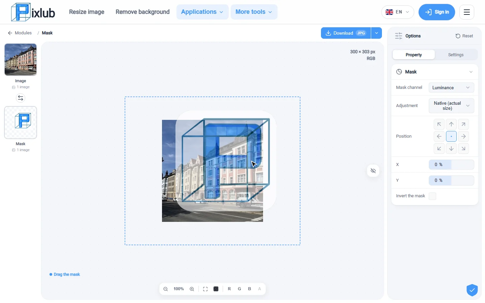

# Mask

Make an image transparent wherever a mask is black.

**Category** : Composition · **Identifier** : `mask` · [API reference](./api.md)

## Where to use it

- **[Module page](https://pixlub.com/en/module/mask)** : Drop your files, adjust, download: the module on its own, nothing else.
- **[Image graph](https://pixlub.com/en/image/graph)** : Connect it to other modules to build a richer effect.

## Inputs

The files the module page accepts: drop them on the import area, or click it to browse. A file in another format is set aside, with a message listing the allowed formats.

| Input | Accepted formats | Files |
| --- | --- | --- |
| **Image** (required) Image whose opacity is modulated. | `PNG`, `JPEG`, `WebP`, `GIF`, `AVIF`, `BMP` | One file |
| **Mask** (required) Mask: its luminance (or alpha) sets the image's opacity, white = visible, black = transparent. | `PNG`, `JPEG`, `WebP`, `GIF`, `AVIF`, `BMP` | One file |

Through the API, the files and their formats are detailed in the [API view](./api.md).

## Video walkthrough

▶ [Watch the video](../../../../assets/modules/mask/demo.en.mp4) : Image and mask, channel, fit and position, invert.

1. `0:00` Import the image and the mask
2. `0:05` Mask channel
3. `0:09` Fit and position
4. `0:14` Invert the mask
5. `0:16` Export the result

## How to use

1. **Import**

   The **image** in the first box, the **mask** in the second.

2. **Pick the channel**

   The mask's **luminance** (white = visible) or its **alpha**.

3. **Fit the mask**

   Fit (native, contain, cover, stretch), position and offset.

## Settings

| Setting | Effect |
| --- | --- |
| **Mask channel** | Luminance or alpha. |
| **Adjustment** | Actual size, contain, cover or stretch. |
| **Position** / **X** / **Y** | Where the mask sits on the image. |
| **Invert the mask** | What was visible turns transparent. |

## Tips

- Build a mask with [Draw a mask](../../07-generate/drawShape/README.md) or [Image to mask](../imageToMask/README.md).

## Export

The **Download** button saves the result in the format of the imported file: a JPEG photo comes out as JPEG. The menu on its right opens the **Export settings** to pick another format, set the quality, size or background, and offers **Copy image**.

- **[The export dialog](../../../../01-app/en/02-image/04-exportation.md)** : Every format, its settings, local or server processing, batches and the local folder.
