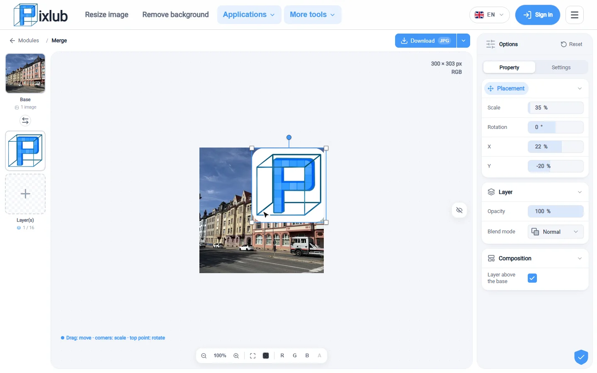

# Merge

Lay one or more layers over a background image.

**Category** : Composition · **Identifier** : `merge` · [API reference](./api.md)

## Where to use it

- **[Module page](https://pixlub.com/en/module/merge)** : Drop your files, adjust, download: the module on its own, nothing else.
- **[Image graph](https://pixlub.com/en/image/graph)** : Connect it to other modules to build a richer effect.

## Inputs

The files the module page accepts: drop them on the import area, or click it to browse. A file in another format is set aside, with a message listing the allowed formats.

| Input | Accepted formats | Files |
| --- | --- | --- |
| **Base** (required) Background image the layers are placed on. | `PNG`, `JPEG`, `WebP`, `GIF`, `AVIF`, `BMP` | One file |
| **Layer(s)** (required) Layer or batch of layers placed over the base, in order. | `PNG`, `JPEG`, `WebP`, `GIF`, `AVIF`, `BMP` | Up to 16 files, gathered in a batch |

Through the API, the files and their formats are detailed in the [API view](./api.md).

## Video walkthrough

▶ [Watch the video](../../../../assets/modules/merge/demo.en.mp4) : Base and layer, scale, placing with the mouse, opacity and blend mode.

1. `0:00` Import the base and the layer
2. `0:05` Scale the layer
3. `0:08` Place it with the mouse
4. `0:12` Opacity and blend mode
5. `0:19` Export the result

## How to use

1. **Import**

   The **base** in the first box, the **layer(s)** in the second.

2. **Place the layer**

   In the preview: drag to move, pull a corner to scale, the top point to rotate.

3. **Blend**

   Layer **opacity** and **blend mode**.

## Settings

| Setting | Effect |
| --- | --- |
| **Placement** | Layer scale, rotation and X / Y offset. |
| **Opacity** / **Blend mode** | How the layer sits on the base. |
| **Layer above the base** | Unchecked, the base covers the layer. |
| **Layers** | With several layers: a list, each with its placement and blend. |

## Tips

- A cut-out PNG logo, scaled down into a corner: a watermark in seconds.

## Export

The **Download** button saves the result in the format of the imported file: a JPEG photo comes out as JPEG. The menu on its right opens the **Export settings** to pick another format, set the quality, size or background, and offers **Copy image**.

With several images, the button becomes **ZIP download**; the menu also offers separate files, or only the image on display.

- **[The export dialog](../../../../01-app/en/02-image/04-exportation.md)** : Every format, its settings, local or server processing, batches and the local folder.
