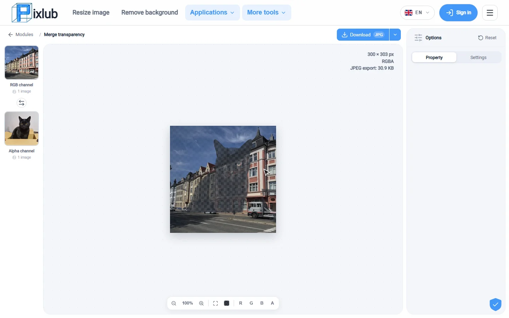

# Merge transparency

Rebuild a transparent image from its colours and a transparency mask.

**Category** : Composition · **Identifier** : `mergeAlpha` · [API reference](./api.md)

## Where to use it

- **[Module page](https://pixlub.com/en/module/mergeAlpha)** : Drop your files, adjust, download: the module on its own, nothing else.
- **[Image graph](https://pixlub.com/en/image/graph)** : Connect it to other modules to build a richer effect.

## Inputs

The files the module page accepts: drop them on the import area, or click it to browse. A file in another format is set aside, with a message listing the allowed formats.

| Input | Accepted formats | Files |
| --- | --- | --- |
| **RGB channel** (required) Image whose colors (RGB) are kept. | `PNG`, `JPEG`, `WebP`, `GIF`, `AVIF`, `BMP` | One file |
| **Alpha channel** (required) Grayscale image that becomes the result's transparency, white = opaque. | `PNG`, `JPEG`, `WebP`, `GIF`, `AVIF`, `BMP` | One file |

Through the API, the files and their formats are detailed in the [API view](./api.md).

## Video walkthrough

▶ [Watch the video](../../../../assets/modules/mergeAlpha/demo.en.mp4) : The colours, then the mask that becomes the transparency.

1. `0:00` Import both images
2. `0:02` The second one becomes the transparency
3. `0:05` Export the result

## How to use

1. **Import the colours**

   First box: the image whose colours are kept.

2. **Import the transparency**

   Second box: a grayscale image. White = opaque, black = transparent.

## Tips

- Useful to reassemble an image after processing its colour and its alpha separately.
- Export to PNG or WebP to keep the transparency.

## Export

The **Download** button saves the result in the format of the imported file: a JPEG photo comes out as JPEG. The menu on its right opens the **Export settings** to pick another format, set the quality, size or background, and offers **Copy image**.

- **[The export dialog](../../../../01-app/en/02-image/04-exportation.md)** : Every format, its settings, local or server processing, batches and the local folder.
