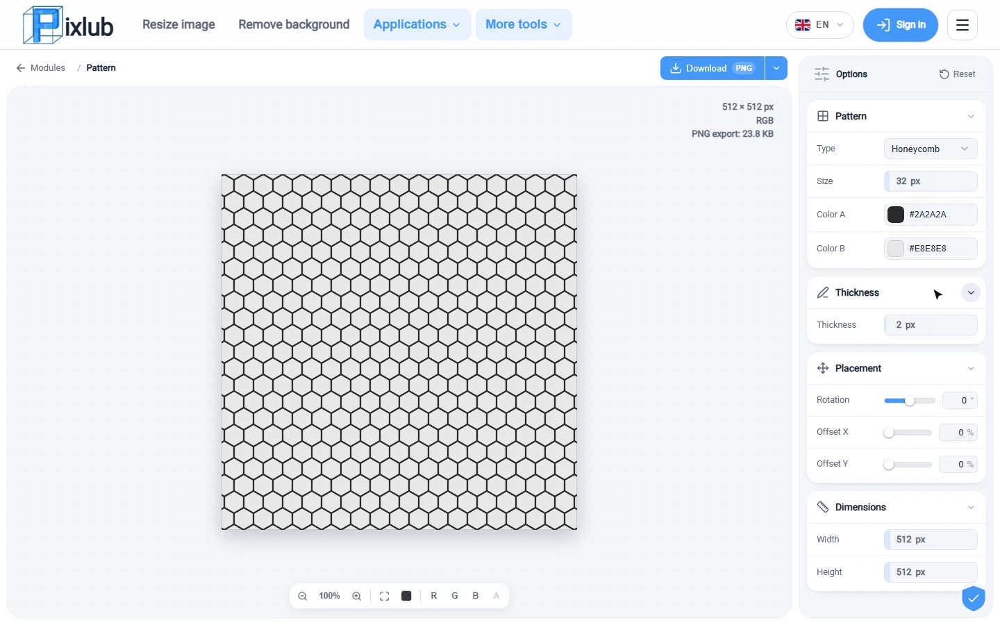

# Pattern

Generate a repeating pattern: checkerboard, grid, dots, stripes, bricks, honeycomb.

**Category** : Generation · **Identifier** : `checker`

## Where to use it

- **[Module page](https://pixlub.com/en/module/checker)** : Drop your files, adjust, download: the module on its own, nothing else.
- **[Image graph](https://pixlub.com/en/image/graph)** : Connect it to other modules to build a richer effect.

## Inputs

This module has no input: it creates the image from its settings alone.

## Video walkthrough

▶ [Watch the video](../../../../assets/modules/checker/demo.en.mp4) : Bricks then honeycomb, size, colour, rotation.

1. `0:00` The render shows right away
2. `0:01` Pick the pattern
3. `0:08` Size and colours
4. `0:17` Rotation
5. `0:20` Export the result

## How to use

1. **Pick the pattern**

   Checkerboard, grid, dots, stripes, bricks or honeycomb.

2. **Adjust**

   **Size**, **colors A and B**, thickness or band width depending on the pattern.

3. **Place it**

   Rotation and offset.

## Settings

| Setting | Effect |
| --- | --- |
| **Type** | The repeated pattern. |
| **Size** | 4 to 512 px. |
| **Color A** / **B** | The two colours. |
| **Thickness** | Grid, dots, bricks, honeycomb. |
| **Band width** / **Softness** | Stripes. |
| **Rotation** / **Offset** | Pattern orientation and position. |
| **Dimensions** | Image size. |

## Tips

- Soft low-contrast stripes make a discreet background for a presentation.

## Export

The **Download** button saves the result in the format of the imported file: a JPEG photo comes out as JPEG. The menu on its right opens the **Export settings** to pick another format, set the quality, size or background, and offers **Copy image**.

- **[The export dialog](../../../../01-app/en/02-image/04-exportation.md)** : Every format, its settings, local or server processing, batches and the local folder.
