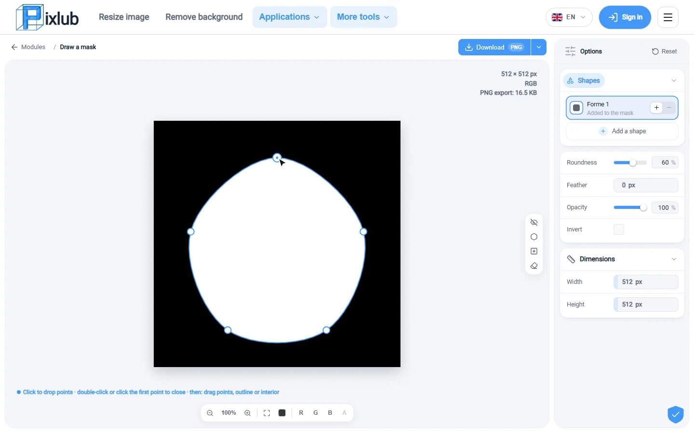

# Draw a mask

Draw precise shapes, added or subtracted, to build a mask.

**Category** : Generation · **Identifier** : `drawShape`

## Where to use it

- **[Module page](https://pixlub.com/en/module/drawShape)** : Drop your files, adjust, download: the module on its own, nothing else.
- **[Image graph](https://pixlub.com/en/image/graph)** : Connect it to other modules to build a richer effect.

## Inputs

This module has no input: it creates the image from its settings alone.

## Video walkthrough

▶ [Watch the video](../../../../assets/modules/drawShape/demo.en.mp4) : Place the points, round, feather, invert.

1. `0:00` The render shows right away
2. `0:01` Place the points
3. `0:09` Roundness and feather
4. `0:14` Invert the mask
5. `0:16` Export the result

## How to use

1. **Place the points**

   Click in the preview for each corner; a click on the first point closes the shape.

2. **Adjust**

   Drag a point, the outline or the inside. The **Shapes** list adds more, added or subtracted.

3. **Soften**

   **Roundness**, **feather** and **opacity**.

## Settings

| Setting | Effect |
| --- | --- |
| **Shapes** | List of shapes, each added or subtracted. |
| **Roundness** | 0 to 100%: corner curvature. |
| **Feather** | 0 to 200 px of soft edge. |
| **Opacity** / **Invert** | Mask density, and white ↔ black. |
| **Dimensions** | Mask size. |

## Tips

- The mask is used in the [image graph](../../../../01-app/en/02-image/01-image-graph.md) to limit an effect to an area.
- A double-click on a point removes it.

## Export

The **Download** button saves the result in the format of the imported file: a JPEG photo comes out as JPEG. The menu on its right opens the **Export settings** to pick another format, set the quality, size or background, and offers **Copy image**.

- **[The export dialog](../../../../01-app/en/02-image/04-exportation.md)** : Every format, its settings, local or server processing, batches and the local folder.
