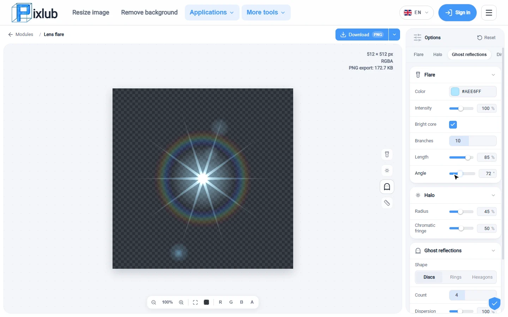

# Lens flare

Generate a lens flare: core, star branches, halo and reflections.

**Category** : Generation · **Identifier** : `flare`

## Where to use it

- **[Module page](https://pixlub.com/en/module/flare)** : Drop your files, adjust, download: the module on its own, nothing else.
- **[Image graph](https://pixlub.com/en/image/graph)** : Connect it to other modules to build a richer effect.

## Inputs

This module has no input: it creates the image from its settings alone.

## Video walkthrough

▶ [Watch the video](../../../../assets/modules/flare/demo.en.mp4) : Branches, halo and fringe, ghost reflections.

1. `0:00` The render shows right away
2. `0:01` Star branches
3. `0:07` Halo and fringe
4. `0:14` Ghost reflections
5. `0:18` Export the result

## How to use

1. **Open**

   The flare shows on a transparent background.

2. **Shape the star**

   Number of **branches**, length and angle.

3. **Add halo and reflections**

   Halo radius, colour fringe, shape and number of ghosts.

## Settings

| Setting | Effect |
| --- | --- |
| **Color** / **Intensity** | Flare tint and strength. |
| **Bright core** | White spot in the middle. |
| **Branches** / **Length** / **Angle** | The star. |
| **Halo** / **Chromatic fringe** | Coloured ring around the core. |
| **Ghost reflections** | Discs, rings or hexagons: count, spread, opacity. |
| **Size** | 64 to 4000 px. |

## Tips

- Lay the flare on a photo in the [image graph](../../../../01-app/en/02-image/01-image-graph.md) with the **Screen** blend.

## Export

The **Download** button saves the result in the format of the imported file: a JPEG photo comes out as JPEG. The menu on its right opens the **Export settings** to pick another format, set the quality, size or background, and offers **Copy image**.

- **[The export dialog](../../../../01-app/en/02-image/04-exportation.md)** : Every format, its settings, local or server processing, batches and the local folder.
