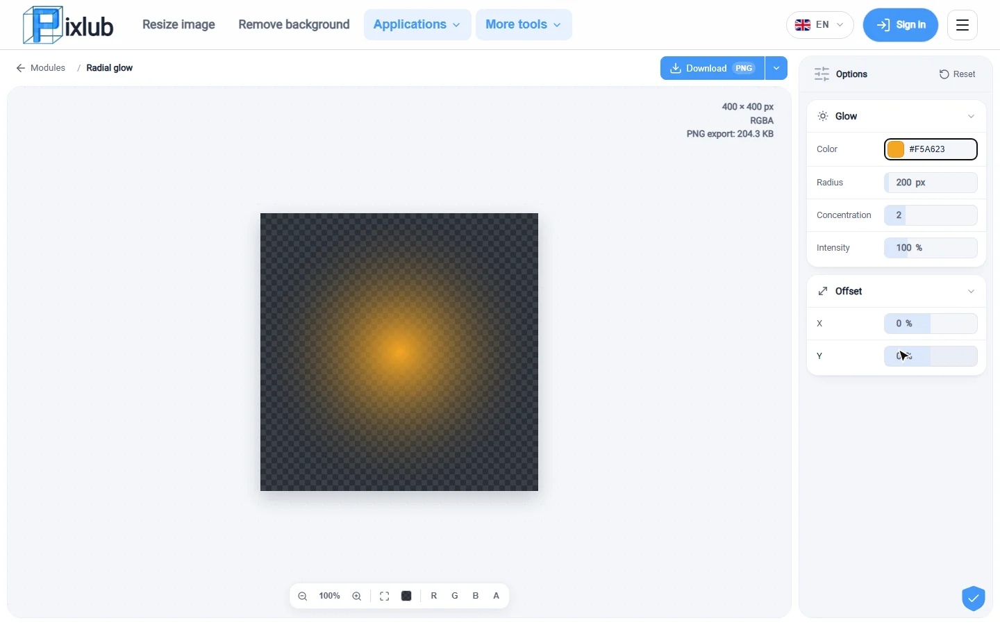

# Radial glow

Generate a round glow that fades toward the edges.

**Category** : Generation · **Identifier** : `glow`

## Where to use it

- **[Module page](https://pixlub.com/en/module/glow)** : Drop your files, adjust, download: the module on its own, nothing else.
- **[Image graph](https://pixlub.com/en/image/graph)** : Connect it to other modules to build a richer effect.

## Inputs

This module has no input: it creates the image from its settings alone.

## Video walkthrough

▶ [Watch the video](../../../../assets/modules/glow/demo.en.mp4) : Colour, radius and concentration, offset.

1. `0:00` The render shows right away
2. `0:01` Colour
3. `0:07` Radius and concentration
4. `0:12` Offset the glow
5. `0:15` Export the result

## How to use

1. **Pick the colour**

   The glow shows on a transparent background.

2. **Adjust**

   **Radius**, **concentration** (higher: tighter core) and **intensity**.

## Settings

| Setting | Effect |
| --- | --- |
| **Color** | Glow tint. |
| **Radius** | 1 to 4000 px. |
| **Concentration** | 0.2 to 8. |
| **Intensity** | 0 to 400%. |
| **Offset X** / **Y** | Glow position. |

## Tips

- A warm glow offset into a corner mimics sunlight entering the picture.

## Export

The **Download** button saves the result in the format of the imported file: a JPEG photo comes out as JPEG. The menu on its right opens the **Export settings** to pick another format, set the quality, size or background, and offers **Copy image**.

- **[The export dialog](../../../../01-app/en/02-image/04-exportation.md)** : Every format, its settings, local or server processing, batches and the local folder.
