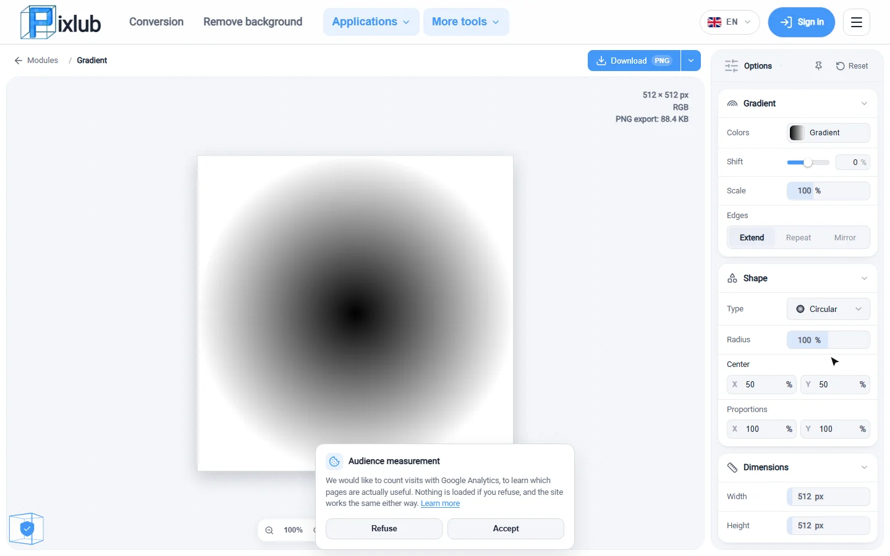

# Gradient

Generate a linear, circular, radial or diamond gradient.

**Category** : Generation · **Identifier** : `gradient`

## Where to use it

- **[Module page](https://pixlub.com/en/module/gradient)** : Drop your files, adjust, download: the module on its own, nothing else.
- **[Image graph](https://pixlub.com/en/image/graph)** : Connect it to other modules to build a richer effect.

## Inputs

This module has no input: it creates the image from its settings alone.

## Video walkthrough

▶ [Watch the video](../../../../assets/modules/gradient/demo.en.mp4) : Shape, colours, scale and edges.

1. `0:00` The render shows right away
2. `0:01` Pick the shape
3. `0:09` Scale and edges
4. `0:15` Shift the colours
5. `0:19` Export the result

## How to use

1. **Pick the shape**

   Linear, circular, radial or diamond.

2. **Pick the colors**

   Place the gradient stops, from 0% (start or center) to 100% (end or edge).

3. **Place it**

   Angle, center, radius or proportions depending on the shape; scale and shift to tighten or slide the colors.

## Settings

| Setting | Effect |
| --- | --- |
| **Colors** | The gradient stops. |
| **Shift** | Slides the colors, −100 to 100%. |
| **Scale** | Gradient length, 1 to 1000%. |
| **Edges** | Beyond the ends: **Extend**, **Repeat** or **Mirror**. |
| **Type** | **Linear**, **Circular**, **Radial** (one turn around the center) or **Diamond**. |
| **Angle** | Linear, radial and diamond; 0° runs left to right. |
| **Radius** | Circular; 100% touches the edges. |
| **Center** | Center position, in % of the image. |
| **Proportions** | Circular and diamond: stretch in X and Y. |
| **Dimensions** | Image size. |

## Tips

- Low scale with **Mirror** edges: regular waves that an animated shift scrolls without a jump.
- As the **Map** of [Texture remap](../../03-transform/remap/README.md), a black → red radial gradient stretches noise into rays.

## Export

The **Download** button saves the result in the format of the imported file: a JPEG photo comes out as JPEG. The menu on its right opens the **Export settings** to pick another format, set the quality, size or background, and offers **Copy image**.

- **[The export dialog](../../../../01-app/en/02-image/04-exportation.md)** : Every format, its settings, local or server processing, batches and the local folder.
