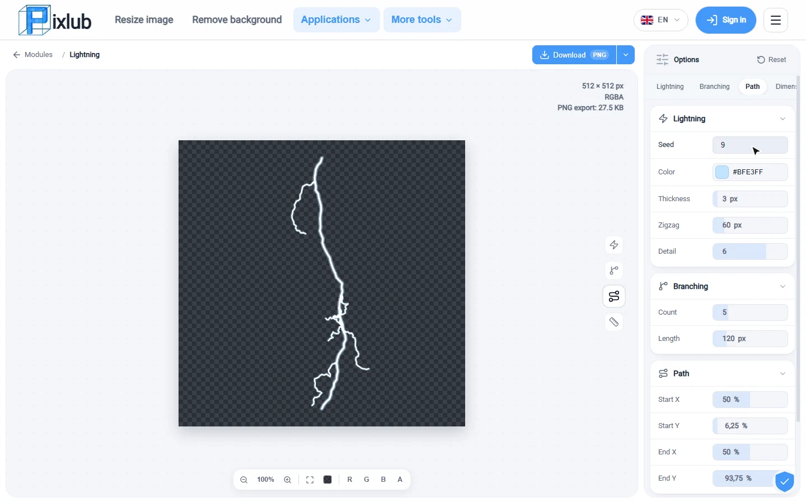

# Lightning

Generate a branching lightning bolt between two points.

**Category** : Generation · **Identifier** : `lightning`

## Where to use it

- **[Module page](https://pixlub.com/en/module/lightning)** : Drop your files, adjust, download: the module on its own, nothing else.
- **[Image graph](https://pixlub.com/en/image/graph)** : Connect it to other modules to build a richer effect.

## Inputs

This module has no input: it creates the image from its settings alone.

## Video walkthrough

▶ [Watch the video](../../../../assets/modules/lightning/demo.en.mp4) : Seed, zigzag and branches, path.

1. `0:00` The render shows right away
2. `0:01` Change the seed
3. `0:05` Zigzag and branches
4. `0:11` Bolt path
5. `0:14` Export the result

## How to use

1. **Change the seed**

   Each seed gives a different bolt.

2. **Shape it**

   **Zigzag**, **detail**, number and length of **branches**.

3. **Set the path**

   Start and end points, in %.

## Settings

| Setting | Effect |
| --- | --- |
| **Seed** | Bolt draw. |
| **Color** / **Thickness** | Line look. |
| **Zigzag** / **Detail** | Size and fineness of the breaks. |
| **Branching** | Count (0 to 24) and length. |
| **Path** | Start and end X / Y. |
| **Dimensions** | Area size. |

## Tips

- Add [Bloom](../../05-filter/bloom/README.md) on the bolt for an electric halo.

## Export

The **Download** button saves the result in the format of the imported file: a JPEG photo comes out as JPEG. The menu on its right opens the **Export settings** to pick another format, set the quality, size or background, and offers **Copy image**.

- **[The export dialog](../../../../01-app/en/02-image/04-exportation.md)** : Every format, its settings, local or server processing, batches and the local folder.
