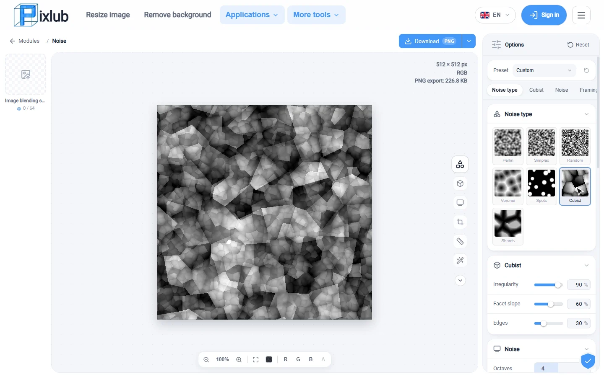

# Noise

Generate a noise texture: Perlin, Voronoi, spots, cubist, shards…

**Category** : Generation · **Identifier** : `noise` · [API reference](./api.md)

## Where to use it

- **[Module page](https://pixlub.com/en/module/noise)** : Drop your files, adjust, download: the module on its own, nothing else.
- **[Image graph](https://pixlub.com/en/image/graph)** : Connect it to other modules to build a richer effect.

## Inputs

The files the module page accepts: drop them on the import area, or click it to browse. A file in another format is set aside, with a message listing the allowed formats.

| Input | Accepted formats | Files |
| --- | --- | --- |
| **Image blending source** (optional) Optional image blended with the noise; when connected, it also sets its size. | `PNG`, `JPEG`, `WebP`, `GIF`, `AVIF`, `BMP` | One or more: each image is processed on its own, with the same settings |

How many images are processed at once depends on your plan.

Through the API, the files and their formats are detailed in the [API view](./api.md).

## Video walkthrough

▶ [Watch the video](../../../../assets/modules/noise/demo.en.mp4) : Noise type, scale, seed, then blending with an image.

1. `0:00` The render shows right away
2. `0:01` Pick the noise type
3. `0:05` Scale and intensity
4. `0:13` Change the seed
5. `0:16` Blend with an image
6. `0:19` Export the result

## How to use

1. **Open**

   The noise shows right away, no import needed.

2. **Pick the type**

   Click a thumbnail: **Perlin**, **Simplex**, **Random**, **Voronoi**, **Spots**, **Cubist** or **Shards**.

3. **Adjust**

   **Scale**, **intensity** and **seed**; the tabs lead to framing and post-processing.

## Settings

| Setting | Effect |
| --- | --- |
| **Type** | Each has its own settings section (ridges, cells, spots…). |
| **Octaves** / **Octave ramp** | Stacked layers of detail and their weight. |
| **Intensity** | Contrast around mid grey, 0 to 400%. |
| **Seed** | Changes the draw; one seed always gives the same noise. Between two whole numbers the noise slides from one draw to the next: animated, the seed moves the cells instead of making them jump. |
| **Framing** | Position, rotation, scale and overlap for a seamless texture. |
| **Dimensions** | Width and height; a blended image imposes its own. |
| **Post-processing** | Auto level, remap curve, quantization into flat tones. |
| **Blending** | Blend mode and opacity: how the adjustment sits on the original picture. |

## Tips

- The tiling **overlap** builds a texture that repeats without a seam.
- Drop an image in **Image to blend** to lay the noise over it (grain, grime).

## Export

The **Download** button saves the result in the format of the imported file: a JPEG photo comes out as JPEG. The menu on its right opens the **Export settings** to pick another format, set the quality, size or background, and offers **Copy image**.

With several images, the button becomes **ZIP download**; the menu also offers separate files, or only the image on display.

- **[The export dialog](../../../../01-app/en/02-image/04-exportation.md)** : Every format, its settings, local or server processing, batches and the local folder.
